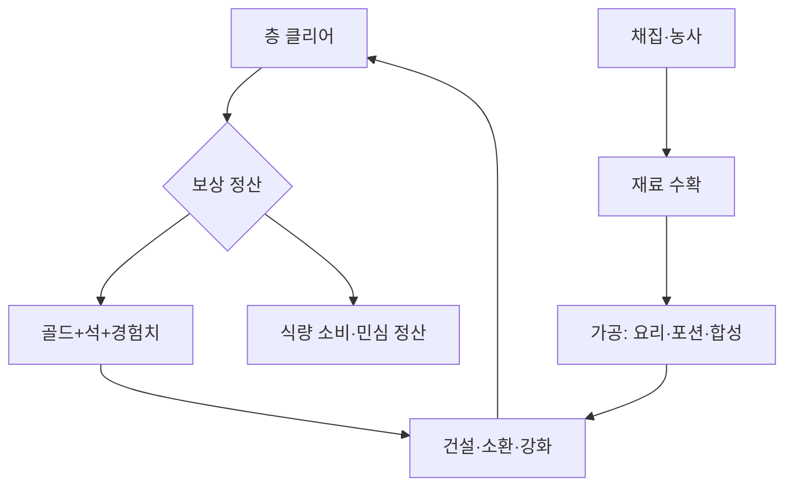

# 영지(공중섬 왕국) 시스템 v1.0 — base 확정

> 📚 **문헌 근거**: #26·#33 가상경제·디지털 화폐(은행 3계정·금본위), #31 경제 정책(칙령·세율), #81·#83 도시 시스템·패턴 언어(시설 배치·도로율), #90 화재 생태(재해 체인), #20 Norman 3층(은행 UI), #68 휴리스틱 평가(B-ID) — [[참고문헌_이론130]]

> [!info] 이 문서는?
> 공중섬 영지를 실제 국가처럼 굴리는 시스템. **상위 기준**: [[GDD_v8.0_00_확정사항]] #18.
> base + 업그레이드계(Lv7) + 통합수지 확정. 세부 수치 가안은 §6 후속.

---

## 1. 목적 & 범위

- **목적:** 자급자족 루프(채집·농사 → 가공 → 소환·전투 환원)로 50층 난이도 상승에 대비하는 제2 전선
- **범위 (in):** 시설 12종 · 인구 · 채집 · 농사 · 식량 · 민심 · 칙령 · 군사(파티)
- **비범위 (out):** 외교·무역(멀티섬 후속) · 징집(00 #3 교체불가와 충돌)

## 2. 설계 원칙

| # | 원칙 | 이유 |
|---|---|---|
| 1 | 단일 국고(골드) — 신화폐 없음 (**예외 1건: 전당의 은혜** — §3.12-2, 2026-09-15 확정) | 관리 피로 최소 (식량·재료·마석은 Consumable) |
| 2 | 영웅=주민 통합 — 파티는 영웅 5인만 · **주민 = 섬에 사는 사람 전체** (배치 주민 = 영웅 겸직 · 일반 주민 = 집계 개체) | 00 #3(사망 시 교체불가) 준수 · 징집 금지 · 배치 주민 기록은 HeroRecord 재사용 (00 #18) |
| 3 | 시설당 운영 1명 필수 — 미배치 시설 정지 | 인력이 곧 국력 (적성은 보너스, 필수 아님) |
| 4 | 점층 해금 — 층 게이트로 순차 개방 | 초반 과부하 방지, 목표 의식 부여 |
| 5 | 수치는 전부 가안 — 플탐에서 확정 | 00 미정F와 동일 취급 — 예외: 소환 확률표는 확정 (00 #32) |

## 3. 규칙 & 수치

> [!warning] 수치 정합성
> 모든 수치는 [[GDD_v8.0_00_확정사항]] 및 부속 문서와 충돌 확인 필수.
> 아래 상수 뒤 (가안) 표시는 플탐 전 조정 예정.

### 3.1 시설 12종

| 시설 | 역할 | 해금 | 인력 |
|---|---|---|---|
| 소환제단 | 소환 실행 (130마석/회·최초 10회 무료) + 채집·농사 관리 | 1층 (**초기 가동 시설 — 유일**) | 1 |
| 병원 | 부상 치료·Sanity 요양 (부활 없음) | 1층 (**건설 — 초기 미건립**. §5 초기 배치 근거: 영웅 여유 시 배치) | 1 |
| 전술소 | 전투 명령 연구/해금 | 4층 건설퀘 (1,000G) | 1 |
| 훈련장 | 경험치 획득 | 12층 (D-263 분산 — 구 10층) | 1 |
| 식당 | 사기 회복·버프 요리 | 10층 | 1 |
| 숙소 | 스트레스 회복 + 자연증가 조건 | 14층 (D-263 분산 — 구 10층) | 1 |
| 연구소 | 마스터 기술 연구 | 20층 | 1 |
| 연금술소 | 포션/버프 제작 | 20층 | 1 |
| 합성소 | 레벨/등급 강화·초월 (**승급만** — 전직은 여기서 하지 않는다 · §3.1-2) | 30층 | 1 |
| 추출소 | 보유 영웅 → 영혼 결정 (자발 환원만 · 영원한 잠 — §3.1-2) | 30층 | 1 |
| 주택 | 침상 제공 (1동 +20) · 민심 +2/동 | 1층 (초기 3동 = **침상 수용량** · 건물 아님 — `estate.housingCount` 초기값 3) | — (패시브) |
| 영웅의 전당 | 전사자 셀렉·보관 · 100층 도달 시 부활 — 재화 '전당의 은혜' 1개/명 (§3.12-2 확정 · 용도 미정I) | 100층 | — (패시브) |

- **시설 운영 적성 (05 §6 7차 7티어 — 2026-09-15 · 35차 개명)**: **요리사**(식당)·**의사**(병원)·**연구자**(연구소)·**조약사**(연금술소)·**대장장이**(합성소) — 시설 5종과 1:1 대응 · `races.json` aptitude 연계 (하프링 요리사++ · 노움 조약사++/연구자+ · 드워프 대장장이++ 등)
  - ★ **35차 (2026-09-29 사용자 지시)** — 적성이 10 → **13종**으로 늘어났다. **시설이 없는 3종**(교육자 · 예술가 · 상인)이 추가되었으므로 **'적성 1:1 시설 대응' 규칙은 5종에 대해서만 성립**한다. 적성에 시설이 없어도 된다. (L4 13장 = 적성 13종과 이름 1:1)
- **효율 공식 (가안)**: 시설 효율 = 기본 × 시설Lv배율(§3.10) × **운영자 티어배율** — 4 견습 ×1.10 · 5 숙련 ×1.30 · 6 장인 ×1.65 · 7 명장 ×2.30 · 티어 1~3(은닉권)은 ×1.00~1.06라 사실상 보정 없음 → **운영 슬롯엔 티어 4+ 배치 권장** (미만 배치 시 시설 기능은 작동, 효율 배율만 없음)
- **등급 게이트 (05 §6 7차)**: 명장(티어7)은 ★5+ 영웅만 보유 가능 — 소환산 명장은 극희소(30k 중 3명) · **주 확보 경로 = 숙련도 성장 (05 §6-2 확정 — 활동 기반)** · 은닉권(티어 1~3) 운영자도 활동 시 견습4로 성장해 효율 배율 획득
- 인력 = 배치 주민 (영웅 겸직 — 원칙 #2) · 표의 '1' = 겸직 영웅 1명
- 건설비는 해금 시점 누적 골드 대비 10~20%선 (가안) — 전술소 1,000G 확정, 나머지 플탐 전 확정

### 3.1-2 추출·승급 (영혼 결정 — 2026-09-15 2차 설계: 50층 ★5 파티 캘리브레이션)

> [!info] 이 서브섹션은?
> 추출소 산출물 = **영혼 결정**(승급 재료 — 소환 화폐는 '마석'으로 개명 2026-09-15, 혼동 해소). 합성소의 승급 재료·비용을 동시 정의 — §3.11 "합성강화"·§3.10 합성비 할인의 빈 참조 해소. 결정은 재료 분류 (원칙 #1 Consumable — 화폐 신설 아님).

- **영혼 결정**: 보유 영웅 추출로만 획득 (유일 수급처) · 합성소 영웅 승급 소모
- 추출 수확 (가안 — 미정G):

| 등급 | ★1 | ★2 | ★3 | ★4 | ★5 | ★6 |
|---|---|---|---|---|---|---|
| 영혼 결정 | 1 | 3 | 10 | 30 | 100 | 300 |

- 레벨 보정: ×(1+(Lv−1)×0.5%) — Lv100 ×1.50 (훈련 후 추출이 이득 — 훈련장 가치 연동 · Lv 상한 100 — 00 #14)
- 추출 규칙: 자발만 (강제 없음) · 배치·파티 편성 중 추출 불가 (해제 후 가능) · 추출 영웅 = **영원한 잠** — 동일 개체 재등장 불가 (이름 재추첨 05 §8 구조) · 영웅의 전당(전사자) 등재 대상 아님 · ★5+ 추출 시 2차 확인 팝업 (v7.12 승계) · **부산물 없음** — 결정 단일 산출 (기억 조각 삭제 2026-09-15 · 부산물은 플탐 후 필요 시 신설)
- 승급 비용 (합성소 — 가안 · 미정G):

| 승급 | 영혼 결정 | 골드 (합성비 — §3.10 할인 적용 대상) |
|---|---|---|
| ★1→★2 | 25 | 50 |
| ★2→★3 | 100 | 200 |
| ★3→★4 | 375 | 750 |
| ★4→★5 | 1,200 | 2,400 |
| ★5→★6 | 3,000 | 5,000 |
| ★6→★7 초월 | 미정C — 재료 미설계 (기억 조각 삭제됨 — 초월 재료 별도 설계) | 8,000 |

- **캘리브레이션 (50층 = ★5 파티 1개 — 00 확정 #32 연동)**: 50층 누적 소환 4,049회 → 추출 기대 결정 **11,626개** (★1 3,119 + ★2 2,672 + ★3 3,875 + ★4 1,603 + ★5 223 + ★6 134 — 레벨 보정 ×1.1 포함 · G+E 재계산 2026-09-17). ★1→★5 승급 = 1,700결정+3,400G/영웅 → 파티 5인 = **8,500결정 + 17,000G = 수급의 73%**. 뽑기 기대 ★5 2.02 + 승급 3.3명 → **50층에서 ★5 파티 1개 완성선** · 잔여 ≈3,126결정 = 예비 ★5 1.8명 — **영구사망 대응 여유 (의도된 설계 · 시뮬 2026-09-15) — ⚠️ G+E 최신 재계산 기준 2.0 미달: 하단 예비 기준선 불릿의 G-3·G-4 개입 트리거 발동 상태 ([[D-255_예비★5와_손실_기준선]])**: 구 시뮬(2026-09-15, 계수 75)에서 현행 1,200 vs 엄격 1,700 비교 → 현행 채택. 100층 누적 ≈79,292개 — ★6 파티 (15,000결정+25,000G) 여유 · 초월 추진 병행 가능. **★6 완성 시점은 설계 목표가 아님 (2026-09-15 사용자 결정)** — 100층 런 내 완성 가능하면 충분하며 의화재 지연·싱크 조정은 하지 않음
- **캘리브레이션 재검증 (2026-09-17 — 확정 #32 ★4 1.2%+비공개 천장 개정 후 · 캘리브레이션 시뮬 1,000런)**: ★5·★6 확률 무변경으로 추출 기대 결정 11,626개·★5 완성선 **불변** (★4 결정 기여 재배분 — 합계 동일) · **중간 마일스톤**: 25층 411회 → ★4 직뽑 기대 8.0장 + 승급 보강 → **★4 파티 완성 98%+ (중앙 20층 전후)** — ★4 피티(소프트 70/하드 130 · 실효 1.94%)가 이 마일스톤의 하중을 지는 구조 · ★5 파티 완성 중앙 40층 (이론 하한 — 추출 타이밍 지연 반영 시 정본 시뮬 55층과 정합) · 시뮬 구현: 소환제단 HTML 캘리브레이션 패널 (`calSim(n)` — 마석 지급식·추출·승급 전 루프)
- 골드 규모: 승급 파티 17,000G = 50층 던전 누적 수입(127,500G)의 13% — **결정이 주 게이트, 골드는 부 게이트** (건설·업글·유지비와 경쟁)
- **예비 기준선 (2026-09-18 사용자 결정 — [[D-255_예비★5와_손실_기준선]])**: 50층 시점 예비 ★5는 **2.0명 이상 유지** — 2.0명 미달 시 G-3(수확표 상향) 또는 G-4(승급비 하향) 개입. 구 계수 75의 2.3→1.2명 축소(D-254 후속)를 G+E 재계산으로 회복하려던 흐름과 합쳐, 개입 트리거를 수치로 못박음 — 현재 실측치가 2.0 미달이면 G-3·G-4 재검토가 열림 (※ 승급비 1,000 가안 실험: 파티 54층·예비 3.3명이나 수급 곡선 전면 재산정 필요 — 기각 이력)
- **★5 손실 기준선 (동일 결정 — 난이도 방향)**: **50층(★5 파티 완성 시점)까지 ★5 영웅 최소 1명 영구사망**을 정상 궤도로 설계 — 예비 2.0명 기준으로 손실 1명 후에도 예비 1.0명+재건 여지 보장. 사건·재해(D-253)·파업(§3.14)·전투 난이도(01·02)가 이 기준선을 만족하도록 밸런싱하며, 50층까지 ★5 손실 0이면 위험도 상향(미정G), 2명 이상 손실이면 예비 경제 재검토 (플탐 측정 항목)
- 소환→추출 순환 시 마석 0 반환 — 순환 루프 없음 (손실만) · **소환 = 풀 확장, 합성소 = 육성** 분업

#### L2 전직 명세 (2026-09-28 — 23차 트리 확정 #39 · 05 §8-1 정문)

> [!info] 전직 vs 승급
> **전직은 합성소에서 하지 않는다.** 합성소가 하는 것은 **승급뿐** — 별 등급 상승 (★n→★n+1 · 순수도 −0.04).
> **전직 = 행동 중 자동 발동** (09 §v0.4 정문) — 영웅이 전투·훈련·생활 중 조건을 달성하면 그 순간 직업이 바뀐다.
> 서로 다른 시스템이고 **발동 장소도 다르다**: 전직은 등급을 바꾸지 않고, 승급은 직업을 바꾸지 않는다.

| 항목 | 명세 (확정) |
|---|---|
| **전직 요건** | 대상 영웅 **★5 이상** — 요건 등급 확정 (2026-09-18 사용자 결정) · L3 2차 전직은 ★6+ 예정 (미정G) |
| **전직 방식** | **확률론 자동 확정 (2026-09-28 사용자 결정)** — 전직은 **플레이어 선택이 아니다**. 각 L2/L3 후보에 **전직 확률(0~100%)**이 매겨지고, 사용자의 평소 행동 + AI 스킬 습득으로 그 확률이 쌓여 **100%에 도달하면 그 직업으로 자동 전직**한다. · **후보 고르기 화면 없음**(2026-09-28 — 기존 "게이트 통과 분기 중 선택" UI 설계는 삭제) · **발동 장소 = 행동 중**(전투·훈련·생활) — 합성소 방문이 조건이 아니다 · 확률 진행도 조회 화면은 합성소에 둘 수 있으나 **발동은 합성소 밖에서 일어난다** |
| **전직 확률의 축** | ① **AI 스킬 습득**(09 · D·C·B·A·S·L 레어도별 태그 — 스킬은 행동에서 학습되고 행동에서 방어된다) ② **행동 누적 런타임**(실전 딜량 · 아군 보호량 · 처치 시점 · 이동 패턴) ③ **적성 토큰**(§6 7티어 · 보유 실물 기준) ④ **성향 가중**(§5 성격 13종) ⑤ **스탯 기울기** — 5축 가산 합계가 확률이 된다. 스킬이 주축이고 나머지가 보조다 |
| **다중 후보 동시 100%** | 두 직업 이상이 같은 시점에 100%에 닿으면 **승계 표면(안A 보너스 보유 여부 · L3 스텝 수 · 직전 30턴 행동 일치도)** 으로 자동 우선순위를 정한다 — 이 경우에도 **플레이어 개입 없음** |
| **전직 재화** | 수치 미정G (G-7 · 플탐 확정) — 확률이 100%에 닿는 시점 기준 재화 차감 가안(스킬 축은 행동이 지불하므로 전적 재화와의 중복 회피 필요 · 미정G) |
| **계수 대체** | 전직 완료 시 JOB_COEF → **JOB_COEF_L2 23종 계수**로 대체 (05 §8-1 정본 표 — 시뮬 검증: L1 대비 CP median ×1.03~1.15 · min ≥1.02) · 스탯 재계산은 §7 파이프라인 그대로 (직업계수만 교체) · 소환 롤 풀에는 영향 없음 (L1 7종만 소환 · 리프는 전직 불가) |
| **안A 보너스** | 전직 완료 시 **CDMG +10 · CRI +2 · PEN +5** 고정 합산 — L2·L3 전직 각 1회 적용 (L3 승계 시 중첩) · 전 체인 CP ×1.07~1.20 비하락 보장 (시뮬 `/tmp/sim_l3_skew.py` — L3는 컨셉축+15%+HP동반축+10% 스큐와 조합) |
| **계열 잠금 해제** | **23차에서 폐지** — L2 후보는 전 종족 공통 풀 23종이며 계열 잠금이 없다(05 §8-1). 종족 성향은 소환 시점의 L1 롤 확률(`races.json` jobWeights)로만 반영되고, 특정 L2는 스탯 기울기·적성 토큰으로만 확률이 오르고, **확률 100%에서만 확정**된다 |
| **리프는 전직 불가** | ★ 35차 개정 — 옛 문구는 "무직 전직 불가"였으나 **더 이상 사실이 아니다**: 무직(L2) 아래에 **L3 생활직**이 생겼다(무명자 › 무직 › 생활직 › L4 13장). 남는 규칙은 **"산하가 없는 리프는 후보가 없어 전직할 수 없다"** 뿐이다 · L2 를 얻으려면 산하 있는 L1(전사·수호자·암살자·궁수·마법사·지원가·무명자)으로 소환되어야 한다 |
| **현자 프레스티지 예외** | 희귀 적성 '현자의 가호' 보유 시에만 현자 L2 확률 축이 켜진다(미보유 시 0% 고정 — 게이트가 아니라 확률 하한 0) · L3는 대현자 고정 (05 §8-1) |
| **조건부 L3 개문** | **대원소마도사만** 해당 — 기본적으로 확률 0%이며, **보유 원소 7개 전소유**(`condition=allSevenElements`) 시에만 확률 축이 열린다. "보유 원소 n/7" 진행 표시 (05 §8-1 조건부 L3 규칙 · 표시 위치 미정) |
| **순수도** | 전직은 순수도에 영향 없음 — 순수도 감소(−0.04)는 등급 승급에서만 발생 (05 §7-1) — "승급 ★은 천생보다 조금 약한 대안" 논리와 정합 (전직은 페널티 없는 성장) |

### 3.2 인구 (00 미정E → 확정)

| 항목 | 수치 |
|---|---|
| 초기 | 30명 (배치 5 — 운영 1[제단]·채집 4 + 일반 주민 25) · 주택 3동 (침상 60) |
| 증가 | 자연증가 **인구×2%/섬 하루** (estate.json `natural_growth_rate_per_island_day` — 2026-09-17 섬일 단위 통일 · 개발도상국 평균 성장율 기반) · ~~게이트 구출 +25/게이트~~ **폐지** (D-257, 2026-09-18 — 규칙 자체 삭제 · 시뮬·데이터 무영향 확인) |
| 증가 서사 | 자연증가의 서사 표현 = **가족 형성** — 일반 주민 2명이 세대 유닛을 이루면(+1섬일 전) 증가분을 "신생아"로 연출 · 개체별 가계도·성장 시스템 없음 — 군중 응집 톤 연출 전용 (가안 — D-258) |
| 침상 | 주택 1동당 +20 (가안) · 유효 상한 = min(스테이지 상한, 침상수) · 자연증가는 빈 침상 있을 때만 |
| 상한 | 60 / 150 / 400 / 1300명 (섬 S1~S4 — §3.8) |
| 주민 세금 | 주민 1명당 **섬 하루** +1G (estate.json `tax.gold_per_pop_per_island_day` — 2026-09-15 플랫 재설계 · 2026-09-17 섬일 단위 통일 · 구 '+1G×층' 폐지) |

**신생아·가족 형성 연출 상세 (가안 — D-258 · 화재·축제 연출과 동일 형식 · 2026-09-18 실측 반영)**

- **트리거**: 일반 주민 2명이 세대 유닛(부부) 결성 → **+1섬일 뒤** 자연증가분을 신생아로 연출 (랜덤 페어링 — 플레이어 개입 없음). 실측 리듬: 런 전체 신생아 **31~50회** (증축 여부 따라 · 50섬일 기준 ≈주 1회) — 과잉 연출 아님
- **연출**: 주택에서 하트 이펙트 + 작은 실루엣 등장 → 성장하며 군중에 합류 (개체 추적 없음 — 00 #18 집계 개체 유지). 부부 유닛은 군중 내 나란히 이동 톤
- **표시**: 섬일 정산 요약에 "오늘의 신생아 N명" 누적 표시 + 인구 패널 증가분 하이라이트 — 숫자(2%)가 아니라 "가족이 늘었다"로 읽히게 하는 2중 표시 (§3.13 섬일 리듬 정합)
- **침상 차단 연출**: 빈 침상이 없으면 신생아 연출도 함께 중단 — "집이 없어서 못 낳는다"가 게임 규칙(§3.2)과 서사가 일치하는 지점. **실측: S1(1~11층) 차단 0일 · 차단은 런 말단(80층~, 침상 60 고정 시 14일/28%)에서만** → 차단 연출은 "위기"가 아니라 **"주택을 지을 이유"의 안내**(주택 건설 프롬프트 연계)로 설계 — 말단 감속을 목표 제시로 전환
- 정본 보호: 수치 무변경 (자연증가 2%/섬일 그대로) · 시뮬·estate.json·감사 무영향 — 연출 전용 레이어

- **S1 상한 60 포화는 발생하지 않음 (2026-09-18 실측 정정 — `run_birth_rhythm.py`)**: 자연증가 2%/섬일(estate.json) 기준 50섬일(100층) 동안 인구 30→61 — 침상 60(주택 3동) 도달은 **89층 부근(S4 말)**이며 S1·S2 구간엔 상한 미도달. 구 주석 "12~15층 전후 포화"는 자연증가가 층 클리어당이던 시절 값의 잔존 — 섬일 전환 시 **삭제 대상**. 파급: S2 해금(12층)의 "인구 병목 해소" 근거 소멸 — S2 해금의 동기는 발견 1 파산점 완화(D-251)로 유지됨. **D-263 (2026-09-19)로 S2 해금 16층** — 동기는 동일 (건설 분산과 세트). 신생아 연출(D-258)은 **S1에서 차단 0일** — 런 전체로도 증축 없으면 말단 14일(28%)·상한 추격 증축이면 0일 (§3.12-2 연출 상세 블록 참조)
- 용어 통일 (2026-09-15): **주민 = 섬에 사는 사람 전체** — 배치 주민(영웅 겸직·HeroRecord 공유) + 일반 주민(비배치·집계 개체). 구 '유민' 표현 폐지 · 증가분(자연증가 — 구 '게이트 구출'은 D-257로 폐지)은 일반 주민으로 합류
- 세금 재설계 (2026-09-15 · 섬일 단위 확정 2026-09-17): 구식 '+1G×층'은 후반 폭발 (주민 1,300·80층 = 10.4만G/클리어 = 던전 수입의 13배 — §3.11 모순) → 플랫 +1G/명 확정. **정산은 층 클리어가 아니라 섬 하루 1회** (estate.json) → 수지: 섬 하루당 던전 수입의 **2~12%** (S1 30~60G vs 1,500G · S3 400G vs 8,000G · S4 1,300G vs 11,000G) · 런 누적 시뮬 **43,055G** (던전 총수입 505,000G의 8.5% — §3.11 발견 1 계열의 보조 수입). 단가 튜닝은 미정G

> **화폐 체제 귀속 재정의 (2026-09-19 · [[D-267_마석본위제_화폐_은행]])**: 본 절 수치는 단위 승계 — 던전 층 수입(505,000G)·세금·유지비·건설·업글·확장·수리 전부 **LEY(레이)**으로 단위만 승계(수치 무변경). 귀속: 층 수입 = 언데드 지역 옛 금화 수확(은행 1:1 환전 — 층 생태계는 미개척 구역이라 화폐 산물 부재, 언데드 폐허만 예외) · 세금 = LEY 순환. 마석 수급(§3.9)은 무변경 — 담보 발행은 소환 쿼터 밴드 밖 별도 계층(한도 525,000 LEY = 잉여 8,750석 × 환율 60 가안). **마나 명칭 확정 (2026-09-19 · 사용자 결정)**: 마석이 공급하는 에너지의 실체 = **마나(MP)** — 몬스터 스탯「마나」와 동일 실체 · 단위 앵커 **1마석=130MP** · 은행 3계정(담보·에너지·환전)이 배급하며 **소환 버퍼 침식 금지 스로틀**(잔여−티켓 1장분 상한) — 시뮬 노브 `energy_rate_mp` 검증 완료(§6b 시설별 표 × 130MP 실측: 정본값 ×1.0에서 런 누적 소모 **255,712 MP = 1,967마석 = 잉여 8,750석의 22.5%**·소환 −0.05%·★5·골드최저 정본 무영향 · ×2 스트레스까지 3,091마석(35.3%) 여유 · 발행 한도 재산정 525,000 → **~406,979 LEY**). **마나 순환형 (2026-09-19 · [[D-268_마나_순환_체계]])**: 소비한 마나의 80%가 지맥으로 환원돼 3층 유동 후 재결정화 — 순수 담보 잠식 22.5%→**5.6%**(순환 on 실측: 환원율 75%·소환·★5·골드 정본 무영향 · 감사 P13 상시 검증). **지맥 건강도 격차 실측**: 보존형 기준 학살형 −12%·강학살형 −30% 소환 격차 — 수확 하한 0.55 미만은 ★5 60층(P11 한계) 유발로 금지.

**은행 UI·마석 예치→LEY 발행 연출 (가안 — D-267 §7 · 신생아·화재·축제 연출과 동일 형식)**

- **접근 경로**: V2 메뉴 은행 타일 / 레거시 우상단 독립 버튼 (런타임 구현 완료 — 2026-09-20 · 전당/영주 저택 내 시설 탭 화는 v2 후보). 진입 시 3계정(담보·에너지·환전) 대시보드가 한 화면 — 마석 잔여·LEY 잔고·발행 한도 잔여가 **동시 노출**되어 "담보↔화폐"의 대차대조표가 항상 보이는 구조. 연출 원칙: 은행은 **투명한 금고** — 플레이어가 넣은 마석이 그대로 보이고, 그 위에 발행된 LEY 액면이 쌓임 (본위 신뢰를 시각화 — "뒤에 실물이 있다"가 UI 언어)
- **발행 트리거·흐름**: 마석 예치 슬라이더(1마석 단위) → **예치 애니(마석이 금고에 쌓임 + 금속음)** → 환율 60 배수의 LEY이 금고 위에서 발광 생성 → **LEY 카드가 골드 패널로 날아가 잔고 가산** (§3.9 쿼터 토스트와 동일 이동 연출 어휘). 상환(소각)은 역방향 — LEY 카드가 금고로 돌아가 마석으로 환원. 발행/상환 모두 **섬일 정산 요약(§3.13)에 이중 표기** — "예치 N마석 · 발행 60N LEY" 한 줄
- **한도 게이지**: 발행 한도 525,000 LEY(마나 소비 차감 재산정 ~406,979 LEY — §3.1 화폐 노트 · 런타임은 (재고−130석)×60 동적 한도)를 **담보 게이지**로 상시 표시 — 현재 발행량/한도 + 에너지 계정 소모로 줄어드는 여유분(마나 배급 스로틀)까지 한 화면. 에너지 계정이 마석을 소모하면 게이지 최대치가 실시간 하락 — "시설 가동 = 화폐 발행 여력 감소"의 1:1 트레이드(D-267 §6b)가 숫자가 아니라 **게이지 움직임**으로 체감
- **스로틀 방어 표시**: 마석 잔여가 소환 티켓 1장분(130석)에 근접하면 에너지 계정 게이지가 **회색 전환 + "소환 보호 중" 라벨** — 시설이 마나를 못 받아도 이유가 UI에서 설명됨(§3.2 침상 차단 연출과 동일 철학: 차단은 위기가 아니라 안내). 정본 보호: 연출·UI는 수치 무변경 — 시뮬 노브 `energy_rate_mp`·감사 앵커 무영향
- **언데드 금화 환전**: 환전 계정 탭은 **옛 금화가 쌓이는 접시** 연출 — 금화 투입 → 1:1 LEY 교환(가안) · 금화는 "과거 문명의 유물" 아이콘으로 마석과 시각 구분 (세계관: 언데드 폐허만 골드 산물 존재 — §3.1 화폐 노트)

**언데드 폐허 옛 금화 수확 연출 (가안 — D-267 §4 · 2026-09-20 기록 · 신생아·화재·축제와 동일 형식)**

- **트리거**: 층 정산(전투 종료) — 조우 풀에 dark 카테고리(언데드)가 있으면 **「언데드 폐허」**, 없으면 **「폐허 유물」** 태그로 출처 구분 (전 층 수입이 옛 금화로 귀속되는 것은 동일 — 폐허 본대 vs 주변 유물의 서사 구분 · D-267 §4 귀속 재해석). 판정은 런타임 `WaveBuilder.IsUndeadCategoryFloor`가 수행 (6·7·12·36 순수 폐허 · 1·5·25·40 혼합)
- **연출**: 보상 카드에 **녹슨 금화 스택**(과거 문명 유물 아이콘 — 마석과 시각 구분) 이동 연출 + 폐허 층에서는 층 배경에 **무너진 건물 잔해 실루엣** 1회 노출("여기가 옛 문명 땅"의 공간 암시 — 층 생태계 = 미개척 구역 설정과 정합). 폐허 층은 금화 이동음에 **종소리 1회** — 유물 회수의 무게감 연출
- **보상 표시**: 전투 로그 「옛 금화(언데드 폐허)/옛 금화(폐허 유물)」 (런타임 구현 완료) + 금화는 **LEY 1:1 승계**로 즉시 잔고 가산 — 별도 환전 단계 없이 유통(§3.1 화폐 노트 수치 무변경). 은행 환전 계정 장부에 유입 기록(감사 P13 대응) — "금화를 은행에 맡기면 LEY이 된다"는 인식은 은행 ③ 환전 탭의 접시 연출(위 블록)이 담당

**은행 3계정 플레이테스트 체크리스트 (2026-09-20 · v1 런타임 실측용 — 플탐_기록지 관례 준용 · 항목 ID B-*)**

| ID | 시나리오 | 조작 절차 | 기대 결과 (정본 근거) | 관찰 메모 | 판정 |
|---|---|---|---|---|---|
| B-1 | 진입·닫힘 | V2 메뉴 은행 타일(레거시: 우상단 독립 버튼) → X 닫힘 | 3계정 카드 + 「대차대조표 성립 ✓」 노출 · ESC로도 닫힘 | | |
| B-2 | 예치·발행 | 마석 500석 보유 → 슬라이더 5석 → 예치·발행 | 마석 −5 · 담보 재고 +5 · 유통 LEY +300 · 로그 1줄 (환율 60 — D-267 §2) | | |
| B-3 | 티켓 보호선 | 마석 132석 → 슬라이더 최대치 확인 | 예치 가능 최대 = 2석 — 슬라이더 상한이 보호선(130석)을 침식하지 않음 (D-267 §6) | | |
| B-4 | 발행 한도 게이지 | 예치 반복 후 한도 표시 | 한도 = (재고−130)×60 · 여력 = 한도−유통 — 실시간 하락 체감 (§3.1 한도 게이지) | | |
| B-5 | 전량 상환 | 유통 LEY 있는 상태 → 전량 상환 | 마석 단위 절삭(환율 배수만) 소각 → 마석 반환 · 재고·잔고 갱신 | | |
| B-6 | 전량 환전 | 골드(LEY 잔고) 있음 → 전량 환전 | 잔고 0 · 유통 LEY +환전액 · 환전 계정 예치 가산 (1:1) — **주의: 전량 환전 후 유지비 등 지출 잔고가 0이 된다 (D-267 후속 계획 리스크 ① — B-7 반환으로 복구 확인까지 세션 유지)** | | |
| B-7 | 금화 반환 | 환전분 있음 → 금화 반환 | LEY 소각 → 금화 반환 · **미예치분 반환 거부**(런타임 가드) | | |
| B-8 | 스로틀 방어 | 시설 가동 중 마석 부족기 | 「소환 보호 중」 — 배급 자동 셧다운 · 소환 루프 침식 없음 (§3.1 스로틀) · 라벨·회색 전환 **런타임 구현 + PlayMode 자동화 완료 (2026-09-20)** — `BankPanelPlayTests.B8_*` (회색 전환·복귀 프레임 루프 검증 · 관측 잔여 해소) | | |
| B-9 | 대차대조표 | 예치→발행→상환→환전→반환 전 수명주기 | 어느 시점에도 「성립 ✓」 — 「불성립」 노출 시 즉시 보고(설계 결함) | | |
| B-10 | 세이브 호환 | 은행 필드 없는 구세이브 로드 | 은행 필드 자동 초기화 — 마이그레이션 불요 · 정상 플레이 | | |
| B-11 | 상태 전환 | 은행 열림 상태에서 전투 진입 | 패널 자동 닫힘 · 잔고 이중 표기 없음 | | |
| B-12 | 옛 금화 입수 | 언데드 층(6·7·12·36) 클리어 | 로그 「옛 금화(언데드 폐허)」 · 환전 계정 「금화 수확 누적」 가산 (D-267 §4) | | |

- 자연증가 단위 변경 (2026-09-17): 층 클리어당 → **섬 하루당 2%** — 인구·세금·식량 소비·유지비(§3.12)가 전부 섬일 축으로 통일되어 **런 기간(섬일)이 영지 경제의 유일한 시간 변수**가 됨. 100층(≈50섬일) 기준 30명 → 이론 81명 (침상·스테이지 상한이 먼저 걸림 — §3.11 행 보간 기준). 부작용: 속공 런은 섬일 수가 적어 소비·유지비 총액이 함께 줄고, 늘어지는 런만 손해 → 구 '빠른 푸셔 = 식량 압박'(§3.11 손익분기) 의도는 성립하지 않음 — **압박 축은 사건 주기 층 연동으로 재설계 채택 (2026-09-17 · §3.12 개정·하단 「압박 축 재설계」 블록 — 미정G 해당 분 해소)**
- 초기 배치 근거 (2026-09-15 정정 · **2026-09-27 사용자 확정 — 00 #70**): 초기 가동 시설 = **소환제단 1 (유일)**. 병원은 건설만 — 영웅 여유 시 배치. → 배치 5 = 운영 1 + 채집 4. 초기 영웅 수요 파티 5 + 배치 5 = **10 = 무료 소환 10회 (00 #17) 정확 일치**. 구현 확인: `estate.json` 의 `initial_level > 0` 시설은 `summon_altar` 단 하나이며, `SaveMigration` 이 신규 런에도 같은 값을 심는다 — 즉 코드는 이미 이 규칙이었고, **충돌은 §3.1 표의 '병원 1층 (초기)' 표기 하나였다.** '초기 3동'은 건물이 아니라 `estate.housingCount` 초기값(침상 수용량)이다.
- 배치 수요 상한 (§3.10 연동): 파티 5 + 운영 11 (제단·병원·전술소·훈련장·식당·숙소·연구소·연금술소·합성소·추출소 10종 + 전당 부활 셀렉 1) + 채집 20 (5팀×4) = **36 영웅** — 소환으로 충당 · 잉여는 추출소 환원 (§3.1)
- 소환 경제 정합 (2026-09-15 재계산 — 00 #19 재계산표 연동): 영웅 수요 36 = 4,680마석 = **18회 소환분** — S4 해금(50층) 누적 티켓 4,049회의 **0.4%**·100층 누적 27,617회의 **0.07%** (G+E 재계산 2026-09-17). 소환은 등급 경쟁(★5~★6 추구)이 소비 주체 — 배치 수요는 소환 경제의 제약이 아님. 참고: E[★5] = 36×0.05% = 0.018장 — 소환 36회 전부 ★1~★3 기대, 배치 효율 +20%(적성 일치)는 적성 롤(05) 분포에 의존. 소환 소비·재화 설계와 무충돌

### 3.3 채집 (구 파견/원정 → 개편 2026-09-14)

- **원정(3층 귀환·파편) 폐지** — 파견대는 채집대로 전환. 층 진행이 리듬의 중심
- 편성: 1팀 4명 (배치 주민 = 파티 미편성 영웅 겸직 — 원칙 #2 통합 모델) · 제단 Lv으로 팀 확충 (최대 5팀)
- 대상: **이미 클리어한 층** 재입장 — 층당 수확 쿨 **24h (마지막 수확 시점 기준 · 갱신형)** · 동일 층 반복 수확 가능 (24h마다 1회)
  - 2026-09-14 재정의: 기존 "깬 시점부터 24h 내"는 미접속 시 수확 기회 영구 소멸 = 위장 FOMO — §3.13 (접속보너스 없음·FOMO 배제) 과 모순
  - 층 진행 유인은 여전히 성립: 수확 배율 ×(1+층/50) — 상위층이 하루 수확량 자체가 큼
- 전투·리스크 없음 (소탕 완료 층)
- 수확/회 (가안): 식량 150 · 약초 10 · 목재 8 · 광석 5 — 식량은 ×(1+층/50) · 계절 보정 (§3.13) · 팀당 쿨 **24섬시간 = 섬 하루 1회** (estate.json `cooldown_island_hours` · 현실 ≈3.4h — §3.13 ×7배속 · §3.3 대상 항목 참조)
- **특성 효율** (배치 주민 = 영웅의 생성 적성 롤 + 종족 aptitude 연계 — 05 §6 7차): 채집·벌목·농부·목수·광부 — **7티어** · 1~3 은닉권(×1.00~1.06) · 4 견습 ×1.10 · 5 숙련 ×1.30 · 6 장인 ×1.65 · 7 명장 ×2.30
  - 채집(식량·약초) / 벌목(목재) / 광부(광석) 효율 = 티어 배율 적용 (가안)
  - **채굴(광석)은 광부 티어 4+ (견습) 보유자만 가능** (견습부터 카드 표시 — 은닉권은 사실상 없음 취급)
  - 목수: 건설·수리 시간 경감 — 티어 배율 적용 (가안)
- 영혼파편 폐지 — 마석은 던전(퇴장+게이트)에서만 수급 (§3.9)
- 광석 용도: 장비 강화 재료 (골드 강화비와 병행 — 01 §3 ③) · 수요 대비 수급은 채굴 특성 필수라 병목 가능 — 플탐에서 재고 확인 (미정G)

### 3.3-2 농사

- 필지: **인구÷20 (최소 3)** (2026-09-18 확정 — 구 '주택 1동당 1' 폐기 · §3.8-3) — 초기 인구 30 → 3필지
- 작물: 곡물(식량 30/수확 · 성장 2일) · 약초(약초 3 · 3일) — 가안
- 성장: **섬 시간 기준** — 곡물 2섬일 · 약초 3섬일 (estate.json `growth_island_days` · 현실 ≈6.9h/10.3h — §3.13 ×7배속) · 수확 30식량/필지 = **15식량/섬일/필지** (가안) · 계절 보정 (가을 수확 +10% · 겨울 파종 불가·수확 -30% — §3.13 원문 · 봄은 인구 자연증가 ×1.5)
- 농부 적성: 티어 배율 적용 — 4 견습 +10% · 5 숙련 +30% · 6 장인 +65% · 7 명장 +130% (05 §6 7차 · 가안)
- 수확은 층 클리어와 독립 — **섬 하루 단위 정산** (§3.13)

### 3.4 식량

| 항목 | 수치 |
|---|---|
| 소비 | 주민 1명당 **섬 하루** 1식 (estate.json `food.consumption_per_pop_per_island_day` — 2026-09-17 섬일 단위 통일 · 가안 — 영웅 겸직 포함 전 주민) |
| 생산 | 채집(§3.3) + 농사(§3.3-2) + 식당 가공 (운영자 요리 티어 배율 — 05 §6) |
| 부족 | 민심 -5/층 → **3섬일 지속 시** 아사 (인구 -2%/섬일 — §3.14) |

- **정산 주기 = 섬 하루 1회** — 접속·층 클리어와 독립 (§3.13 섬 시간 기준 · 유지비 §3.12와 동일 축). 생산(채집·농사)도 같은 주기라 **클리어 속도는 식량 수지에 영향 없음 → 구 '손익분기 클리어율'(§3.11)은 폐기 (2026-09-17)**
- 두 주기 분리 적용: **민심 -5는 층 클리어 시**(민심 체계는 층 단위 — §3.5 파업·회복과 정합), **아사 판정은 소비와 같은 섬일 단위** (§3.14)

### 3.5 민심 0~100 (50 시작)

- 상승: 게이트 승리·분배 칙령·식량 풍족·축제(D-256) / 하락: 고세율·기아·화재(D-256 — 구 '도적 습격' 기원 교체)
- 효과: 전 생산 ±20% — 수치화 **(민심-50) ÷ 50 × 20%** (50 기준 0) / 20 미만 지속 시 파업 — 전 생산 정지 5층 (§3.14) (가안)
- 민심 = 섬 단위 지표 — 영웅 개인 사기(§3.6-2)와 별개 (혼동 주의)

### 3.6 군사

- 상비군 = 출격 파티 5인 (영웅). 예비·징집 없음 — 00 #3 준수
- 훈련장은 경험치 전용

### 3.6-2 영웅 상태 회복 (사기·스트레스·Sanity — 2026-09-14 신설)

> [!info] 이 서브섹션은?
> [[GDD_v8.0_01_등급_전투력]] §5 상태보정(C)의 **회복 경로** 정의 — 01 §5 "식당·추모·숙소 전까지 수동 설정" 갭 해소.
> 영지는 회복만 담당. 전투 중 감소(전투 참가 Sanity -5 · 아군 사망 목격 -10 등)는 01 §5 소관.

**공용 규칙**

- 정산 타이밍: Hub 귀환 시 자동 정산 (농사 정산 §3.3-2와 동일 타이밍) · 접속보너스 없음 (§3.13)
- 사기 = 영웅 개인 지표 — 섬 단위 민심(§3.5)과 별개 (혼동 주의)
- 운영자 미배치 시설의 회복은 정지 (원칙 #3)
- 식당·숙소 해금(10층) 전: 사기·스트레스는 01 §5 수동 설정값 유지
- 상태보정: C = clamp(1 + 사기 + 스트레스 + Sanity, 0.80, 1.10) — 01 §5
- **성격 불화 스트레스 연계 (00 #42 — 2026-09-19)**: 출격 파티에 불화 쌍(난폭×신중·무자비×헌신·고집×교활·난폭×냉정·몰입×낭만)이 있으면 **귀환 정산 시 파티원 전원의 스트레스 획득 +25%/쌍** — 불화 파티는 장기 원정일수록 서서히 무너짐 ("사람 같은 파티" 체감 · 편성 화면에서 불화 경고 표시). CP 감점(01 §3 ⑧ −2~4%)과 병행 이중 패널티

| 상태 | 담당 시설 | 회복 규칙 (가안) | 비고 |
|---|---|---|---|
| 사기 (낮음/보통/높음) | 식당 | 귀환 1식 → 1단계 회복 · 추모 보너스 §3.12와 중첩 · **요리 XP +1 (05 §6-2)** | 01 §5 보정 ±5% |
| 스트레스 (보통/높음/한계) | 숙소 | 귀환 시 1단계 회복 | 01 §5 보정 -5%/-10% |
| Sanity (0~100, 영웅별) | 병원 | 병상 요양 +10 (L1 기준) · +5/Lv (L7 +40 — §3.10) · **간호 XP +1/명 (05 §6-2)** | 병상 2~14 (§3.10) · 경고 <50 · 위험 <25 (01 §5) |

- 요양(병원) 적용 조건: 해당 영웅이 다음 출격 미편성일 때만 (가안) — 요양과 출격 동시 불가
- 버프 요리·재료 소모는 §3.1 기존 기능 — 회복과 별개 · 버프 강도는 운영자 요리 티어 배율 (×1.10/1.30/1.65/2.30 — 05 §6 7차)
- 회복 수치 전부 가안 — 미정G (플탐)

### 3.7 칙령 (10층 해금, 1슬롯 — 2026-09-14 리밸런스 · 2026-09-15 구조 확정)

> [!warning] 리밸런스 사유
> 기존안은 중상주의 지배적 — +30% 골드 대가가 민심 -10(생산 약 -4%)뿐이라 나머지 2종 쓸 이유 없음.
> 3종이 **서로 다른 자원을 올리고 내리는** 구조로 재조정. 수치 전부 가안 (미정G).

> [!success] 2026-09-15 사용자 결정
> **트레이드오프 구조(3종 자원 상충) 확정** — 우위 칙령 없음. 수치는 플탐(미정G)에서 확정, 이 문서 수치는 가안 유지.

| 칙령 | 올라가는 것 | 내려가는 것 | 니치 (언제 쓰나) |
|---|---|---|---|
| 중상주의 | 세금 +30% | 민심 -15 | 골드 급할 때 (확장·건설 저점) — 민심 여유 있을 때만 |
| 분배주의 | 민심 +15 · 자연증가 +50% (가안 신설 — §3.2 연동) | 세금 -20% | 민심 회복 · 신생아 리듬 가속 (침상 여유 시 유효 — 2026-09-18 실측: 상한 포화가 후반부터라 초반엔 증가율 자체가 체감 포인트) |
| 채집장려 | 채집·농사 수확 +20% | 민심 -5 (공공 노역 강화) | 식량·재료 급할 때 (겨울 · 인구 급증기) |

- 기본 1슬롯 · **30층부터 2슬롯** (동시 발효 2개 — §3.10) · 변경 쿨다운 5층 (가안)
- 민심 생산 보정 수치화: **(민심-50) ÷ 50 × 20%** (§3.5 명시) — 중상주의 -15 ≈ 생산 -6% · 채집장려 -5 ≈ -2% · 분배주의 +15 ≈ +6%
- 조합 긴장 (2슬롯 — 30층, §3.10): 중상주의+채집장려 = 민심 -20 → 50 기준 30 · 기아(-5/층)·겨울(-5) 중첩 시 파업(20 미만) 권 — 의도된 트레이드오프
- 채집장려는 골드 수입 무관 — 골드가 필요하면 중상주의, 생존이 급하면 채집장려 (선택 기준 명확)

### 3.8 섬 스테이지

| 스테이지 | 조건 | 인구 상한 |
|---|---|---|
| S1 | 초기 | 60 |
| S2 | **16층** + 3,000G (가안 — D-263 채택 2026-09-19 · 구 12층 D-251 2026-09-15 · 시뮬 검증: 최초 골드<0 20층 사소분 · 10층 잔고 +1,932G) | 150 |
| S3 | 25층 + 10,000G (가안) | 400 |
| S4 | 50층 + 30,000G (가안) | 1300 |

- 10층 시점 지출 밀집 — **D-263 세트로 해소 (2026-09-19 채택)**: ① 시설 3종 분산(식당@10·훈련장@12·숙소@14 — 각 3,000G) ② S2 확장 16층으로 지연 ③ 확장비 분할(해금 50%+3층 후 50% — G-10). 시뮬 실측: 10층 **+1,932G**·최초 골드<0 **20층 −171G** (사실상 해소 — 구 파산 −7,068G) · 런 최저도 −15,485 → −8,306(stress) 절반 이하
- 20·25·50층 클러스터도 동일 세트로 완화 (50층 S4 30,000G는 분할로 50+53층 15,000씩 — §3.11 발견 1-3 재실측 노트)

**건설 리듬·분할 지급 연출 (D-263 · 가안 — 플탐 체감 검증 대상)**: 분산·분할이 "떨어져 나가는 돈"이 아니라 "타워를 세워가는 리듬"으로 느껴지게 하는 표현층 — 시뮬 밴드(-8,306)는 최악 보증으로 유지되므로 연출 변경이 경제 정본에 영향을 주지 않는다.

- **건설 퀘스트 리듬 (시설 3종 분산)**: 각 시설 건설은 **1층짜리 미니 퀘스트** 형식 — 해금 층 도달 시 시설 부지(밑그림) 노출 + "식당 건설 — 3,000G" 카드. 전술소의 4층 건설퀘(§3.1)와 동일 패턴이라 플레이어는 이미 학습된 리듬을 3회 반복 — 총액 9,000G가 **3번의 "완성 순간"**으로 분해됨 (완성 시 시설 개관 연출 + 주민 대기열 + 토스트 "식당 완공 — 사기 회복 해금"). 10/12/14층 각각 완성 보상 체감이 발생해 단발 9,000G 지출보다 심리적 부담이 낮고, C 타임라인 ②구간("건설 리듬 관찰")의 관찰 대상.
- **분할 지급 표시 (G-10 · 모든 해금 지출)**: 확장비 해금 시 **"1차 지불 — 15,000G" 토스트 + 잔여 15,000G는 "3층 뒤" 예고 칩**으로 표시. 예고 칩은 골드 패널에 상주(예: "S4 확장 잔여 15,000G · 53층") — 지연 지불이 "깜짝 지출"이 아니라 "예정된 계약"으로 읽히게 함. 2차 지불 층 도달 시 잔여 자동 차감 + "확장 완료" 연출로 마무리. 전술소(4층 1,000G)는 단가가 낮아 분할 없이 단발 유지 — 분할은 S3(10,000G)·S4(30,000G)에 적용.
- **정합성 규칙**: 연출은 지불 타이밍(시뮬 trace)과 1:1 — 연출을 위해 지불 순서·금액을 바꾸지 않는다(최악 보증 유지). 건설 카드·예고 칩 모두 §3.13 섬일 정산 요약에 누적 표기 — "이번 섬일 지출 15,000G"만 보고 놀라는 일이 없게 이중 표시(사건 연출의 섬일 리듬 표시 원칙과 동일 축).

### 3.8-2 식민섬 개방 (방향 확정)

- 식민섬 9개는 **구름에 잠긴 상태** — 해금 장치(비행정·구름제거장치 등, 이름·형태 미정)로 하나씩 개방
- 개방 시점: 본섬 도달층 10·20·…·90층 게이트마다 1개씩 (가안)
- 식민섬의 인구·석 수급 규칙은 **멀티섬 확정 시 별도 설계** (미정) — 골드 배율(1+0.2×식민섬수)만 선반영
- **마석 수급 방식 비교 (2026-09-18 — G+E 채택 후 재정리)**: 본섬 단독이 이미 100층 쿼터 **106%**(§3.9 G+E 재계산표)라 **배율식 마석 보너스는 후반 과잉만 심화** — 4안 비교:

| 안 | 식 | S2(16층 — D-263) | S3(25층) | S4(50층) | 100층 | E[★5]@100 | 판정 |
|---|---|---|---|---|---|---|---|
| **A. 마석 배율 없음 (현행)** | 골드만 +20%/섬 | 88% | 51% | 156% | 106% | 13.8장 | **채택 (기본)** — 뽑기 경제 보호 |
| B. 골드 동률 +20%/섬 | 수급×(1+0.2×섬수) | 106% | 72% | 311% | 297% | 38.7장 | 기각 — 후반 폭발 (로스터 전량 직뽑 수준) |
| C. 완화 배율 +5%/섬 | 수급×(1+0.05×섬수) | 92% | 56% | 195% | 154% | 20.0장 | 기각 — 초반 +4%p에 그치는데 후반 +48%p |
| **D. 정액식 (권장 가안)** | 섬당 **일 200마석** + 개방 일회성 2,000 | 108% | 57% | 162% | 108% | 14.1장 | **미정G 권장** — 초반만 보강(+20/+6%p)·후반 무영향 (S2 셀 2026-09-19 산식 정정·16층 기준) |

> [!note] D안 산식 (운영일 = 개방 게이트 도달일~현재 섬일 · 표준 페이스 §3.13 — F1-10 ×3.0 · F11-25 ×2.5 · F26-80 ×2.0 · F81-100 ×1.5 · 쿼터 = §3.9)
> 12층(4일차·10층 게이트 3일차 개방): 운영일 2일×200+2,000 = 2,400석 → 13,365 = 102회 = **85%** · 25층(9일차): Σ10일×200+4,000 = 6,000석 → 59,500 = 457회 = **57%** · 50층(22일차): Σ52일×200+10,000 = 20,400석 → 546,775 = 4,205회 = **162%** · 100층(50일차): Σ265일×200+18,000 = 71,000석 → 3,661,250 = 28,163회 = **108%**. **D-263 정합 (2026-09-19)**: S2 해금이 16층으로 이동 — 16층(7일차): 운영일 5일×200+2,000 = 3,000석 → 16,830 = 129회 = **108%** · S3·S4·100층 무변경 — G-18 정액식이면 초반 쿼터가 108%로 사실상 해소 (미정G 가안 유지 · 2026-09-19 S2 공급 산식 정정 13,830 반영)
> 강화 변형(일 300+개방 3,000): 12층 **93%** · 25층 60% · 100층 109% (E[★5] 14.2장) — S3 병목(51%대)은 정액으로도 +9%p 한계 — 잔여는 무료 10회·저등급 소비 흡수 (미정G 체감 판단 유지)

- 시뮬(`sim_economy.py`)은 본섬 단일 수급 모델 — 식민섬 수급은 정적 산식으로만 검증 (의화재 제외 유지)

### 3.8-3 인구 렌더링 (1섬 1,300 · 총 13,000)

- **통계+대표 이중 표현**: 인구는 숫자로 관리하되, 3D로 보이는 건 섬당 **최대 500명의 대표 주민(군중)** (GPU Instancing — 1드로우콜 · 저폴리 500~2k 트라이 + 쿡드 애니 기준)
- 가시 규칙: 인구가 500 이하면 **전원 실시간 가시** · 500 초과분은 집 밝힘·인구 배지로 표현 — S3(400명)까지는 도시가 꽉 차 보임
- 나머지는 집 밝힘·굴뚝 연기·인구 배지로 존재감 표현 ("도시가 살아있다" 연출)
- 대표 주민(군중) 배회: 단순 웨이포인트 로직 (개별 AI 아님) · 새/구름과 동일한 배경 배우 취급 · 500개도 LOD로 원거리 퇴화
- 전투·적성·개별 심리는 **배치 주민(영웅 겸직) 전용** — 일반 주민은 집계 개체 (개별 기록·이름·대화 없음 · 3D 군중은 렌더링 전용)
- 확장: 특별 주민(군중 중 이름 있는 인물 1~3명/섬)만 이름·대화 보유 (연출용)
- **영지 뷰 규모 계산 (2026-09-18 사용자 결정 — S4 인구 1,300 기준 · 상세 산출: 설계/영지뷰_규모계산_S4_1300.md · [[D-260_영지뷰_규모]])**:
  - **주택 12동 (Lv7)** — 침상 110/동 × 12 = 1,320 ≥ 1,300 (§3.10 침상표 역산) · 단계 성장 3→5→8→12동이 S1~S4 상한 전부 커버
  - **기능 시설 1동씩 11종 + 주택 12 = 23동** — 시설 운영은 영웅 겸직 36명 구조 (§3.1)라 시설 증설 없음
  - **장식 가옥 +30동** — "매우 큰 섬" 체감용 배치 전용 (기능 없음 — 정본 수치 무변경 · **D-260 §3 판정** · **D-262 §4 기능 가옥 289동과 별개 계층** — 289동 = 인구÷4.5의 도시 조직 연출 레이어 · 이 +30동 = 주거 구역 밀집 강화용 장식 · 둘 다 기능 주택 12동(Lv7 침상 제도)에는 불산입 — GPU 예산은 D-262 §6에 289동+군중 500 기준으로 별도 산정)
  - **농지 = 인구÷20 (최소 3)** — 2026-09-18 사용자 결정. 구식 '필지 = 주택 동수'는 주택 고Lv 압축 시 농지가 줄어 §3.11 수지와 모순 → 인구 기준으로 확정 (코드 EstateSystem.MaxFarmPlots 반영 · plots_per_housing은 하위 호환 잔여 필드)
  - **에셋 교체 규약** — 건물·소품은 PropFactory 경유: 프리미티브 기본 + Resources/Prefs/{키}.prefab 넣으면 자동 스왑 (키: Building_* · Deco_House · TowerGate · MagicCircle_* · FarmPlot · IslandDisc). 몬스터·지형 에셋은 **자체 제작 방침** (무료 에셋 톤 불일치 — 2026-09-18 사용자 결정)
  - **공간 규격 (2026-09-18 확정 — 딥리서치+시뮬 검증 · 상세: 결정로그/[[D-262_영지공간_규격]] · 시뮬 _tools/estate_space_sim.py)**:
    - **스케일**: 1유닛=1m (전투 아레나와 체감 일치) · 배치 그리드 1셀=2m · 건물 발면 표 확정 (소환제단 120m²·병원 140m²·주택 72m² 등 — D-262 §2) · Lv 상승은 발면 불변·높이로 표현
    - **섬 반경 (밀도 계단 역산)**: S1 51m → S2 71m → S3 95m → **S4 151m** — 목표 거주 밀도 75/100/150/200명/ha (중세 도시 실측 밴드 75~200명/ha · Cesaretti 2016 면적-인구 스케일링 β=0.57의 densification 역적용 — 설계 β=0.68로 여유)
    - **도시 조직**: 가옥 동수 = 인구÷4.5 (가구 기반 — S4 289동, §3.8-3 군중 500과 정합) + 뒷뜰(toft) + 공용지(croft — 채소밭·우리·과수원) — 기능 주택 12동은 침상 제도, 가옥은 연출 레이어
    - **장애물 해금 (2026-09-18 사용자 결정)**: 전체 디스크(R=151m)를 S4부터 역산 고정 → 미개방 구역은 안개·암석으로 봉인, 장애물 제거 = 스테이지 확장 (estate.json expansion_cost 0/3천/1만/3만G 그대로) · 개방 전에도 시설 자리 표시
    - **성능**: 인터랙션 GO ~35 (게이트 ≤300) · GPU 인스턴스 ~854·3드로우콜 (가옥 289+군중 500+농지 65) — Intel 30fps 여유
    - **식민섬 재사용**: 식민섬 9개는 동일 공식·발면 표·그리드 재사용 (P=1,300 동결 — §3.8-2)

### 3.8-4 구역 정화 연출 (장애물 해금 — 2026-09-18 확정 · 상세: 결정로그/[[D-262_영지공간_규격]] §5-1)

- **트리거**: 안개 벽 접촉 시 봉인 부재 표시 + 정화 라벨 (비용·층수 조건 표기) — 골드 부족·층수 미달은 진입 전 거부 토스트
- **3막 연출 (총 ≤4초)**: ① 접촉 — 안개 밀려남·봉인 부재 노출 (즉시) → ② 정화 — 골드 차감, 정화 파동 3회(청록→백색 디스크 확장+페이드) · 안개 응축 소멸 · 암석 파편 포물선 낙하 (1.2초) → ③ 개방 — 반경 확장을 카메라가 2.5초 추적 · 시설 자리 표시 드러남 · "정화 완료 — S{n} 구역" 토스트
- **구현**: CombatFeelDirector 채널 재사용 (트리거만 신설) · 프리미티브+공유 머티리얼 (파티클 총 ~20개 — 30fps 게이트 유지) · 스왑 키: `FogWall`·`SealStone`·`PurgeWave` (PropFactory)
- **세이브**: 정화 완료 시 stage_id 저장 (액션 단위 커밋 — 정화 중간 상태 미저장) · 재접속 시 확장 상태 유지

### 3.9 뽑기 쿼터·마석 수급 (피로도)

- 쿼터: 누적 뽑기 **공급 목표** = 2 × 총인구 상한 (하드캡 아님) — 단계 목표는 본섬 상한 기준 (S1 120·S2 300·S3 800·S4 2,600 = 00 #19) · 최종 목표 26,000회 = 2 × 전 섬 총인구 13,000 (00 #16)
- 수급: 던전(탑) 퇴장 시 마석 지급 — 컨셉 "탑이 영혼을 피로도처럼 뜯어감"
- 지급식 (확정): **퇴장 층수×30석 + 게이트잭팟 (게이트층²×85) + 게이트 소형 보상 (잭팟 미지급 GK층 5·15·…·95층 ×5·f²) — G+E 채택 (2026-09-17 사용자 결정 · D-252 후속)** — 구 계수 75는 D-252 당시 정본 (2026-09-14 재계산 — 기존 1,000은 목표 대비 약 11배 초과 공급)
- 기존 "3층당 1석" 룰 폐지 (본 룰로 대체)
- 무료 10회 유지 — 쿼터 초과분으로 흡수 (파편 폐지)
- 지급식 계수 튜닝은 미정G (플탐)
- **잭팟 지급 층: 10층 단위 — 확정 (2026-09-15 D-252 · 시뮬 `jp_A10/B5_naive/B5_rebal` — GK는 5·10·15·20층 명명 배치지만 잭팟은 10의 배수만 · 계수 튜닝은 G+E로 2026-09-17 확정)**:

| 안 | 지급 근거 | 누적 잭팟 (100층) | S2(16층 — D-263) 달성률 | 판정 |
|---|---|---|---|---|
| **A. 10층 단위 (당시 계수 75)** | 10·20·…·100 — GK 중 주요 게이트 | 2,887,500 (당시) | **63%** (당시) | **채택** — 채택 논리는 계수와 무관해 유효 · 아래 G+E 정정 노트 참조 |
| B. 5층 GK 전면 ×75 | GK 5·10·15… 전부 | 5,381,250 (Σ(5k)²×75 — A안의 1.86배) | **75%** | **기각 (2026-09-17 재계산 후에도 유지)** — 25층 108% · 50층 225% · 100층 164% — 초반은 개선(63%→75%)되나 총량 1.86배 과잉공급 |
| C. 5층 GK ×40 (계수 재조정) | 총액 보정 (71,750×40 = 2.87M) | 2,870,000 (−0.6%) | 47% | 예비안 — 곡선은 부드우지만 초반 쿼터 −16%p · 10→20층 잭팟 공백 체감 시 플탐 대안 (시뮬 `jp_every=5, jp_coeff=40`으로 재검증 가능) |

> [!note] 산식 검산 (2026-09-17)
> 누적 잭팟 = Σ(게이트층² × 계수) · 누적 퇴장 = Σ(층 × 30) · 달성률 = (잭팟 + 퇴장) ÷ 130마석 ÷ 쿼터 목표(12층 120회 — **D-263 후 체크포인트는 16층 120회·S2 달성률 표기는 16층 기준**).
> 5층 전면은 게이트가 20개(5·10·…·100) → Σ(5k)² = 71,750 — A안 Σ(10k)² = 38,500의 **1.86배**(4배가 아님).
> B안 검산: 12층 75.1% · 25층 108.5% · 50층 224.9% · 100층 163.7% (5,532,750마석 = 42,560회).
> C안 검산: 12층 47.1% · 25층 62.3% · 50층 125.2% · 100층 89.4% (3,021,500마석 = 23,242회).
> A안은 종전 기재치 그대로 재현됨(63.1%/45.4%/133.4%/89.9%) — B·C 행 수치만 산식과 불일치했다.
>
> **G+E 정정 (2026-09-17 채택 후)**: 위 A안 행의 "×75"·"2,887,500"·"63%"는 당시(계수 75) 값 — **정본은 계수 85 + 게이트 소형 ×5·f²** → 100층 잭팟 3,272,500 + 소형 166,250 = **3,438,750** · S2 체크포인트 달성률은 **16층 106회 = 88%** (D-263 — 구 12층 84회·70% · 2026-09-19 산식 정정 — 아래 재계산표). A안의 채택 논리(10층 단위·연출 정합·GK 역할 분리)는 계수·해금층과 무관해 전부 유효

**소형 게이트 보상 검증 (2026-09-15 — D-252 후속 · 5→10층 공백 메우기 · 시뮬 `jp_small_lin/sq`)** — 잭팟 미지급 GK층(5·15·25…)에 소형 지급 2안:

| 안 | 식 | 총액 (100층) | 소환 +회 | 결정 +개 | 초반 기여 | 판정 |
|---|---|---|---|---|---|---|
| lin | 게이트층 ×5·f | 2,500 (+0.1%) | **+19** | +62 | 12층 +25마석 = **+0회 (63% 불변)** | 기각 — 너무 작아 공백 체감 해소 안 됨 |
| **sq** | 게이트층 ×5·f² | 166,250 (+5.5%) | **+1,278** | +4,141 | 12층 +125마석 = 76회 (63.3%) | **권고** — 잭팟(f²)과 같은 곡선족이라 스케일 일관 · S3 45.0→46.6% · ★5 파티 시점 불변 (55층) |

> [!note] 판단
> 공백 체감의 본질은 "GK를 이겼는데 아무것도 안 준다"는 것 — lin은 보상이 너무 작아 체감 해소가 안 되고, sq는 잭팟과 같은 f² 곡선으로 후반 잭팟과 스케일이 자연스럽게 이어짐. 총액 +5.5%는 쿼터 90% 달성(23,376→24,654회)에 기여해 §3.8-2 식민섬 의존도도 완화. **플탐 체크 항목 (미정G)**: GK 승리 연출과 소형 보상 표시의 쾌감 검증 · ~~sq 채택 시 §3.9 재계산표·확정 #32 수치 전체 재산정 필요 (총액이 바뀌므로)~~ **→ sq 채택 + 계수 85로 2026-09-17 G+E 확정 — 재계산표·§3.1-2 전부 재산정 완료 (아래)** |

**수급 재계산표 (2026-09-17 G+E 채택 — 티켓 130마석 · 계수 85 + 소형 ×5·f²)**

| 시점 | 퇴장 누적 (층×30) | 잭팟 누적 (층²×85) | 소형 누적 (5f²) | 합계 (마석) | 티켓 환산 | 쿼터 목표 | 달성률 |
|---|---|---|---|---|---|---|---|
| S2 해금 (16층 — D-263) | 4,080 | 8,500 | 1,250 | 13,830 | 106회 | 120 | **88%** (구 12층 84회·70% — 2026-09-19 산식 정정) |
| S3 해금 (25층) | 9,750 | 42,500 | 1,250 | 53,500 | 411회 | 800 | 51% |
| S4 해금 (50층) | 38,250 | 467,500 | 20,625 | **526,375** | 4,049회 | 2,600 | 156% |
| 100층 완주 | 151,500 | 3,272,500 | 166,250 | **3,590,250** | 27,617회 | 26,000 (전 섬) | 106% |

> [!note] 50층 행 검산 (G+E)
> 잭팟 Σ(10k²×85, k≤5) = 85×5,500 = **467,500** · 소형 Σ(5f², f=5·15·25·35·45) = 5×4,125 = **20,625** · 퇴장 38,250 → 합계 **526,375석 = 4,049회** (쿼터 2,600 대비 **156%**). 전 행 동일 산식: 16층 13,830(106회·88% — D-263 S2 해금 이동 · 2026-09-19 산식 정정) · 25층 53,500(411회·51%) · 100층 3,590,250(27,617회·106%).
> **S2@16 산식 정정 (2026-09-19)**: D-263 당시 기재 12,365(3,540+8,500+325)은 손계산 오류 — 엔진 산식(25층 행과 동일 검산 ✓)으로는 퇴장 30×136 = **4,080** + 잭팟 85×10² = **8,500** + 소형 5×(5²+15²) = **1,250** → **13,830석 = 106회 = 88%**. 구 기재는 S2를 과소평가(+9%p 오차) — "초반 미달"은 S3만 남음.
> **G-2(sq) 채택 파급 독립 재현 검증 (2026-09-18)**: 소형 sq 총액 +166,250석(계수 75 기준 +5.5%·G+E 기준 +4.9%)·티켓 +1,278회(23,310→24,588 — 시뮬 jp_A10 vs jp_small_sq 실측 · 문서 주석의 23,376→24,654와 동일 Δ)·E[★5]@50 2.02 재현 — §3.9표·#32·§3.1-2 파급 전부 교차 일치. **지급 관례 확정**: 잭팟 = 층 도달 시 즉시(25층 표에 25층 잭팟 포함) vs 소형 = GK 클리어 시(25층 시점 25층 GK 미클리어라 제외) — 25층 행 53,500이 이 관례로만 성립. 플탐에서 G-2 쾌감 미달 → 계수 재조정 시에도 같은 절차(산식 재현 → 엔진 대조 → 재계산표·#32 동기화) 재사용.

- 100층 본섬 단일 수급 27,617회 = 최종 목표 26,000회의 **106%** — 본섬 단독으로 목표 도달 (구 90%에서 역전). 식민섬 수급(§3.8-2)·무료 10회는 **여유분** — "필수 보완"에서 "상향 여유"로 역할 재정의 (2026-09-17)
- 식민섬 편입 시 (§3.8-2 D안 정액식 가안): S2 88→**108%** (D-263 16층 기준 — 구 12층 70→85%) · S3 51→**57%** · S4 156→**162%** · 100층 106→**108%** — 초반만 보강·후반 무영향 (배율 아님)
- 초반 미달은 **S3만 해당** — S2는 D-263 해금 이동+산식 정정으로 70→**88%** 개선(사실상 해소) · S3 51%는 무료 10회·저등급 위주 소비로 흡수, 플탐 체감은 미정G
- **S3 해금 층 조정 검토 (2026-09-19 — "S3 쿼터 51% 유일 미달" 시뮬 실측)**: S3 해금 25층 → 27/28/30층 이동 시 체크포인트 달성률 51.4%(411회) → 27층 **55.9%**(447회) · 28층 **56.8%**(454회) · 30층 **132%**(1,056회 — 30층 잭팟 85×30² 도달 즉시 지급 점프 포함). **런 전 지표 무영향 실측** (s3_floor 스윕 — baseline 골드최저 −7,225@53층·★5 55층·stress 아사 9·파업 6·인구 −10.6% 전부 동일 — 확장비 집행 수층 이동은 업글 버퍼 정책(20%)이 흡수). 판정: 27~28층 이동은 +5%p에 그치고 S3 콘텐츠(3번째 섬) 지연 트레이드오프 — **정액식(G-18)이 같은 +6%p(S3 57%)를 콘텐츠 지연 없이 제공**하므로 현행 25층 유지 권장. 30층은 132% 역전이지만 해금 직후 잭팟 재화 낭비 체감 리스크. → **25층 유지 확정 ([[D-264_S3_해금_25층_유지]] — 2026-09-19 사용자 결정)** — 체감 미달 시 대응 순서: ① G-18 정액식 채택 → ② G-1 계수 상향 (27~28층 이동은 최후 수단 — 재검토 트리거는 체크리스트 A-2 관찰이 유지)
- 확정 #32 연동: 50층 4,049회(E[★5] 2.02·E[★6] 0.40) · 100층 27,617회(E[★5] 13.8·E[★6] 2.8) — 00 확정 #32 표와 동기화

### 3.10 업그레이드계 (Lv1~7 · 만렙 L7)

| Lv | 1 | 2 | 3 | 4 | 5 | 6 | 7 |
|---|---|---|---|---|---|---|---|
| 해금층 (가안) | 1 | 15 | 35 | 45 | 60 | 75 | 90 |
| 비용 (가안) | — | 3천 | 8천 | 2만 | 4만 | 8만 | 15만G |

- 병상(병원): 2,4,6,8,10,12,14 · Sanity 회복 +10부터 +5/Lv (L7 +40)
- 침상(주택): 20,35,50,65,80,95,110 (+15/Lv) · 민심 +2부터 +1/Lv
- 채집팀(제단): +1/Lv, 5팀 상한 — L6+는 채집·농사 수확 +15%/Lv
- 명령(전술소): L1 이동·집중 / L2 방어 / L3 후퇴 / L4 쿨-30% / L5 게이지상한+50 / L6 효율+20% / L7 쿨-50%
- 배율형(훈련·연구·연금효율): ×(1+0.5×(Lv-1)) → L7 ×4.0 · **최종 효율 = 시설Lv배율 × 운영자 적성 티어배율(4/5/6/7 — 05 §6)** 곱연산
  - 예: 연구소 L4(×2.5) × 장인 운영자(×1.65) = ×4.13 · 명장이면 ×5.75 — L7+명장 조합은 ×9.2 (후반 연구 가속 설계)
  - 명장(티어7)은 ★5+ 영웅만 보유 — 소환 30k 중 3명 수준의 극희소 운영자 · **주 확보 경로 = 숙련도 (05 §6-2)**: 장인 운영자로 활동 누적 → XP 120 + 10,000G → 명장 (★5+ 게이트 유지)
- 합성비: -5×(Lv-1)% (L7 -30%) · 추출환원: +10×(Lv-1)% (L7 +60%)
- 특수: 연금 상위 L3/최상위 L5 · 합성 초월 L6 · 연구 최종기술 L7 · 숙소 자연증가 +5,+8,+12,+16,+20,+24,+28
- 칙령 2슬롯: 30층 해금 (동시 발효 2개)

### 3.11 통합 수지 (경제↔영지)

| 재화 | 수입원 | 지출처 |
|---|---|---|
| 골드 | 던전 100×층×(1+0.2×식민섬수) · 주민 세금 · 재료 매각 | 건설·업글·섬확장·합성비 · **유지비** 10G×Lv/섬 하루 (§3.12) |
| 마석 | 던전 퇴장 층×30·게이트잭팟 · 무료 10회 | 소환 130마석/회(티켓) — 합성·승급은 영혼 결정·골드로 이관 (§3.1-2) |
| 식량 | 채집×tier · 농사 · 식당 가공 | 인구 1인 × 1식/섬일 (§3.4) |
| 재료 | 채집·농사 · 추출소(영혼 결정) | 가공(요리·포션) · 영웅 승급(합성소 — §3.1-2) · 장비 강화(광석) · 매각 |

- 골드 (100층 누적 50만 vs 풀업 330만+확장): 전부 못 찍음 — 선택과집중 성립 · **유지비 총액 가안 ≈84만G** (12종×L7×10G — 100층 구간 환산) > 수입 50.5만G — 비용 체계 전반 미정G 재조정 대상 (2026-09-15 재기록 — §3.12-2 제안서 축소 시 유실분 복원)
- 마석 (본섬 단일): 100층 누적 3,590,250마석 = 티켓 27,617회 — 최종 목표 26,000회의 **106%** (본섬 단독 목표 도달 · S4 시점 156% — 수급 폐쇄 · §3.9 재계산표 · G+E). 식민섬 수급은 상향 여유 (§3.8-2 — D안 정액식 가안: 초반만 보강·후반 무영향)
  - **귀속 재정의 (2026-09-19 · [[D-265_층_미션_시스템]]·[[D-267_마석본위제_화폐_은행]])**: 수급 정본(층 30f·잭팟·소형)의 **출처 = 탑의 미션 보상** — 층당 미션 7개(주1+부6)·층 수확 전량 마석(미개척 구역 — 언데드 지역만 옛 금화 예외). 총액·타이밍 무변경 · 소환 소비 잉여 **8,750석 = 은행 담보 발행 한도 525,000 LEY**(환율 60 가안)의 근거 · **잉여분의 에너지(마나) 소비는 정본 총액에 미포함** — 담보 한도 침식이므로 시설 가동량(가안 시설당 50~400MP/일 · 1마석=130MP)이 늘면 발행 여력이 줄어드는 1:1 트레이드. 가안 채택 시 소모량 실측 후 재산정 (D-267 §6b)
- 본 표 상수는 전부 가안 — 플탐에서 확정 (미정G)

**식량 수지표 (2026-09-14 작성 · 2026-09-17 섬일 단위 재계산 — 가안 · 미정G)**

> [!info] 가정
> **단위: 섬 하루** — 채집 쿨·소비·농사 수확·세금·자연증가 전부 `estate.json *per_island_day` 기준 (§3.2·§3.4·§3.13). 표의 '/섬일' = 섬 하루 (현실 ≈3.4h)
> 채집: 쿨 24섬시간 갱신형 (§3.3) — 팀당 섬 하루 1회 수확 · 팀수 = 제단 Lv (L5=5팀 · L6/7 수확 +15/+30%) · 팀수 해금층 1/15/35/45/60 (§3.10) · 특성 티어 배율 미적용 기준 (견습+ 투입 시 상향 — §3.3)
> 농사: 필지 = **인구÷20 (최소 3)** 자동 스케일 (2026-09-18 확정 — 구 '주택 동수' 기준 폐기: 주택 고Lv 압축 시 농지 축소 모순 · §3.8-3) · 곡물 15식량/섬일/필지 (30÷2섬일) · 약초 전용지 제외 · **겨울은 농사 성장 정지** (estate.json winter.growth_mul=0.0 — 2026-09-17 G-15 재튜닝에서 시뮬 반영)
> 식당 ×1.2 (10층+) · 민심 50 (보정 0) · 평시 계절 · 칙령 없음 기준
> 소비 = 인구 × 1식/섬일 (§3.4 — estate.json) — 생산과 같은 시간 축이라 **클리어 속도(층/일)는 수지에 영향 없음**
> 최악 중첩 = 겨울 ×0.70 · 흉작 ×0.70 · 민심 25(×0.90) 적용 → **×0.44** (화재 채집대 1팀 차출은 별도)

| 스테이지 | 대표 층 | 인구 | 팀수 | 채집/섬일 | 농사/섬일 | 합계/섬일 (식당 포함) | 소비/섬일 | 수지 (평시) | 최악 중첩 (×0.44) |
|---|---|---|---|---|---|---|---|---|---|
| S1 | 5 | 30→60 | 1 | 165 | 45 | 210 (식당 전) | 30~60 | 흑자 ×3.5~7.0 | ×1.5~3.1 |
| S2 | 17 | 150 | 2 | 402 | 120 | 626 | 150 | 흑자 ×4.2 | ×1.8 |
| S3 | 40 | 400 | 3~4 | 810~1,140 | 300 | 1,332~1,728 | 400 | 흑자 ×3.3~4.3 | ×1.5~1.9 |
| S4 초반 | 55 | 1,300 | 4 | 1,260 | 975 | 2,682 | 1,300 | **최저 ×2.1** | **×0.9 (적자)** |
| S4 중반 | 80 | 1,300 | 5 (L6) | 2,243 | 975 | 3,862 | 1,300 | ×3.0 | ×1.3 |
| S4 후반 | 95 | 1,300 | 5 (L7) | 2,828 | 975 | 4,563 | 1,300 | ×3.5 | ×1.5 |

- **결론: 평시 전 구간 흑자 (×2.1~7.0)** — 생산·소비가 같은 섬일 축이라 클리어 속도와 무관하게 유지 (쿨 24h 갱신형 전환(§3.3)의 '상한 인구 대비 생산 부족' 해소는 그대로)
- **손익분기 클리어율 폐기 → 압박 축 재설계 (2026-09-17 확정)**: 소비가 시간 고정이라 '3.5층/일' 임계는 정의되지 않음. 구 '빠른 푸셔 = 식량 압박'은 섬일 통일로 성립하지 않게 되어, **사건 주기를 층에 연동**하는 방식으로 압박 축을 재설계 (§3.12 개정 — 아래)
- **압박 축 재설계 후보 3종 검토 (2026-09-17 시뮬)**: ① 정체 패널티(같은 층 N섬일 체류 시 민심 -1) — 구현 복잡·체감 애매 ② 전선 유지비(최고 도달 층 비례) — 속공을 오히려 가혹하게 만듦(전선 확장 속도에 비례) ③ **사건 주기 층 연동 — 채택**: 섬일 고정 사건(기존)은 급공 런이 사건을 회피하는 구조가 되는데, 층 연동(25층마다 1회)이면 **급공 런일수록 섬일당 사건 밀도 상승**(급공 0.17/일 vs 거북 0.04/일 — 4.2배) → 완충 재고가 얇은 구간에 사건이 몰림. 흉작 노출 비율도 급공 26% vs 기준 12% (2.2배)
- **재설계 효과 정량 (시뮬 — 페이스별 런 종료 골드 · **2026-09-18 estate.json 정본 사다리 재실측 — 사건 상수 25·평시**)**: 급공 4.5층/일 37,030G > 속공 3.0 5,364G < 기준 2.0 17,414G < 느림 1.5 30,869G > 거북 1.0 16,259G — **급공-거북 격차 +20,771G (던전 총수입의 4.1%)** · 단조 아님: 속공 3.0이 전 페이스 중 최저(업글 집행 타이밍 격차 — E4 분해 블록 참조)라 "빠르게 밀면 손해"는 **속공~기준 구간에서 유효**, 급공은 업글 조기 완료로 회복. 종료 골드가 아니라 **스트레스 붕괴 깊이(아사·파업 밴드)가 리스크 프리미엄의 실체** (아래 역전 분해 블록) · 사건 총액은 4회로 동일(층 연동은 밀도만 변화)이므로 총액 기준 쿼터·수급 불변. 구 수치(454,962~499,206G·8.8%)는 2배 사다리 가안 시절 값 — 이력 보존
- **유지비 런기간 의존 재설계 비교 (2026-09-18 E5 — 발견 2 재설계 · 정본 무변경 · 비교 전용)**: 종료 골드 격차는 유지비(-1.3만G)·사건비용(±0.2만G)이 아니라 **업글 집행 격차**가 지배 (급공 378,000 vs 거북 450,000 — 느린 런이 업글 여유에 더 투자). 재설계 후보 4안 비교: B 전선비례(50층 초과 ×20G/일)·C 트립와이어(40G/일)는 **격차 13,071G 유지·왜곡** (수비적 지출 압박 효과는 있으나 프리미엄 축이 아님) · **D 속공 수수료(표준 페이스 초과 층당 400G)만 유일하게 격차를 움직임** (13,071→12,141G · 800G에서 861G — 과하면 압박 소멸) → **채택 가안: D·400G (미정G — 플탐 체감 후 확정)**
  **정정 (2026-09-17 상수 스윕 — 8.8%는 구 엔진 가치치)**: 사건 골드 효과(화재 물자 소실(금고)·폭풍 수리비)를 엔진에 반영한 현재 기준으로 재측정하면 **급공-거북 격차는 던전 총수입의 2.3~2.9%대** (상수 15 = **-2.0%** — 사건 배치 탓에 급공이 오히려 유리해지는 역전 · 상수 20 = 2.9% · 25 = 2.6% · 30 = 2.4% · 35 = 2.3% — 상수를 늘려도 프리미엄이 거의 안 변함 = **종료 골드 격차는 사건보다 유지비 런기간 의존(발견 2)이 지배**). 리스크 프리미엄의 실체는 종료 골드가 아니라 **스트레스 국면의 붕괴 깊이**(아사·파업 밴드) — 아래 상수 스윕 참조. 격차 수치 8.8%는 이전 엔진 기준 실측으로 이력 보존
  **역전 원인 분해 (2026-09-18 E4 재실측 — estate.json 정본 사다리 반영)**: 구 “상수 15 미만 금지”는 **2배 사다리 가안 시절의 산물** — 정본 사다리(3k→8k→…→150k)에서는 **역전이 소멸**: 격차 상수 10 +24,749(4.9%) · 12 +24,047(4.8%) · 15 +21,462(4.2%) · 20 +19,324(3.8%) · 25 +20,772(4.1%) · 30 +20,095(4.0%) · 35 +19,765(3.9%) — 전 구간 단조 유지. 대신 **스트레스 붕괴가 재분배**: 상수 15 아사 15·파업 20 · 20 아사 11·파업 11 · **25 아사 9·파업 6 (밴드 중앙 — 유지)** · 30 아사 10·파업 5 · 35 아사 7·파업 0 → **하한 조건을 “파업 밴드 유지(파업 ≥5층)·아사 ≤15”로 재정의** (G-15 행 참조 — 구 “15 미만 금지” 폐기)
- **설계 의도 명시**: 속공 런이 '불가능'해지는 게 아니라 **사건 대응 여유(재고·민심·금고)가 얇아져 리스크 프리미엄을 치르는** 구조 — 풀업 후반이나 숙련자의 도전 루트로 유효. 기본 권장 페이스는 기준 2.0층/일
- **유일한 적자 조건 = 최악 중첩 (×0.44)**: 겨울 ×0.7 · 흉작 ×0.7 · 민심 25 ×0.9 동시 적용 시 **S4 초반만 ×0.9 적자** (화재 1팀 차출까지 겹치면 ×0.8), 나머지 구간은 ×1.3~3.1 흑자. 이는 정적 계산이며, 재고 이월이 있는 동적 시뮬(`stress`)에서는 정적 여유가 재고로 흡수되다가 채집팀 전환 최저점·사건·파업이 겹치는 **S3 말~S4 중반(57·75층)에 소진 — 아사 9층** (§3.11 스트레스 시나리오 — 2026-09-17 G-15 재튜닝)
- **몬테카를로 최악 케이스 (2026-09-18 — `run_mc_probe.py` E2/E6 · 감사 P11)**: 사건 간격 지터(±3층)·6종 확률 분포(완화 0/10%)로 3시드 9런 — 최악 **아사 10층 · 파업 9층 · 골드 최저 -18,306G · ★5 55층** 전부 기준선 내 (골드 한계 -22,000 · ★5 ≤60 · 아사 밴드 1~15). 결정론 정본(stress 아사 9·-18,306)이 9런 최악과 동일선 — **정본 스트레스 곡선이 운 나쁜 런까지 대표**함을 확인. 도구: `sim_economy --mc` (배치 모드 — 결정론 정본 출력 무영향)
- **발견 2 재설계 비교 (2026-09-18 — `run_mc_probe.py` E4/E5 · 전부 비교 전용 가안 — 정본 변경 없음 · **estate.json 정본 사다리 재실측**)**: 종료 골드 격차의 구조 분해(E4) — 상수 25 기준 급공-거북 격차 +20,772G (업글 집행 격차 -48,000G가 최대 지출 항, 유지비 -1,210G·사건 비용 +78G — 정본 사다리에서 업글 격차 축소로 역전 소멸). 재설계 3안 비교(E5): B 전선유지비 20G/층/일은 격차 -20,386G로 **역전 유발**(급공이 전선이 길어 부담 — 압박은 커지지만 격차 축 붕괴 — 기각) · C 골드 트립와이어 40G/일은 격차 무영향(기각) · **D 속공 수수료(speed_fee)**만 격차를 단조 이동 — 400G면 **+2,614G(격차 소멸 수준 — 현행 +19,614 대비)**·800G면 **-14,386G 역전**(과다) → **채택 가안: D·400G (미정G — 플탐 체감 후 확정)**
- **몬테카를로 최악 케이스 (2026-09-18 — 감사 P11·MC 3시드 9런)**: 사건 간격 지터(±3층)·6종 랜덤(완화 0~10%)로 시드를 흔들어도 최악 아사 10층·파업 9층·골드 최저 -18,306G·★5 55층 — 전부 기준선 밴드 내. 결정론 감사(P0~P10)가 '평균적인 운'을 보증하면 P11이 '운 나쁜 런'을 보증 — 정본 궤적은 무변경 (MC 노브는 옵트인)
- **집행 타이밍 지터 상시 감시 (2026-09-18 — 감사 P12 · D-263 갱신 2026-09-19)**: G+E 채택으로 마석 수급이 앞당겨지며 43~53층에서 소환·승급·업글 집행 타이밍이 흔들린 구간(발견 4)을 전 층 트레이스로 상시 감시. 3개 앵커 — ① 50·53층 S4 분할 스냅(각 -9천±G — D-263: 30,000G를 G-10 분할로 15,000+15,000) ② 비사건 층 1층 낙폭 ≤4,000G (50·53층 제외 — 정상 최대 -3,300G) ③ 54층 재수렴 -645G. 엔진 경제 변경 시 앵커 갱신 대상 (도구: `sim_economy --trace`)
- **취약 구간: S4 초반 (45~60층)** — 팀수 4→5 전환 전 최저점 ×2.1 (최악 중첩 시 유일한 적자). 인구 1,300 도달을 60층 이후로 유도됨 (S4 해금 50층 + 자연증가 시간) — 의도와 일치
- 변동 요인: 겨울 -30% · 가을 +10% · 민심 ±20% (§3.5 수치화식) · 칙령 채집장려 +20% · 화재(채집대 1팀 차출 = -20%) · 흉작 -30% (§3.12)
- 농지 자동 스케일: 인구↑ → 주택↑ → 필지↑ — 농지 별도 확장 룰 불필요 (약초 전환 시 식량 감소 트레이드오프만 존재)
- 플탐 확인 항목 (미정G): (1) 섬 하루 정산이 체감되는가 (세금·소비가 층 클리어와 함께 오르지 않음) (2) 최악 중첩 시 S4 초반 적자 폭이 적절한가 (3) 섬일 전환으로 느려진 인구 성장이 S4 1,300 도달을 60층 이후로 유지하는가

**재화 흐름 시뮬 (2026-09-15 기준 · 2026-09-17 섬일 단위 재실행 — `_tools/sim_economy.py` · 재실행 가능 · 가안)**

> [!info] 시뮬 가정
> 런 페이스: F1-10 ×3.0 · F11-25 ×2.5 · F26-80 ×2.0 · F81-100 ×1.5 (층/일) · 인구 = §3.11 수지표 행 보간 · **주민 세금 +1G/명·섬 하루 · 식량 소비 1식/주민/섬 하루 — 일 단위 정산 (estate.json — 2026-09-17 단위 통일)** · 소환 버퍼 1만 마석 초과분 전량 소환 (무료 10회 포함·무료분도 추출) · 배치 36명 제외 전량 추출 (레벨 보정 ×1.1) · 승급 결정·골드 즉시 집행 · 건설비·업글비 = **estate.json 정본 대조 완료 (2026-09-18 — 10층 3종 9,000 · 사다리 3k→8k→20k→40k→80k→150k)** · 미적용(의화재 제외): §3.10 합성비·추출환원 보너스 (상향 여유분) · 식민섬 · 사건/계절/칙령 · 전당의 은혜

| 시점 | 런 일차 | 골드 | 마석 | 영혼 결정 | 비고 |
|---|---|---|---|---|---|
| 10층 | 4 | **1,932** | 5 | 152 | 파산점 해소 — 건설 3층 분산·S2 16층 (D-263 · 구 -7,068 → 흑자) |
| 25층 | 9 | **715** | 10,085 | 953 | S3 확장 후 흑자 유지 — G-10 분할 병용 (D-263 · 구 -4,285) |
| 50층 | 22 | **-5,485** | 10,015 | 6,230 | S4 확장 3만G 직후 — 분할 잔여 15,000G 상쇄 (구 -15,485 · 런 최저는 50/53층 -8,306 stress) |
| 80층 | 37 | **10,355** | 10,010 | 10,029 | ★6 파티 완성 (참고값 — 설계 목표 아님) |
| 100층 | 50 | **28,255** | 10,050 | 47,004 | 풀업 미달 (평균 Lv5) — 선택과집중 성립 |

- 발견 1 — 10층 골드 파산점: 필수 지출(전술소 1,000 + 10층 시설 3종 + S2 확장 3,000) ≈1만G vs 던전 누적 수입 5,500G → 구조적 적자 (세금·소비 섬일 정산 포함 **-7,068G** — 2026-09-18 estate.json build_cost 정본 사다리 재실측 · 구 -2,568G는 2배 사다리 가안 시절 값) — **D-263 세트로 해소 (2026-09-19 채택): 건설 3층 분산+ S2 16층 + 확장비 분할 → 10층 +1,932G·최초 <0 20층 −171G (아래 발견 1-2 경위 기록)**
- 발견 1-2 — 파산점 해결안 비교 (2026-09-15 시뮬 `fixA/B/C` — 충동 업글형 최악 정책 하):

| 안 | 10층 잔고 | 최초 골드<0 | 비고 |
|---|---|---|---|
| A 시작 골드 5,000 | -8,268 | 10층 | 여유분이 즉시 업글로 소진 — 단독으론 미해결 (저축형 플레이어에만 유효) |
| **B S2 확장 12층 지연** | **-4,068** | 20층 | **최악 정책 기준 S2 해금 지연으로 10층 적자 절반 완화** · 20층까지 S3 확장비 회복 대기 — 경제 왜곡 0 |
| C 10층 건설비 50% 감면 | -2,568 | 10층 | 적자 절반 — 그러나 미완 해결 + 특례 룰 복잡도 |

  **채택: B안 — S2 해금 12층 (D-251 확정 · §3.8 표 반영)** — 부작용은 S1 포화 2층 연장뿐. 13층 변형은 시뮬상 이점 없음 (파산 지점이 S3라 12층 이후 잔고 동일) — 기각. **2026-09-19 보완안 검증 → D-263 채택으로 승계**: fixB 단독 10층 -4,068G 미완 해결 → G-10 분할은 10층에 무효(분할 대상이 확장비뿐)·시작 골드는 역효과(버퍼 초과분 조기 업글 집행) 확인 → **D-안 건설 3층 분산이 유효 보완** 판정 → **D-263 (2026-09-19 사용자 결정): 건설 3층 분산 + S2 16층 + G-10 분할 세트 채택** — estate.json·§3.8 표 갱신 완료 (본 로그는 D-251 역사 보존)
- 발견 1-3 — 지출 클러스터 재설계안 비교 (2026-09-15 시뮬 `cluster_S1~S4` — 전부 D-251 기반): 근본 구조는 "해금 시점마다 강제 지출(확장+건설)이 구간 수입 초과" — 20·25·50층에서 반복

| 안 | 25층 잔고 | 50층 잔고 | 최초 <0 | 골드 최저 | 판정 |
|---|---|---|---|---|---|
| S1: S3 확장 28층 지연 | +2,715 | -15,485 | 12층 | -15,485 | 25층 해결 — 50층 그대로 (부분) |
| S2: 확장비 분할 50%+3층 | +715 | **-485** | 20층 | **-5,625** | **25·50층 동시 완화 — 최고 효율** |
| S3: 시작 골드 2,000 | -5,485 | -21,685 | 10층 | -21,685 | 충동형에 무력 (D-251 A안과 동일 결함) |
| S4: 분할 + 소액 조합 | -485 | -6,685 | 10층 | -8,425 | 골드 최저 개선 · 10층 재적자 (↑) |

  *(위 2개 비교표의 수치는 2026-09-15·09-18 시뮬 값 — 역사 비교 전용. **D-263 세트 채택 (2026-09-19)**: S2 분할이 정본 편입 — 50층 S4 30,000G가 50층 15,000+53층 15,000 분할 지급 → S4 직후 최저 -5,485(평시)·런 최저 -8,306(stress·한계 -22,000 내) · S3 시작 골드는 역효과 확정으로 기각 확정)*

  **추천: S2안 확장비 분할 (해금 시 50% + 3층 후 잔여 50%)** — 건설 2층 소요 룰(§3.12)과 정합 (미가동 구간이 이미 존재해 분할이 자연스러움) · **2026-09-18 estate.json 정본 사다리 재실측 수치로 갱신** · 50층 잔고 -15,485 → **-485** · 런 골드 최저 -15,485 → **-5,625G** (53층) · S3 확장 28층 지연과 조합 가능 (25층 잔고 +1,215). 단, 최종 확정은 플탐(미정G) — 현재는 시뮬 근거 기록만
- 발견 2 — 유지비는 런 기간 함수: 유지비는 시간 비용·수입은 진행 비용이라 총액 비교가 런 기간 가정에 의존 — 50섬일(속공) ≈2.3만G (시뮬 실측 22,750G — 2026-09-18 정본 사다리 재실측 · 구 26,830G는 2배 사다리 가안 시절 값)
- 발견 3 — 결정 경제 동적 검증 통과: 런 획득 79,004 vs 정적 추정 79,292 (오차 0.4%) · ★5 파티 55층 완성 (목표 50 — 소환·추출 배분 탓 ±5층 내 허용) · ★6 파티 80층 관측 — **★6 완성 시점은 설계 목표 아님 (2026-09-15 사용자 결정): 100층 런 안에 완성만 되면 충분 · 싱크 조정·소모처 추가 검토 불필요 — 시뮬의 '목표 90' 표기는 관측 참고값으로 강등**
- 발견 4 — 식량 무아사(평시): 전 구간 흑자로 100층 재고 **7.2만** 누적 (72,079 — 섬일 통일 후) → 평시엔 흉작·겨울이 재고 보유자에겐 무력화. 단 **스트레스(최악 중첩)는 G-15 재튜닝(2026-09-17)으로 아사 9층·파업 6층 재확보** — 평시 무아사는 설계 의도(여유), 압박은 스트레스 국면이 담당하는 이원 구조로 정리. 추가 소모처 확대는 G-16
- 발견 5 — 마석 루프 없음 동적 확인: 추출 환원 0 — 수급 3,590,250 = 소비 정합 (§3.9표와 일치 · G+E)
- 발견 6 — 숙련도 골드 장벽 검증 (2026-09-15 · 시뮬 `proficiency_test.py gold_vs_income()` — 2시드 n=150/500 · 런 페이스 §3.13 동일 가정): 등급 승급 골드 지급 시점(장인 2,000G · 명장 10,000G — 05 §6-2)을 던전 수입 곡선(100×층 누적 — 100층 총 505,000G)에 정렬 — ① **운영자 풀이 실질 단위**: 시설 운영자 5인 풀 명장화 60,000G = 100층 총 수입의 **12%** — 영혼 결정(주 게이트, §3.1-2) 대비 적절한 부 게이트 ("결정이 주 게이트, 골드는 부 게이트" 철학 정합) ② **풀 로스터 명장화는 구조적 불가능 (310~1,011%)** — 선택과집중 정상 작동: 무투자 시 성장 상한 숙련 ×1.30 · 명장 1인 추가는 유지비(≈84만G)·풀업(330만G)과 경쟁하는 의사 결정 ③ **지급 타이밍 안전**: 런 최악 잔고 구간(발견 1-3 · 50층 **−15,485G** — 2026-09-18 정본 사다리 재실측 · 구 −17,985G는 2배 사다리 가안 값)에서 숙련도 수요 최대 4,000G — 대액 지급은 런 종료 후 50~200일 (수입 정지 후 505,000G 고정 풀에서 지출 — 파산 클러스터 비접촉) ④ **명장 총량 실질 상한은 결정**: 100층 런 결정 ≈79,292개 ÷ ★5 승급 1,200개 = **최대 66명** — 시뮬의 365일 명장 수(411/500)는 등급 승급이 결정 비용 무시 가정이라 로스터 규모 숫자로 읽지 말 것 (가정 플래그)
  재현: `cd design-docs/_tools && python3 proficiency_test.py` 마지막 골드 섹션

**스트레스 시나리오 (2026-09-15 작성 · 2026-09-17 G-15 재튜닝 재실행 — 같은 시뮬러 `stress` 모드 · 순수 최악 · 칙령·재고 완화 미적용)**

> [!warning] 조건 (전부 §3.5·§3.12·§3.13·estate.json 정본)
> 전 기간 겨울 ×0.70 + **농사 성장 정지 (estate.json winter.growth_mul=0.0)** · 흉작 10일 주기 ×0.70 · **사건·재해 층 연동 (§3.12 확정 — 25층마다 확정 1회 · 화재→폭풍→역병→민심 순환 · 발동 민심 -2)** · 민심 25 시작 (생산 ×0.90 — 파업 임계 20 직전) · 아사 룰 §3.14 (식량 0 **3섬일** 지속 → 인구 -2%/**섬일**)
> 이전 실행(2026-09-17 오전)은 겨울 농사 정지·층 연동 사건·파업을 미반영해 아사 0이 나왔었음 — **정본을 다 반영하자 스트레스가 다시 실패를 만든다** (아래 결과). 시뮬이 느슨하다고 문서를 늘리기 전에 시뮬의 누락 정본부터 확인할 것

- **결과 (2026-09-17 G-15 재튜닝 — 시뮬 실측)**: **아사 9층 · 최초 식량 0 = 57층 · 인구 손실 -10.6% (아사 -9.6% + 역병 -5% 중첩) · 파업 6층 (75~79층 5층 + 100층 사건 직후 1층 — 런 종료국면 겹침) · 종료 민심 17** — 무너지는 지점이 **식량 + 민심 + 골드 3축으로 회복**. 골드 최저 -18,306G (50층 — baseline -15,485G보다 2,821G 깊음: 화재 물자 소실(금고) 10% + 폭풍 수리비 2,500G — 재해 비용 합계 2,821G와 정확 일치). 생존은 하지만 **아무 완화 없는 최악 중첩은 아사·파업이 실제로 발동하는** 선 — G-15 목표 달성
  **아사 9층의 내역 (곡선 재검증 — `run_g15_sweep.py`)**: 성격이 다른 **두 구간** — ① **57~61층 (5층)**: 사건 없이 흉작 주기×겨울×민심 25의 정적 최악중첩(×0.44 — §3.11 수지표가 예언한 S4 초반 적자 구간)이 재고를 소진 ② **75~79층 (4층)**: 75층 역병(인구 -5%) + 파업(전 생산 정지 5층) 중첩 — **사건이 만든 두 번째 붕괴**. 즉 정적 여유만으로도 1차 붕괴가 오고, 사건이 2차를 가격 — 사건·계절 강도와 압박 축이 분리 독립하며 상호 보강
  **사건 배치 민감도 (haz_offset 스윕 — 화재→폭풍→역병→민심 순환 시작점 4회전 — 2026-09-18 정본 사다리 재실측)**: 아사 5~9층 · 파업 6층 · ★5 54~55층 · 골드 최저 -15,785~-18,306G로 **전 회전에서 밴드 내** — 순서 운에 좌우되지 않는 견고한 곡선. 정본 순서(화재 시작)가 최악(아사 9) — 보수적 기준선으로 적절
  **사건 상수 민감도 (15/20/25/30/35 스윕 — `run_ev_every_sweep.py` · 2026-09-17)**:

| 상수 | 사건수 | 스트레스 아사 | 파업 | 인구 손실 | 골드 최저 | 평시 프리미엄* | 판정 |
|---|---|---|---|---|---|---|---|
| 15 | 6 | 15 | 20 | -17.5% | -17,912 | **4.2%** | 기각 — 파업 20층 밴드 초과 (구 “역전”은 구 사다리 기준 — 소멸) |
| 20 | 5 | 11 | 11 | -10.6% | -18,367 | 3.8% | 유보 — 파업 11층 과다 |
| **25 (정본)** | **4** | **9** | **6** | **-10.6%** | **-18,306** | **4.1%** | **유지 — 밴드 중앙** (※ -18,306 = D-263 확장비 분할 채택 전(2026-09-18) 산식 실측 — 채택 후 판정 밴드는 **-8,306** — san_chain v2 재검증 2026-09-20 · 아래 MC 블록도 동일 전제) |
| 30 | 3 | 10 | 5 | -12.4% | -15,633 | 4.0% | 유보 가능 — 파업 5층으로 약화 |
| 35 | 2 | 7 | 0 | -5.9% | -15,756 | 3.9% | 기각 — 파업 미발동 · 압박 축 소멸 시작 |

  *평시 프리미엄 = 급공-거북 종료 골드 격차 ÷ 던전 총수입 505,000G. **4.0~4.9%대로 상수에 둔감** — 종료 골드 격차는 사건보다 유지비 런기간 의존(발견 2)이 지배. 리스크 프리미엄의 실질 측정치는 스트레스 붕괴 깊이(아사·파업 밴드)이며, **상수 25가 유일하게 파업 5~20층 밴드의 중앙** — G-15 플탐 체감 확인까지 유지
  이력: 구 기록(2026-09-15 · 아사 34층)은 소비가 층 클리어당이던 구 규칙의 산물 → 섬일 통일(2026-09-17 오전) 후 아사 0(소멸)으로 봤으나, 그 실행은 **정본 3종(estate.json 겨울 농사 정지·§3.12 층 연동 사건·§3.14 파업)이 시뮬에 누락**된 상태였음 — 정본 반영 후 위 수치로 회복. 구 표기 "생산 ×0.44가 소비를 웃돎"은 채집 쿨 갱신 전제의 정적 계산이라 동적 재고 소진(채집 1팀 국면·팀수 전환 최저점)을 반영하지 못한 판단 오류였음
- **사건 경로 (시뮬 기록)**: 25층 화재(금고 -10%+차출) → 50층 폭풍(수리비 -2,500G) → 75층 역병(인구 -5%) → 100층 민심 — 100층 런에 사건 4회 고정이며, **75층 역병 직후 민심 20 미달 파업 6층**이 최악 구간. ★5·★6 파티 완성은 55/80층 불변 — **승급 곡선은 사건에 강인** (결정 수급이 식량·민심 피해와 분리)
- **완화 장치 정량 비교 (2026-09-15 작성 · 2026-09-17 재실행 — `mitig_decree/stock/both`)**:

| 완화 장치 | 아사 층수 | 인구 손실 | 식량 최저 재고 | 100층 재고 | 비고 |
|---|---|---|---|---|---|
| (없음 — stress) | **9** | **-10.6%** | 0 | 3,848 | 순수 최악 기준선 — 아사·파업 발동 |
| 채집장려 칙령 (+20%) | **1** | -5.0% | 0 | 6,855 | 아사 9→1 — 완화 장치가 생존을 가름 (부활) |
| 재고 운영 (재고<500 시 저속) | **2** | -5.0% | 0 | 3,449 | 아사 9→2 · 다만 100층 재고 최하 — 소모·유지비 증가 트레이드오프 |
| 칙령+재고 조합 | **0** | -3.3% | 61 | 7,535 | 조합 시에만 아사 0 — 완화 장치 가치 정량 입증 |

  **결론: 완화 장치 비교표 부활 (2026-09-17 G-15 재튜닝)** — 강도 재튜닝 전에는 네 시나리오 모두 아사 0이라 완화 유무가 생존을 가르지 않았으나, 정본 반영 후 **완화 없으면 아사 9층 · 칙령이나 재고 운영만으로 1~2층 · 조합 시 0** — 완화 장치가 실질 선택지로 복귀. 단 재고 운영(저속 클리어)은 여전히 소비·유지비 총액을 늘리는 트레이드오프(100층 재고 3,449 — 최하)라 "필수"가 아닌 "아사 최소화 선택지". 식량 압박을 더 강화하려면 소모처 확대(G-16)가 남은 축
- **승급 곡선은 사건에 강인** — ★5·★6 파티 완성 층수 불변 (55/80층). 결정 수급은 소환 기반이라 식량·민심 피해와 분리
- **플탐 체크 항목 (미정G)**: (1) 사건 종류 6종의 **실제 랜덤 분포** (시뮬은 고정 순환 근사 — 풍년·축제 등 완화 이벤트가 끼면 실체감은 시뮬보다 완화됨) (2) 파업 발동 경험(75층 민심 17)이 재미 있는 긴장인지 짜증인지 (3) 섬일 정산 주기(세금·소비)가 유저에게 보이는지 — 층 클리어와 함께 오르지 않는 체감 확인
- 시뮬 한계: 단일 결정론적 러프 (사건 주기·민심 고정 가정) — 실제 플탐 분산은 이보다 큼. 방향성 검증용으로만 사용

### 3.12 추모·사건·건설운영

- 추모 (광장 비석 — 시설 아님): 전사 영웅 자동 안치 · 장례비 200G/명 (가안) · 추모 1명당 민심 +1 (최대 +10) · 파티 사기 +2%/명 (최대 +10%) (가안) · 100층 도달 시 영웅의 전당(§3.1)으로 이관·부활 가능 (재화 '전당의 은혜' — §3.12-2 확정) · 부활 후 용도는 미정I
- **사건·재해 (25층 클리어마다 1회 — 2026-09-17 섬일→층 연동 전환 · D-253 확정)**: 구 '5층마다 30%'는 확률형 섬일 사건이라 속공 런이 사건을 우회하는 문제(§3.11 압박 축 재설계)가 있었음. **층 연동 고정**(25층마다 확정 1회)으로 전환해 **급공 런일수록 섬일당 사건 밀도 상승**(급공 0.17/일 vs 거북 0.04/일) — 빠른 푸셔 압박의 새 축
  - 발동 순서 (고정 순환 — D-253): **화재 → 폭풍 → 역병 → 민심 → …** 4종 재해 순환 (구 도적→폭풍→역병 — D-256 라벨 교체) · 풍년·축제 등 완화 이벤트는 순환 제외 (최악 시뮬 순수성) · **6종 확률 분포 검증 완료 (2026-09-18 — G-15 잔여 종결)**: 재해 4종 균등 + 완화 2종 합산 0~20% × 3시드 MC — 최악 아사 10·골드 -18,306·★5 55로 밴드 내, 완화 이벤트 혼입 시에도 압박 안정 (boon 10% 구성에서 아사 3~6으로 오히려 완화) · 플탐 구현은 6종 확률 분포 권장 (재해 4종 균등 + 완화 10~20%)
  - 사건 종류 (기존 5종 유지 · 가안 — **기원 제약 D-256: 외부 기인 제거**): 역병(방치 인구-5% / 500G 격리 시 -1% — 내부·위생) · 풍년·흉작(식량 +50%/-30% — 계절·일조) · 폭풍(시설 1동 파괴 → 수리비는 건설비 50% — 하늘) · 축제(민심 +3 — 구 '생존자 합류' 교체 — D-256) · 화재(물자 소실 금고-10% or 진화 인력 1팀 2일 차출 — 구 도적 — D-256) · 발동 시 민심 -2 (가안) · §3.1 게이트 구출 +25명은 **폐지** (D-257, 2026-09-18 — D-256 잔여 종결)
  - **사건 연출 컨셉 (2026-09-18 기록 — 가안 · 플탐에서 체감 검증)**: 사건은 "벌칙 연출"이 아니라 **"섬의 삶 이벤트"**로 연출 — 기원 제약(D-256)이 컨셉의 뼈대. 공통 원칙 3가지: ① **원인 가시성** — 트리거·원인이 화면에서 읽혀야 한다 (파업 판정 기준 "원인 파악 가능 + 회복 수단 가시"와 동일 축) ② **비례 연출** — 피해 규모가 눈에 보이는 것과 연결(불탄 시설·비 내리는 화면) ③ **정산 표시는 섬일 리듬 따르기** — 피해·보상 수치는 발동 순간 토스트 + 섬일 정산 시 누적 요약으로 2중 표시 (섬일 통일 §3.13 정합)
    - **화재 (구 도적 — 재해 순환 1번째)**:
      - 트리거: 25층 도달 시 **불꽃 아이콘 + 화재 경보음**으로 예고 → "시설 X에서 발화" 카메라 포커스 (랜덤 시설 1동 — 실제 소유 시설 대상)
      - 연출: 해당 시설 위 연기 파티클 · 주민 대피 이동 애니 · 2일간(차출 기간) 시설 위 **소방 인력 마커** 표시 — "진화 중" 상태가 보임
      - 피해 표시: **선택지 프롬프트** — 「물자 투입」(금고 −10% — 즉시 진화) vs 「인력 차출」(채집팀 1팀 2일 — 금고 보존) · 시뮬은 최악 보증(둘 다) 기준이라 실제 플탐 피해는 선택에 따라 ≤ 시뮬 — "선택으로 피해를 조절한다"가 체감 포인트
      - 종료: 진화 완료 시 시설 복구 연출 + 물자 소실 내역 정산 토스트 ("식량 120식 소실" 등 구체 수치)
    - **축제 (구 생존자 합류 — 완화 이벤트)**:
      - 트리거: 랜덤 모드 전용(boon 추첨) — **광장에 깃발·등불 장식 + 축제 음악** 선행 연출 (재해 경보와 반대 톤 — 예고 자체가 보상 기대)
      - 연출: 주민 군중(일반 주민 3D 군중 렌더링 — 00 #18)이 광장에 모이는 애니 · 파티 배치 주민 중 1~2명이 축제 아이콘 표시
      - 보상 표시: **민심 게이지 +3이 광장 UI에서 상승 애니** — 수치 토스트("민심 +3 — 섬의 축제") + 민심 패널 펄스 · 인유는 없음(D-256 — "사람이 늘어나는 연출" 금지, 즐거움 자체가 보상)
      - 기대 효과: 완화 이벤트가 재해 루틴 사이 "숨 돌리기"가 되어 사건 시스템 전체의 감정 리듬 형성 (C-5 관찰 항목과 연결 — 시뮬 최악 보증은 변하지 않음)
  - 층 연동 상수 25은 미정G — 플탐에서 조정 (짧으면 압박 과다, 길면 압박 무력) · **하한·상한 조건 (2026-09-18 E4 재실측 — 정본 사다리)**: **파업 ≥5층 유지 + 아사 ≤15층** — 상수 35는 파업 0으로 압박 소멸, 15 이하는 파업 20층으로 과다 (구 “15 미만 금지·역전” 근거는 구 2배 사다리 가안 기준 — 소멸, 정본 사다리에선 격차 단조 3.8~4.9%) · 흉작은 **별도 주기 유지 (D-259)** — 사건 편입 전면(ratio 1.0)은 하이브리드(ratio 0.5) 대비 아사 8 vs 11로 오히려 약해지는 역효과
  - **사건-민심 상호작용 (2026-09-17 G-15 스윕에서 확인)**: 민심 25에서 시작해도 사건 -2 누적으로 **75층 이후 민심 20 미달 → 파업(§3.14) — 시뮬 실측 파업 6층**. 민심 시작 50 런은 사건만으로 파업 불가 — 사건이 민심을 깎는 구조가 파업 장치를 실제로 발화시킴
  - **확률 분포 모드 (2026-09-18 — G-15 잔여 '랜덤 체감' 검증 · 시뮬 `ev_mode=random`)**: 사건 종류를 고정 순환 대신 확률 추첨으로 뽑는 모드 — 재해 4종 균등(합 1-boon) + 완화 2종(풍년 = 당일 수확 ×1.5 · 축제(구 축제 합류) = 주민 +25) 합 boon. 3시드 MC 결과(§3.11 MC 블록): 재해 전용(boon 0) 아사 5~9층·골드 최저 -16,706~-15,485 · 완화 10% 아사 3~6층·파업 0~6층 — **고정 순환+간격 지터 최악(아사 10·골드 -18,306)이 랜덤 분포(최악 -16,706)보다 깊어 최악 꼬리를 대표 — 최악이 사건 순서보다 배치 시점에 결정됨**하고 랜덤 분포는 밴드 안쪽 (2026-09-18 재실측 · 구 -17,985~-18,956은 사다리 재설계 전 값). 완화 2종은 파업을 억제하는 체감 효과 관측. **판정: 정본 = 고정 순환 유지(최악 보증) + 플탐 구현은 확률 분포 권장** — 최악 시뮬이 상위 경계를 커버하므로 파라미터 변경 불필요 (**G-15 잔여 닫힘**)
  - **사건 간격 지터 (시뮬 `ev_jitter` — MC)**: 발동 간격 ±3층 스케줄 지터로 시드 운을 흔들어도 아사 9~10층·골드 최저 -18,306 이내 — 층 연동 구조는 간격 변동에 견고 (감사 P11 근거)
  - **내부 사건 원인 체인 (2026-09-18 기록 — 가안 · D-256 후속)**: 내부 기인 사건(역병·파업·화재)에 **"플레이어가 볼 수 있는 원인"**을 시설 연동으로 부여 — 사건이 무작위 벌칙이 아니라 **관리 상태의 결과**로 체감되게 하는 설계 계층. 원칙: ① 원인은 **선행 지표로 예측 가능**(진행도 게이지) ② 시설 투자·운영이 **발동률·피해를 낮추는 방어** ③ 발동률 변조는 **정본 수치(피해량·주기)를 건드리지 않는 선**에서만 — 시뮬·감사 밴드 유지
    - **역병 — 위생 체인**: 위생도(0~100 · 시작 70) = **40 + 병원 Lv×15, 상한 100** (**2026-09-20 런타임 정본 — estate.json `sanitation` 블록 · `EstateSystem.GetSanitationLevel` 계약 · 테스트 일치**) · 역병 연쇄율 = **0.30 − 0.15×병원 Lv (하한 0.06)** — 연쇄율 자체 절하 모델(아래 시뮬 검증 참조) · 연쇄 시 인구 −2% · 발동 피해(인구 −5%)는 정본 유지 · ~~구 가안 "숙소 Lv 합×10 + 병원 Lv×15 − 과밀 페널티(−20)"~~는 런타임 v2 확정으로 대체됨 — 과밀 완화는 후속 가안(estate.json 확장 필드)으로 이관
    - **런타임 v2 정합 근거**: chain_base_p 0.30 = sim extra_p · chain_p_min 0.06 = 연쇄율 절하 하한 · 테스트 `Sanitation_Hospital_Level_Cuts_Chain_Probability`·`GetSanitationPct` 42/42 통과 (2026-09-20)
    - **파업 — 내정 체인**: 발동 조건(민심 20 미달 → 전 생산 정지 5층 · §3.14)은 유지하고 **전 단계에 예고 계층** 추가: 민심 25 미만 진입 시 "불만 게이지" 표시 → 15 이하 경고 연출 → 20 미달 3층 지속 시 파업 시작(기존 즉시 발동을 3층 유예로 — 원인 가시성 원칙 ①) · 파업 중 대화 시도: 식량 흑자+칙령 교체로 조기 종료 가능(회복 +5/층 룰 §3.14 연동) · 시뮬의 즉시 발동 모델은 **최악 보증**으로 유지 — 실제 유예는 피해를 줄이는 방향만 가능
    - **화재 — 시설 상태 체인**: 발화 대상 시설은 **Lv·사용 연도(운영 층수) 비례 노후도** 상위 시설 — 업글(§3.11)을 미룬 시설일수록 발화 우선순위 상승 → "미룬 업글이 화재로 회수된다"는 관리 트레이드오프 · 발화 시 선택지(「물자 투입」vs「인력 차출」— 연출 컨셉 블록)는 유지 · 노후도는 시설 패널에서 상시 표시(원칙 ①)
    - **화재 타깃팅 플탐 실측 (2026-09-21 — 런타임 규칙 파이썬 재현 · D-263 건설 분산 연동)**: 100층 런(haz_offset 0 · 화재 4회 @25/50/75/100층)에서 **훈련장(최초 건설)이 4회 전부 타깃** — 노후도 최상위 = 가장 오래된 시설이라 인과는 관측되나, 현재 가안 rate 0.005로는 **100층 내내 최상위 노후도 50% 미달** → 첫 화재가 경고선 50% 도달 전에 터져 "예고 없는 피해"로 체감될 위험. **rate 보강 가안 0.012**: 25층 경미(12%) → 50층 경고 관측(59% ≥ 50%) → 75층 회수(주요) → 100층 회수 — "경고 표시 → 방치 → 회수"의 2단 서사 리듬 성립 (스윕 0.005/0.010/0.012/0.015 중 체감 리듬 최적). rate 확정은 플탐 체감 후(G-15 연동) · 노후도 cap 0.80은 100층 런에서 미도달 — 유예 구간 역할 유지
    - **데이터·구현 잔여**: 위생도·노후도·불만 게이지는 estate.json 신규 필드 필요(`sanitation`, `facility_wear` 등) — 수치는 전부 가안이라 플탐 체감 후 확정(G-15·G-13 연동) · 시뮬은 원인 체인을 모델링하지 않음(최악 보증 유지) — 발동률 변조 효과 검증은 플탐 후 과제
    - **위생 체인 시뮬 검증 (2026-09-18 — `run_san_chain.py` · 노브 `san_chain` 옵트인)**: 위생 결핍 시 역병 **연쇄**(기하분포 · extra_p) 모델링 — extra_p 0.2~0.5 × 피해 계수 0.95/0.90 스윕에서 **아사 9·파업 6·골드 -18,306·★5 55 전부 밴드 유지**(인구 손실만 10.6→12.4%로 깊어짐) → 발동률 변조는 붕괴 깊이만 바꾸고 정본 밴드는 깨지 않음 정량 확인. **방어 모델(같은 날 개선)**: 방어를 피해 경감이 아닌 **연쇄율 자체 절하**로 재설계 — 위생 투자 효율(병원 Lv당 연쇄율 -15%p·상한 80% 가안) + 격리비 지불(§3.12 500G 격리 룰 연동 — 1차 피해 0.95→0.99). 개선 후 extra_p=0.3 기준 무방어 인구손실 11.5% → 방어 10.8%로 **방어 효과 관측 성공** · 연쇄 기대 0.20회 · MC 3시드 전부 밴드 내 · 정본 회귀 무변경. 시뮬 정본 경로엔 노브 미적용 — 실게임 3지표는 estate.json 신규 필드로 별도 확정 (아래 데이터 흐름도). **런타임 v2 구현 (2026-09-20 · D-267 사건 v2)**: estate.json `sanitation` 가안 블록 주입 — 위생도 = 40+병원 Lv×15 · 역병 연쇄율 = 0.30−0.15×병원 Lv(하한 0.06)·연쇄 시 인구 -2% — `EstateSystem.ApplyFloorEvent` 역병 케이스에 연결 (연쇄율 자체 절하 모델 그대로). 화재 채집대 차출(-20% · `disaster` 블록)도 동시 구현 — §3.11 변동 요인 표의 런타임 재현 완료. **사건 v2 밴드 재검증 (같은 날 — `run_san_chain.py` 재실행)**: extra_p 0.2~0.5 전 구간 아사 9·파업 6·골드 -8,306 밴드 유지 · MC 3시드(11/22/33) 전부 밴드 내(아사 ≤15·파업 ≤20·골드 ≥-22,000·★5 ≤60) — **런타임 v2 파라미터와 시뮬 정합 확정**: chain_base_p 0.30 = sim extra_p · chain_p_min 0.06 = sim 「연쇄율 상한 80% 절하」 하한 · 채집대 차출 = **2섬일**(sim seized_days 정합 — 초기 구현 25층을 정합 수정) · fire_gather_mul 0.80 = 채집 -20%

    - **신규 3지표 데이터 흐름도 (2026-09-18 — 유니티 구현 전 정리 · 전부 가안)**:
      ```
      estate.json (확정 시)                런타임 (EstateManager 가칭)              UI
      ─────────────────────                ──────────────────────────              ─────
      sanitation {base:70,                 위생도 계산: 40+병원Lv×15 (런타임 v2 정본)       섬 패널 게이지
        dorm_per_lv, hosp_per_lv,           − 과밀 페널티 → <40 리스크 누적 ──▶     (예측색: 40 미만 경고)
        overcrowd_pen, risk_start}          리스크 ≥ 임계 → 25층 사건 시 역병 연쇄    역병 예보 아이콘
      facility_wear {rate, cap,            노후도: 시설별 운영 층수 누적 ×rate      시설 패널 마모 바
        repair_discount}                    → 화재 발화 우선순위 정렬 ──────────▶   (상위 1개 경고 표시)
      morale_unrest {enter, warn,          불만 게이지: 민심 <25 진입일 누적        민심 패널 옆 불만 아이콘
        strike_after, decay}                → 20 미달 3층 지속 시 파업 발동 ─────▶  (15 이하 경고 연출)
      ```
      구현 순서 권장: ① sanitation (역병 체인 — 검증 완료) ② facility_wear (화재) ③ morale_unrest (파업 유예) — 각 지표는 시뮬 정본 경로와 독립(옵트인)이라 순차 도입 가능 · estate.json 반영은 플탐 체감 후 G-15·G-13과 동시 확정
  - **흉작 편입 판정 (D-259 — 병행 세션 번호 충돌로 D-254에서 재번호)**: 사건 편입 전면(ratio 1.0)은 아사 8·흉작일 0, 하이브리드(0.5)는 **아사 11(밴드 상한 초과)**, 주기형 전용(정본)은 아사 9 — 하이브리드는 채집팀 전환 최저점과 사건 흉작이 겹치는 조합이 새로 생겨 과압박. **결론: 흉작은 주기형(10섬일) 전용 유지 · 사건 순환은 재해 4종 (D-254 확정)**
- 건설운영: 건설 2층·업글 1층 소요 (그 사이 미가동) · 유지비 시설당 10G×Lv/**섬 하루** (가안 — 층 클리어 횟수와 무관, §3.13 섬 시간 기준 · 재입장 파밍 시 유지비 폭탄 방지 · 미정G)

### 3.12-2 부활 재화 — 확정: 신규 재화 "전당의 은혜" (2026-09-15, 사용자 결정 — 안 B 채택)

> [!success] 상태: 확정
> 원칙 #1(단일 국고)의 **명시적 예외** — 부활 가치를 골드 인플레(미정G 재조정)에서 격리하는 것이 예외 채택 사유.

- **재화**: 전당의 은혜 — 기존 재화 체계(골드·마석·식량·재료) 외 별도 신설 · 원칙 #1 예외 (2026-09-15 결정)
- **획득**: 100층 클리어 보상으로 N개 지급 — 획득 경로는 100층 도달뿐 (획득 시점 단일 통제 → 부활이 권리가 아닌 성취 · 00 #3 전력 영구감소 정신 유지)
- **소모**: 부활 1명 = 1개
- **성격**: 부활은 서사적 이벤트 — 반복 농사용 소모품 아님 (00 #3 승계)
- **잔여 미정**: 지급 개수 N은 미정I(부활 후 용도: 타 섬 대결 등) 설계와 연동 — 플탐 후 확정

**플레이 테스트 체크리스트 — 전당의 은혜 잔여 (2026-09-18 신설 · 00 #28 확정 · 미정I 연동)**

> [!info] 진행 방법
> 재화 구조 자체는 확정(#28) — 잔여는 **지급 개수 N**과 **부활 후 용도(미정I)**뿐. 관찰은 100층 런 종반부(★5 손실 누적 추적 포함 — [[D-255_예비★5와_손실_기준선]]) · 구현 전이면 캘리브레이션 시뮬 기대치로 대체. 판정 후 → 본 블록 갱신 + 00 #28·미정I 행 갱신.

**A. 지급 개수 N (§3.1 영웅의 전당 · §3.10 추모 연동)**

- [ ] 100층 도달 시점 누적 ★5 영구사망 수 실측 — N ≥ 사망 수 + α여야 "부활이 성취의 보상"이 됨 (시뮬 기대치로 교차 검증 · 정상 궤도 = 1명 이상 사망 — 00 #39)
- [ ] N=1 가정 — 1개로 부활이 가능한 최소 단위가 서사적 이벤트로 체감되는가 (반복 농사용 소모품 화 방지 — §3.12-2 성격 조항)
- [ ] N=2~3 변형 — 여유분이 존재하면 "다음 런을 위한 저축" 동기가 생기는가 (미정I 타 섬 대결과의 정합 — 저축이 대결 메타로 전환되는지)

**B. 부활 후 용도 (미정I — 방향만 존재)**

- [ ] 부활 영웅의 순수도·숙련·적성 승계 규칙 체감 필요성 — 부활이 "같은 영웅의 귀환"인가 "새 개체"인가 (05 §7-1 연동 — 확정 시 05 재검토)
- [ ] 타 섬 대결(미정I 구상)에서 부활 영웅의 위치 — 부활 가치가 대결 보상으로 희석되지 않는가 (00 #3 전력 영구감소 정신 유지 확인)

### 3.13 시간 (24h·365d — 현실 연동 · ×7배속)

- 섬 시간 = 기기 현실 시간 × **7배속** (현실 1시간 = 섬 7시간) — 농사·채집 쿨이 현실 몇 시간 단위로 체감
- **게임플레이 배속 아님** — 전투·캐릭터 애니는 정상 속도. 시계·성장 타이머만 섬 시간 따름
- **일 단위 정산 (2026-09-17 확정)**: 주민 세금·식량 소비·인구 자연증가·채집 쿨·농사 성장·유지비(§3.12)는 전부 **섬 하루** 기준 (`estate.json *_per_island_day`·`*_island_*`) — 층 클리어 횟수와 독립. 층 단위로 남는 것은 민심·사기/아사 민심 패널티·파업 기간뿐 (§3.5·§3.14)
- 낮밤·사계절은 섬 시간 기준 (계절 1바퀴 = 섬 90일 = **현실 약 13일**)
  > [!warning] 2026-09-29 정정 — 이 줄은 "섬 시간 기준" 이라고만 했고 수치가 없었다.
  > "계절 1바퀴 = 현실 약 52일" 은 **섬 1년(365섬일)을 현실 단위로 환산한 값**이었다
  > (365 ÷ 7 = 52.1). 계절은 4개월(90섬일) 이므로 현실 약 **12.9일**이 정답이다. 4배 어긋남.
  > 더 확인된 사실 — `EstateSystem.CurrentSeason` 은 `nowUtc.Month`(기기의 실제 달력 월)로 계절을 고른다.
  > 즉 **계절 판정에는 섬 시간 ×7 배속이 걸리지 않는다**(정산 누적분만 섬 시간으로 환산된다).
  > 코드: `EstateSystem.cs` `CurrentSeason` · `AdvanceTime` — 04 §3.13 "일 단위 정산" 만 섬 시간 기준이다.
- 계절 (월 기준 · 가안): 봄(3~5월) 자연증가 +50% · 여름(6~8월) 평시 · 가을(9~11월) 채집·농사 수확 +10% · 겨울(12~2월) 식량수확 -30%·민심 -5
- 낮/밤 (18~6시 야간): 연출のみ — 플레이 페널티 없음
- 접속보너스 없음 (일회성 구매 게임 — FOMO 배제)

### 3.14 엣지 룰 (가안)

- 상한 초과 자연증가분: 수용 불가 (버려짐) + 민심 -2/회 (구 '구출분' — D-257 구출 폐지 후 용어 정정 · 상한 초과 룰 자체는 유효)
- 시설 파괴: Lv 유지 · 수리비 건설비 50% · 재가동 2층
- 민심 붕괴: 파업 후 식량흑자+무사건 시 +5/층 회복 (떠나는 개념 없음 — 뜬섬이라 갈 곳이 없음)
- 파견 전멸 개념 폐지 — 채집은 전투 없음 (사건·재해만 재해 대응)
- 채집 창구 경과: 패널티 없음 — 미접속 기간은 수확 공백일 뿐 (손실·적립 없음, §3.13 정합)
- 식량 0: 즉시 민심 -5/층 → **3섬일 지속 시** 아사 (인구 **-2%/섬일** — 소비 정산 주기와 동일 · 2026-09-17)

> [!note] G4 천정(101~130층) 경제 재검증 항목 (2026-09-21 — 확정 #52 전파 검수)
> 확정 #52로 G4 31층이 정본에 편입됐으나 **04의 경제 정본 수치(§3.9 마석 수급·§3.11 통합수지·미정표 G-1~G-16)는 전부 100층 런 기준**이다.
> G4 확장분의 경제 파급은 아래 2건으로 관리하며, 확정 전까지는 기존 100층 수치를 유지한다:
>
> | 항목 | 내용 | 상태 |
> |---|---|---|
> | G4-E1 | **마석 수급 재산정** — G4 잭팟 f² 인플레(sim_g4_ceiling.py: 1런 379만석 = ★7 790개분 확인, #55)와 소환 쿼터·수급 폐쇄(106%)의 재정합 — 캡 전환·쿼터 상한 등 노브 확정 필요 | ⬜ 미판정 (플탐 착수 전) |
> | G4-E2 | **영지 지출·사건·계절의 101~130층 구간 연장** — 시설 만렙 이후 유지비·사건 상수 25의 G4 구간 밴드 재검증 (아사·파업 밴드 유지 여부 — sim_economy 시나리오 확장) | ⬜ 미판정 (G4-E1 이후) |

## 4. 로직 흐름



## 5. 구현 연동

- 데이터: `data/*.json` — 장래 `estate.json`(시설·인구·채집·농사 상태) 신설 시 스키마는 본 문서 §3 준수
- 적성: `races.json` aptitude + 영웅 생성 적성 롤 — **7티어 (05 §6 7차)** · 등급 게이트(명장=★5+ · 장인=★4+ · 숙련=★3+) · 시설 배치·채집 효율 판정에 사용 (티어 4+만 효율 배율 · 카드 표시도 4+만)
- 숙련도: 적성별 XP 누적 → 티어 성장 (05 §6-2 가안) · HeroRecord 확장 필드 · 시설 정산·수확 시 지급 · 보류 XP는 합성소 승급 시 반영
- 검증: `design-docs/_tools/check_docs.py` (exit 0 = 준수)

## 6. 미결정 & 리스크

- [ ] 멀티섬 (문서화 보류)
- [ ] 섬 방위전 (후속 — 탑의 역습 개념): 본섬+식민섬 9개=10섬 · 10~90층 게이트마다 해금 · 섬당 상한 1300 · 총 13,000 — 방향 논의됨, 확정 시 신규 서브섹션으로 문서화 (현 §3.9는 뽑기 쿼터 — 번호 무관)
- [ ] 수치 가안 확정 (플탐): 소비율·세율·건설비·수확·농사 계수 — 00 미정G
- [ ] 적성 티어 곡선 밸런스 (가안): ×1.10/×1.30/×1.65/×2.30 — 시설Lv배율과 곱연산 시 후반 폭발 여지 (L7×명장 ×9.2) → 플탐에서 상한 검토 · 명장 확보 경로는 숙련도 성장으로 해소 (05 §6-2)
- [ ] 리스크: ~~S1 상한 60 포화가 너무 빠르면 초반 답답함~~ → **해소 (2026-09-18 실측 — S1 포화 미발생 · §3.1 정정 블록)** · D-258 신생아 차단 체감(막힘 vs 목표)은 유지
- [ ] 미결정 사항 → [[GDD_v8.0_00_확정사항]] 등록

**미정G 잔여 항목 — 플탐 체크리스트 (2026-09-15 총정리 · 확정 시 본 표에서 체크 + 각 섹션 수치 갱신 · 세션 관점 실행판은 하단 ⬇)**

> [!info] 범위
> 미정G = "영지 수치 확정" (00 미정표) — 이미 확정된 것 제외: 잭팟 지급 층 10의 배수(D-252)·S2 해금 12층(D-251)·세금 플랫 +1G/명·칙령 트레이드오프 구조·전당의 은혜 재화(미정H). 아래는 **플탐에서 수치를 확정해야 할 잔여 전부** — 시뮬(`sim_economy.py` 18시나리오)로 재검증 후 확정할 것.

| # | 항목 | 현행 가안 | 섹션 | 플탐 확인 방법 | 판정 기준 |
|---|---|---|---|---|---|
| G-1 | 마석 지급 계수 (퇴장 ×30·잭팟 ×85 + 소형 ×5·f² — G+E 채택) | 30/85/5 | §3.9 | 쿼터 달성률 추적 (S2 88%·S3 51%·100층 106%) | S3 미달 체감 시 상향 (S2는 88%로 해소 · S3 해금 25층 유지 확정 — D-264) — 단, E[★5] 1.73→2.02로 이미 상승했으므로 후반 E[★6] 상승 확인 후 판단 |
| G-2 | 소형 게이트 보상 (sq안 ×5·f² — **G+E 채택 2026-09-17**) | 채택 (정본) | §3.9 | GK 승리 연출·보상 표시 쾌감 + 5→10층 공백 체감 (체크리스트 A-3·B-1·B-2) | ~~채택 시 §3.9표·#32 재산정~~ **재산정 완료 + 독립 재현 검증 (2026-09-18)** — 소형 총액 +166,250석·티켓 +1,278회·E[★5]@50 2.02 · 쾌감 미달 시 계수 재조정도 동일 절차 재사용 |
| G-3 | 추출 수확표 (★1~6 = 1/3/10/30/100/300) | 1/3/10/30/100/300 | §3.1-2 | 50층 ★5 파티 완성 시점 (목표 50 · 시뮬 55) | 60층 이후면 상향 검토 — 캘리브레이션 ±5층 유지 |
| G-4 | 승급 비용 (결정 25~3,000 + 골드) | 현행표 | §3.1-2 | ★5 파티 완성 후 예비 여유 (시뮬 실측 — §3.1-2 기준선) | **예비 2.0명 미달 시 하향 필요 — 기준 상향 (2026-09-18 · [[D-255_예비★5와_손실_기준선]])** |
| G-5 | 세금 단가 (+1G/명·**섬일**) | 1G | §3.2 | 골드 파산 구간 실측 (시뮬 10·25·50층) · 런 누적 세금 (시뮬 43,055G = 던전 수입 8.5%) | 발견 1-2 해결안과 중복 시 단가 조정 대신 지출 쪽 조정 우선 |
| G-6 | 건설비 가안 (10층 3종 각 1,000 등) | 수지표 정합 가안 | §3.11 가정 | 해금 층별 잔고 곡선 | 확장비 분할(발견 1-3 S2안)과 세트로 확정 권장 |
| G-7 | 전직 재화 (L2 전직 — 요건 ★5+ 확정 · 재화 종류·수량 미설계) | 결정+골드 구조 가안 (승급과 동일) | §3.1-2 | ★5 파티 완성 후 첫 전직 시점 체감 (전직 지연이 트리 진행 병목인지) | 승급 비용(G-4)과 합산 시 예비 ★5 기준선(2.0명) 재확인 — D-255 트리거 유지 |
| G-7 | 업글비 곡선 (3,000×2^(L-1)) | 기하급수 가안 | §3.11 가정 | L7 도달 시설 수 (시뮬: 100층 평균 Lv5) | 풀업 과다/전무 확인 — 선택과집중 유지선 |
| G-8 | 유지비 (10G×Lv/섬 하루) | 10G | §3.12 | 예상 런 기간 기준 유지비 총액 (발견 2) | 런 50섬일 기준 2.3만G (시뮬 2026-09-18 재실측 22,750G) — '예상 런 기간' 확정 후 재산정 |
| G-9 | 시작 골드 보완 (1,000~2,000) | 미지급 (기각) | 발견 1-2 | 저축형·충동형 플레이어 잔고 비교 — **역효과 검증 (2026-09-19)**: 버퍼 1,000G 초과분이 10층 전 업글로 즉시 집행 → 10층 잔고 악화 (fixA +5,000 → -8,268·cluster_S3 +2,000 → -5,268) | **기각 확정 (D-263)** — 파산점은 건설 분산으로 해소 |
| G-10 | 확장비 분할 (해금 50% + 3층 후 50%) | **채택 (D-263 · 2026-09-19)** | 발견 1-3 | 50층 S4 30,000G → 50+53층 분할 지급 — 런 최저 -15,485 → **-8,306 (stress)** · 10층엔 무효였던 한계도 건설 분산(D-263)과 세트로 보완 | 시뮬 정본 편입 완료 — 결정로그 D-263 · 체감 관찰은 체크리스트 **A-5(건설 리듬)·C-8(예고 칩)·E-4(정량)**로 통합 (2026-09-19 — 구 E-3 잔여에서 분리) |
| G-11 | 채집 수확량·주기 (150/10/8/5 · 24**섬**시간) | 현행표 (estate.json) | §3.3 | 재료 수급 vs 강화 수요 (광석 병목 포함) | 병목 지속 시 수확량 상향 or 수요 완화 |
| G-12 | 농사 계수 (곡물 30·약초 3·필지 1/동 · 성장 2/3**섬일**) | 현행표 (estate.json) | §3.3-2 | 식량 재고 곡선 (baseline 100층 7.2만 무아사) | 평시 무아사는 유지 의도 — 추가 압박은 G-15(사건·계절)·G-16(소모처)이 담당 |
| G-13 | 회복 수치 (식당/숙소/병원) | 회복 규칙 가안 | §3.6-2 | Sanity·사기 회복 속도 체감 | 무리한 런 지속 가능해지면 하향 |
| G-14 | 칙령 수치 3종 (중상/분배/채집) | §3.7 가안표 | §3.7 | 칙령 사용률·자원 변동 실측 | 트레이드오프 구조(확정) 유지한 채 수치만 확정 |
| G-15 | **사건·계절 강도 (층 연동 상수 25 + 겨울·흉작 계수 + 사건-민심 연동 — D-253)** | §3.12·§3.13 가안 (2026-09-17 재튜닝 — 스윕 결과 기존 정본 계수로 충분) | §3.11·§3.12 | 스트레스 아사 9층·파업 6층·인구 -10.6% (재튜닝 전 아사 0 — 정본 누락이 원인) · 완화 장치 비교 재확보 (칙령 1·재고 2·조합 0) · **랜덤 체감·간격 지터 검증 완료 (2026-09-18 — MC 3시드 9런 최악 아사 10·골드 -18,306 밴드 내 · 플탐은 확률 분포 구현 권장)** · **배치 민감도 4회전 전부 밴드 내 (아사 5~9 · 파업 6 · ★5 55)** · **상수 스윕 15~35 — 25만이 파업 밴드 중앙 (15=20층 과다·역전, 35=미발동)** · **6종 랜덤 MC (2026-09-18)**: boon 0~20% × 3시드 — 최악 아사 9·골드 -16,706·★5 54 (밴드 내 · 완화 이벤트 혼입 시에도 안정) · 간격 지터 ±3층 3시드 — 최악 아사 10·파업 9 (밴드 내) | **구조 확정 (D-253) — 잔여 종결 (2026-09-18)**: 사건 6종 실제 확률 분포 시뮬 완료 (boon 0~20% — 최악 밴드 내) · 간격 지터 검증 완료 · 상수 25 유지 (스윕) · **하한 조건 (E4 분해 — 2026-09-18 정본 사다리 재정의)**: **폐기 — 정본 사다리에서 역전 소멸** (상수 10~35 전 구간 격차 +19,764~+24,748 양호·단조 — 구 "15 미만 금지"는 2배 사다리 가안 시절 산물) · 대신 **상한 조건**: 상수 30 이상은 파업이 소멸(35 = 파업 0 — 사건-민심 연동 사망) → **파업 밴드 유지(파업 ≥5층)·아사 ≤15를 하한으로 재정의** · 잔여: 순환 시작점(플탐 첫 사건 배치)만 남김 |
| G-16 | 식량 소모처 확대 여부 | 없음 | 발견 4 | baseline 재고 곡선 (7.2만 누적) | 스트레스는 G-15 재튜닝으로 재확보 — 평시 여유분까지 깎을지는 별도 판단 (여유는 빌드 다양성의 원천) |
| G-17 | 속공 수수료 (표준 페이스 초과 층당 400G — E5 D안) | 미채택 (보관) | §3.11 발견 2 재설계 | 급공 런 도전 시 리스크 프리미엄 체감 (시뮬 2026-09-18 정본 사다리 재실측: 격차 +19,614 → 400G +2,614 소멸 수준 — 800G면 -14,386 역전) | 압박은 이미 스트레스 국면(아사 밴드)이 담당 — 체감 부족 시에만 채택 검토 · **사용자 결정 2026-09-18: 돈 내는 구조는 현행 미도입 — 추후 별도 검토** |
| G-18 | 식민섬 수급 보너스 (정액식 — 섬당 일 200마석 + 개방 2,000) | **플탐 후 결정 (2026-09-18 사용자 결정)** | §3.8-2 | S3 쿼터 미달(51%) **체감만이 판단 재료** — S2는 88%(정액식 시 108%)로 해소 · S3 해금 25층 유지 확정(D-264)로 정액식이 체감 대응 1순위 · 진행 영향은 시뮬로 무해 확인 (★5 55층·골드·수급 전 정본 밴드 유지 — 초반 부족은 승급·캘리브레이션이 흡수) | 초반을 점진 증가 설계로 유지 — 체감 부족 시에만 정액식 채택 검토 (G-1 상향과 세트 판단) |

**미정G 플레이 테스트 세션 체크리스트 (2026-09-18 신설 — 위 표를 실행 관점으로 재배열 · 테스트 1회 단위로 체크 · 2026-09-19 D-263 건설 리듬·분할 지급 관찰 통합 — A-5·C-8·E-4 신설 + 기록지 E-4 1:1 · 잔여 2건 관찰 계획 신설 — D-264 후속)**

> [!info] 진행 방법
> 런 1회(신규 세이브) + 스트레스 런 1회(민심 25 시작)면 전 항목 커버. 시뮬 기대치는 §3.11 시뮬 블록·`sim_economy.py` 시나리오 참조. **측정 결과는 `_템플릿/플탐_기록지.md` 세션 기록지로 기록** (층·섬일·관찰 메모·판정 열 — 항목 ID 1:1 대응 · D-263 건설 관찰은 기록지 E-4와 A-5/C-8/E-4가 대응). 체크 후 → 위 G-표 갱신 → `check_docs.py`·`playthrough_audit.py` 재실행 → 구조 변경이면 결정로그 신설.

**잔여 2건 관찰 계획 — S3 체감 판단·G-18 정액식 (2026-09-19 정리 · [[D-264_S3_해금_25층_유지]] 후속)**

> [!info] 판정 흐름 — A-2 관찰이 잔여 전부를 끌고 간다
> ① **1차 런 (16~35층 구간 집중)**: A-2에서 S3 구간 뽑기 공백 체감 관찰 — 기준선 25층 누적 411회(51%)
> ② **판정**: 공백이 무료 10회·저등급 소비로 **흡수된다**(기록지 A-2 ✅) → 미정G 잔여 **종결** — G-18은 "채택 불필요"로 G-표 기록
> ③ **흡수 못 한다**(❌) → **G-18 정액식 채택** (S3 체감 대응 1순위 — D-264) — §3.8-2 정액 가안(섬당 일 200마석 + 개방 2,000 — S3 57%) 구현 후 재런 1회, 기록지 **A-4**(정액식 체감 — 구현 전 비관찰 ➖)로 체감 비교
> ④ **재판정**: 정액식에도 미달 시에만 **G-1 계수 상향** (재계산표·#32 재산정 절차 재사용) — 해금 층 이동(27~28층)은 최후 수단(D-264)
> 판정 결과는 G-표 G-1·G-18 행에 반영 → 정본 변경이면 결정로그 신설(D-265) · 시뮬 무영향은 s3_floor 스윕(§3.9 3안 노트)·G-18 진행 영향 무해 실측(§3.8-2)으로 선검증 완료

**A. 초반 쿼터 체감 (G-1·G-2·G-18·D-263 건설 리듬 — 세션: 1~25층 신규 런)**

- [ ] **A-1** S2 해금(16층) 직후 티켓 106회(88%) — "첫 10연차 + 여유"가 체감되는가 (불만 다수면 G-1 상향 vs G-18 정액식 세트 판단)
- [ ] **A-2** S3 해금(25층 — **유지 확정 D-264**) 411회(51%) — 구간별 뽑기 공백이 무료 10회·저등급 소비로 흡수되는가 **(체감 미달 시: ① G-18 정액식 → ② G-1 상향 — 해금 이동은 최후 수단)**
- [ ] **A-3** 5층 GK 승리 직후 — sq 소형 보상(정본 · ×5·f²)이 "이겼는데 아무것도 안 준다" 체감을 해소하는가 (세션 중 2회 이상 미해감이면 계수 재조정 검토 — 재계산표·#32 재산정 절차는 산식 확정 · 독립 재현 검증 2026-09-18 완료)
- [ ] **A-4** 식민섬 개방(10·20층 게이트) 시 정액 보너스(가안) 체감 — 초반 밀도가 +15%p로 올라가는 게 느껴지는가 (G-18)
- [ ] **A-5** **건설 미니 퀘스트 리듬 (D-263)** — 시설 3종이 10/12/14층에 하나씩 들어설 때, 각 해금 층의 부지 노출 → "식당 건설 — 3,000G" 카드 → 완성 연출(개관 + 주민 대기열 + 사기 회복 해금 토스트) 흐름이 ①전술소 4층 건설퀘(§3.1)와 **같은 학습된 패턴**으로 읽히는가 ②단발 9,000G가 3회 완성 순간으로 분해돼 **심리적 부담이 낮게** 체감되는가 (§3.8 연출 블록 · 기록지 E-4 완성 순간 횟수 대응 — 미니 퀘스트가 귀찮은 잡일로 느껴지면 역효과, 그 경우 §3.8 연출 블록 재검토)

**B. 소형 보상 쾌감 (G-2 — 세션: A와 동일 런 · 5·10·15층 GK에서 집중 관찰)**

- [ ] **B-1** GK 승리 연출 → 보상 표시 흐름의 쾌감 — 잭팟(10층 단위)과 소형 sq(5층 단위)의 스케일 차이가 자연스러운가 (lin은 작아서 해소 안 됨 — §3.9 검토 이력 · G+E 채택)
- [ ] **B-2** 5→10층 공백 구간 — sq 소형(정본)이 공백 체감을 해소하는가 (무소형·lin은 기각 이력 — 채택 후 체감 재확인용)

**C. 압박 체감 (G-15·G-16·G-17·G-10 분할 지급 — 세션: 스트레스 런 · 민심 25 시작 권장 — 층별 타임라인은 체크리스트 말미 ⬇)**

- [ ] **C-1** 첫 사건 배치(25층 화재) — G-15 유일 잔여(순환 시작점). 첫 사건이 "시스템 소개"로 읽히는가, 아니면 갑작스러운가
- [ ] **C-2** 파업 발동(75층 민심 17 경로) — **긴장인가 짜증인가** (판정: 원인 파악 가능 + 회복 수단이 보이면 긴장 PASS)
- [ ] **C-3** 완화 장치 3종(칙령·재고·조합) 사용률 — 재고 운영이 "필수 선택지"로 체감되는가 (시뮬: 무완화 아사 9 vs 재고 2 — §3.11 완화표)
- [ ] **C-4** 아사 위험 구간(57~61·75~79층) 진입 전 — 재고·민심 지표로 예측 가능했는가
- [ ] **C-5** 6종 랜덤 구현 시 완화 이벤트(풍년·축제) 혼입 — 시뮬(고정 순환·최악 보증)보다 실제가 완화되어 보이는지 확인 (§3.12 확률 분포 권장안)
- [ ] **C-8** **분할 지급 예고 칩 (D-263 · G-10)** — S3/S4 해금 시 "1차 지불 — 15,000G" 토스트 + 골드 패널 상주 칩(`S4 확장 잔여 15,000G · 53층`)이 ①깜짝 지출이 아니라 **예정된 계약**으로 읽히는가 ②2차 지불 층(해금+3) 도달 시 자동 차감 + "확장 완료" 연출로 자연스럽게 종결되는가 (기록지 E-4 예고 칩 가독성 __/5 대응 · C 타임라인 ⑤ 50층 구간에서 관찰)
- [ ] **C-6** 속공 런 도전(페이스 3.0+) — 사건 밀도 상승이 리스크 프리미엄으로 체감되는가 + 수수료 D안이 필요한가 (G-17)
- [ ] **C-7** 평시 재고 여유(100층 7.2만) — "남는다"로만 느껴지면 G-16 소모처 확대 재검토 (여유 = 빌드 다양성의 원천 — 기본 유지)

**D. 계절·섬일 체감 (G-12·G-5·G-8 — 세션: 겨울 포함 구간 관찰)**

- [ ] **D-1** 겨울(농사 성장 정지·민심 −5) — "겨울 준비 = 재고 쌓기"가 사전 행동으로 읽히는가
- [ ] **D-2** 섬일 정산 주기 — 세금·소비·유지비가 섬 하루 단위로 정산되는 게 UI에서 보이는가 (층 클리어와 함께 오르지 않음 — §3.11 플탐 확인 항목 ① · §3.12 플탐 체크 항목 ③)
- [ ] **D-3** 인구 1,300 도달이 60층 이후로 유지되는가 (§3.11 플탐 확인 항목 ③)
- [ ] **D-4** 최악 중첩(겨울 ×0.7 × 흉작 ×0.7 × 민심 25 ×0.9 = ×0.44) 구간 — 적자 폭이 "관리 가능한 위기"인가 (§3.11 플탐 확인 항목 ②)

**E. 기타 파라미터 (G-3~G-14 — 위 표 '플탐 확인 방법' 열이 실행 지침)**

- [ ] **E-1** ★5 파티 완성 50±5층 · 예비 2.0명 기준선 (G-3·G-4 — [[D-255_예비★5와_손실_기준선]])
- [ ] **E-2** ★5 영구사망 1명이 50층까지 정상 궤도로 체감되는가 (손실 0 = 위험도 상향 검토)
- [ ] **E-3** 회복 수치(G-13)·칙령 수치(G-14)·세금 단가(G-5) — 표 확인 방법 열대로 실측 · 시작 골드(G-9)는 기각 확정으로 관찰 대상 제외
- [ ] **E-4** **건설 리듬·분할 지급 정량 (D-263 — 기록지 E-4와 1:1)** — 완성 순간 체감 횟수(기대 3회: 10/12/14층)·예고 칩 가독성 5점 척도를 정량 기입 — 판정 기준: 완성 순간이 A-5 흐름대로 연출되고 칩이 4/5 이상 가독이면 ✅ · 칩 3회 이상 놓치면 ❌(§3.8 연출 블록 재검토) · 세부 항목은 A-5(퀘스트 리듬)·C-8(예고 칩)이 질적 판정 담당 — E-4는 정량 기록 전용

**C 타임라인 — 스트레스 런(민심 25 시작) 층별 관찰 포인트 (2026-09-18 신설 · 시뮬 `stress` 시나리오 기대치 기준)**

> [!info] 읽는 법
> 기준 페이스 2.0층/일 (100층 = 50섬일). 시뮬 기대치는 **전 기간 겨울 근사** — 실제 세션은 계절에 따라 달라지므로 기록지 §1에 계절을 기재하고 대조 시 근사임을 감안. 사건은 D-253 고정 순환(화재→폭풍→역병→민심 · 25층마다 1회 · 발동 민심 −2). **판정 밴드: 아사 1~15층 · 파업 5~9층 · 골드 최저 −8,306 이내(한계 −22,000) · ★5 55~56층 (D-263 갱신 2026-09-19)** — 실측이 밴드를 이탈하면 정본 누락 또는 과도 강도 → G-15 재검토 (감사 P4·P11과 동일 기준).

| 구간 (층) | 섬일(≈) | 시뮬 기대 | 관찰 포인트 | 판정 질문 (기록지 C-x) |
|---|---|---|---|---|
| **사전 준비** | — | 시작 민심 25 · 시작 골드 0 | 기록지 §1 상수 대조 + **계절 기재** | 민심 25 시작이 UI에 명시되는가 |
| ① 1~11 (S1) | 1~4 | 10층 골드 **+1,932** (D-263 — 파산 해소 · estate.json 건설 분산+G-10 정본 반영) · **식량 153 (baseline 552의 28%)** | 사건 전부터 민심 ×0.90 + 겨울 ×0.70의 생산 압박 — 압박이 식량·재료 쪽에 먼저 옴 · 건설 3종이 10/12/14층에 하나씩 들어서는 리듬 관찰 | (C-4 기초) 생산 압박의 원인이 플레이어에게 보이는가 · 파산 없이 지출이 흐르는가 |
| ② 10·12·14 · **시설 3종 분산 건설** | 5~7 | 10층 +1,932 → 14층 +1,044 | 각 층 3,000G 지출 — "타워를 세워가는" 리듬 체감 (D-263) | (C-3) 건설 타이밍 선택이 보이는가 |
| ③ 25 · **사건① 화재** | 9 | 골드 −4,606 · 민심 23 · **최악 생산 ×0.32** (1팀 차출 겹침) | **C-1 핵심** — 런 최초 사건 | 첫 사건이 "시스템 소개"로 읽히는가 vs 갑작스러운가 |
| ④ 26~49 (S3) | 9~21 | 사건 없음 — 흉작 주기 × 겨울만 | 재고 곡선 하락세 가시성 · 페이스 기록 | (C-4 기초·C-6) 사건 없는 구간이 "숨 돌리기"인가 "정체"인가 |
| ⑤ 50 · **사건② 폭풍** + S4 해금 | 22 | **골드 최저 −8,306 (stress)** (수리비 + 확장 15,000 분할 + 화재 회복기 겹침 — D-263) | 골드 한계선(−22,000)까지 13,694G — 여유 확대 | (C-4) 한계선 근처가 "위기"로 체감되는가 — 한계선이 UI에 보이는가 |
| ⑥ 51~56 | 22~25 | 식량 1,131 → 445(55층) → 0(60층) 급락 | **아사 진입 전 예측 지점 (C-4 핵심)** | 재고·민심·흉작 주기로 "곧 식량 0"을 예측했는가 |
| ⑦ 57~61 · **아사 1구간** | 25~27 | 최초 식량 0 = 57층 · **사건 없는 정적 최악중첩 ×0.44** | 채집팀 전환 최저점 · 아사 민심 패널티 | (C-3·C-4) 아사가 "관리 실패의 결과"로 느껴지는가 — 완화로 몇 층 줄였는가 (시뮬: 무완화 9 → 칙령 1 · 재고 2 · 병용 0) |
| ⑧ 62~74 | 28~34 | 식량 재축 시작 | 회복기 완화 운용 | (C-3) 재고 운영이 "필수 선택지"로 쓰이는가 |
| ⑨ 75~79 · **사건③ 역병 + 파업 + 아사 2구간** | 34~35 | 역병(인구 −5%) 후 민심 20 미달 → **§3.14 파업(전 생산 정지 5층)** — 삼중 중첩 | **C-2 핵심** — 체감 최악 구간 | **긴장인가 짜증인가** — 원인 파악 가능 + 회복 수단이 보이면 긴장 PASS |
| ⑩ 80~99 | 37~47 | 식량 261 → 2,456 · 골드 1.3만대 회복 | 사건 없는 안정 구간 | (C-2 후속) 파업 후 회복이 "보상"으로 느껴지는가 |
| ⑪ 100 · **사건④ 민심** + 종료 | 50 | 민심 17 확정 · 파업 +1층 · 종료 골드 19,846 · **식량 3,848** · 인구 −10.6% | 견인성 확인 — baseline 종료 식량 7.2만 vs stress 3,848 (감사 P9) | (C-7) "여유 = 평시만의 것"이 대비로 체감되는가 |

**전 구간 상시**: (C-6) 페이스 기록 — 속공 도전(3.0+)은 별도 세션 권장: 사건 층 간격은 고정이라 **급공일수록 섬일당 사건 밀도·흉작 노출이 상승** (급공 0.17/일 vs 거북 0.04 — §3.11). (C-5) 6종 랜덤 모드 구현 시 사건 지점 ③⑤⑨⑪에서 풍년·축제 혼입 관찰 — 시뮬은 고정 순환(최악 보증)이라 **실제가 완화되어 보이는 게 정상** (MC 3시드 밴드 검증 완료 — G-15 잔여 종결).

---

## ✅ 작성 완료 체크리스트 (AGENTS.md §6)

- [x] ①~④ 프론트매터(`version`·`up`·`aliases` 포함) · 위키링크 · 콜아웃 · 머메이드
- [x] **⑤ README 등록** — 아래 관련 문서 표 + design-docs README 문서 목록 등록
- [x] **⑥ 결정로그 등록** — 00 #18 확정행 + 미정F·G 신설
- [x] **⑦ 상태 태그 = 상태/초안과 정합** — 본 문서에 업그레이드계 미결이 남아 Draft 유지
- [x] **검증 스크립트 실행** — `python3 design-docs/_tools/check_docs.py` (exit 0)
- [x] 🔗 관련 문서 표에 상호 링크

---

## 🔗 관련 문서

| 관계 | 문서 |
|---|---|
| 🏛 홈 | [[README]] |
| 📖 기준 | [[GDD_v8.0_00_확정사항]] #18 · 미정F·G |
| 📌 결정 | [[GDD_v8.0_00_확정사항]] #39 (L2 전직 트리) |
| 🗺 계획 | [[GDD_v8.0_03_개발플랜]] P4-3 |
| 🧬 전직 정본 | [[GDD_v8.0_05_영웅생성]] §8-1 (게이트·JOB_COEF_L2 표 — 본 문서 §3.1-2는 실행 명세) |

---

*템플릿: `_템플릿/시스템_설계서.md` — 작성 후 README 등록 · 관련 결정은 GDD_v8.0_00_확정사항에 반영 (AGENTS.md §6)*
