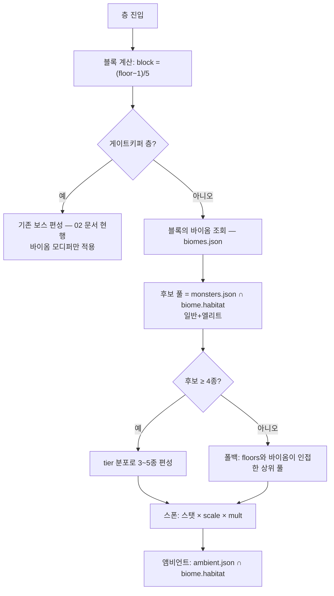

# 바이옴 시스템 v1.0 가안 (v8.0)

> [!info] 이 문서는?
> 130층을 **기존 21개 바이옴(하층 13 + 중층 8) + 상층 신설 5바이옴이 5층 블록 단위로 나눠 갖는** 지형·난이도·스폰 계층.
> **층체계 130 재설계 (2026-09-20 — 확정 #52 · 2026-09-21 번호 정정)**: 진행 방향 = 상승 등반 · G4 천정 101~130 신설 · 기존 1~100 수치 무오프셋 보존 — [[설계/층체계_130_재설계_개정안]] 참조.
> **상위 기준**: [[GDD_v8.0_00_확정사항]] §23 (2026-09-14 사용자 승인 — B안: 편성까지 전환).

---

## 1. 목적 & 범위

- **목적:** 층마다 같은 전투가 반복되는 문제를 해소 — 5층마다 지형 테마·난이도 모디퍼·출현 몬스터 풀이 달라지게 하고, 101~105층은 모든 요소가 겹치는 정점 돌파 구간(★6 마일스톤)을, 106~130층(상층 — 신설)은 마나 희박·응고 역류체의 상승 최종 구간을 만든다(개정안 §3 · biomes.json v1.3 자체 실측).
- **범위 (in):** 바이옴 정의(20종 → G4 신설로 26종, 2026-09-20 확정 #52) · 5층 블록 슬롯 배정 · 바이옴별 난이도 계수·모디퍼 · **바이옴 서식지 기반 일반 몬스터 편성(B안)** · 앰비언트 서식지 판정 · 검증 스크립트 확장
- **비범위 (out):** 게이트키퍼(5·10·15·20층) 편성 — 기존 방침 유지 · WFC 지형 실제 생성 알고리즘 — 구현 단계 · 보스 스케일식 — 02 문서 현행 유지 · 렌더링·아트 에셋

## 2. 설계 원칙

| # | 원칙 | 이유 |
|---|---|---|
| 1 | **데이터 단일 소스** — 바이옴 정의는 `biomes.json` 하나 | 02 문서 수기 표와 JSON이 어긋난 전례(층 밴드 공백) 재발 방지 |
| 2 | **habitat 코드 재사용** — monsters/ambient/ecology_codex의 기존 40코드를 바이옴에 매핑 | 신규 코드 0개로 전 몬스터가 자동으로 소속 바이옴을 갖는다 |
| 3 | **몬스터 데이터 무변경** — 편성 방식만 바뀌고 스탯·패턴·tier는 그대로 | 기존 밸런스 자산 승계, 리스크 최소화 |
| 4 | **게이트키퍼는 바이옴 밖** | 게이트는 성장 검증 지점 — 지형 난이도와 분리해야 측정 가능 |
| 5 | **난이도는 계수+모디퍼 2축** — 계수는 스탯, 모디퍼는 지형/규칙 | 숫자만 키우는 단조로움 방지, 지형이 전술을 바꾼다 |

## 3. 규칙 & 수치

> [!warning] 수치 정합성
> 계수·모디퍼는 전부 **가안** — [[GDD_v8.0_00_확정사항]] 미정G(영지 수치)와 함께 플탐에서 확정.
> 층 스케일식은 [[GDD_v8.0_01_등급_전투력]] 권장CP와 정합 확인 필수.

### 3.1 구조 — 10/9/1 그룹

| 그룹 | 바이옴 수 | 층 범위 | 블록 수 | 배정 |
|---|---|---|---|---|
| G1 하층 | 13 | 1~65 | 13 | 그룹 내 랜덤 배정 (biomes.json v1.3 자체 실측) |
| G2 중층 | 8 | 66~105 | 8 | 그룹 내 랜덤 배정 — 구 G3 정점 역할은 슬롯 21 역류폭포 |
| **G4 상층** | 5 | 106~130 | 5 | **신설 (확정 #52)** — 얼은 지상권 5테마: 동결 해양 · 수정 숲 · 유리 사막 · 붕괴 천창 · 이데아 관문 |

- **5층 = 1블록 = 슬롯 1개.** 블록 5층은 같은 바이옴 (층별 세부 변주는 지형 생성 몫).
- **배정 규칙:** 리셋 주기마다 그룹 내 슬롯을 섞는다(shuffle). 슬롯 시드는 [[#6. 미결정 & 리스크]] 참조.

### 3.2 난이도 — 계수 + 모디퍼

**층 스케일식 (가안 — 01 §2 몬스터 스케일 정합):**

```
G1: scale = 2.0 + floor × 0.03          (1층 2.0 → 50층 3.5)
G2: scale = 3.5 + (floor−50) × 0.04     (51층 3.5 → 95층 5.3)
G3: scale = 5.3 + (floor−95) × 0.10     (96층 5.4 → 100층 5.8)
적 스탯 = 기본 스탯 × scale × biome.difficulty.mult
```

> 개정 대조 (2026-10-23 · biomes.json v1.3 자체 실측) — 데이터의 층대는 하층 1~65 · 중층 66~105 · 상층 106~130 이다.
> 위 G1~G3 식의 계수는 이 층대로 재산정되지 않았다 — **수치 미정**, 새 값을 여기서 만들지 않는다.

**몬스터 레벨 (확정 #37 — 층 스케일식 등가 전환):**

- 만렙 **Lv130** (영웅 확정 #34와 동일 축) · **Lv = round(층 × 1.3)** — 1층 Lv1 · 50층 Lv65 · 100층 Lv130
- 스탯 계산은 위 층 기반 scale 그대로 — 레벨은 **표기·API 축**(UI 표시 · 필드 스폰 · 조건 판정)이며 실질 강도는 tier × scale이 담당
- 필드(탑 밖) 몬스터: 목표 층을 역산해 레벨 부여 — 역매핑 편차 최대 0.73%(95층)로 무시 가능 (시뮬 /tmp/sim_mon_level.py — 탑 내 편차 0%)
- **레벨 ≠ 강력함**: 같은 레벨 축을 공유해도 강도는 tier가 가름 (Lv130 t5 보스 ≫ 영웅 Lv130 파티 스케일) — "영웅 등급곡선과 몬스터 tier 배율은 별개 곡선"(01 §2) 원칙 유지
- **데이터 필드** (monsters.json — 2026-09-17 반영): 각 몬스터에 `level` 필드 신설 — `spawn.floors`(불연속 출현 층 리스트)의 각 층을 Lv = round(층 × 1.3) 역산해 **[최소 레벨, 최대 레벨]** 범위로 기록 (출현 층 1개면 단일 값) · 반올림은 확정 #34 영웅 앵커(50층=Lv65·100층=Lv130)와 통일 — 사사오입 · 예: 게이트키퍼(구 발록 슬롯) floors [20,46,50] → level [26,65] · 스탯 계산은 이 필드와 무관하게 층 스케일식 그대로
- **필드 스폰 규칙**: 스폰 층 f 결정 → 레벨 Lv = round(f × 1.3) 산출 → 표기·조건 판정·파밍 리턴 계산에 사용 · 스탯은 scale(f) × tier 배율 — 레벨은 강도 계산 입력이 아님 (등가 전환 원칙)
- 앵커 예시 (monsters.json 2026-09-17 리튠 베이스): t2 일반 Lv1 HP 650/ATK 53 → Lv130 HP 1,856/ATK 151 · t5 보스 Lv1 HP 47,700/ATK 771 → Lv130 HP 136,300/ATK 2,204
- 예비 손잡이 → **확정 전환 (2026-09-18)**: 상기 G3 후반 손잡이로 반영 — HP 계수는 monster_hp_mult(f)로 구현 (gacha_test.py 재현)

| Lv | ≈층 | scale |
|---|---|---|
| 1 | 1 | 2.03 |
| 33 | 25 | 2.76 |
| 65 | 50 | 3.50 |
| 98 | 75 | 4.50 |
| 130 | 100 | **5.80** |

- G2·G3 사다리꼴 곡선 — 전 구간 기하식 대비 후반 부담 완화 (계단식 급등 방지).
- FB-07 −15%는 계수 합산 후 최종 적용 (기존 방침 승계).
- 게이트키퍼 보스 스케일(HP·ATK × 배치층/bossScaleRefFloor)은 기존 02 문서 현행 — 배치층 5~20 전용·선형이라 G3 모디퍼와 무교차
- **G3 후반 손잡이 (확정 — 2026-09-18 시뮬 /tmp/sim_g3_lever.py)**: ① `bossHp ×1.2` 단발 계단 폐지 → **f96~100 +4%p/층 경사** (f96 1.04 → f100 1.20 — 총량 동일·96층 벽 해소) ② 몬스터 **Lv110+ HP 복리 ×(1−0.02)^(Lv−110)** — Lv130 보스 HP −33.2% (ATK·DEF 불변 — 회전 개선·감쇠 페널티 유지) · 목표: ★5 만렙 f100 실효 마진 1.2~1.4 · 승급 1회는 각성 육성으로 복원(0.92 → 1.0+) — k=−0.03 기각 (과완화 · f75 수준 풀림)

**바이옴 계수 (biomes.json — 가안):**

| 그룹 | 바이옴 | mult | 핵심 모디퍼 |
|---|---|---|---|
| G1 | 초원 | 1.00 | — (기준) |
| G1 | 숲 | 1.05 | cover ×0.9 (지형 가림 다함) |
| G1 | 습지 | 1.10 | 이속 −15% · 독 확률 +10%p |
| G1 | 동굴 | 1.10 | 시야 −40% (조명) |
| G1 | 폐허 | 1.15 | 기습 +15%p |
| G1 | 묘지 | 1.15 | 언데드 1회 소생 |
| G1 | 산맥 | 1.15 | 고지대 타일 +15%p |
| G1 | 사막 | 1.10 | 은신 몬스터 +10%p |
| G1 | 화산 | 1.20 | 용암 타일 · 화염 오브젝트 |
| G1 | 연해 | 1.10 | 수역 타일 50% |
| G2 | 심해 | 1.00 | 수역 타일 70% (G2 기준) |
| G2 | 천공 | 1.05 | 낙하 타일 · 낙뢰 5% |
| G2 | 미궁도시 | 1.05 | 미로 · 함정 ×1.5 |
| G2 | 하수도 | 1.10 | 독 +15%p · 스폰 밀도 ×1.5 |
| G2 | 신전 | 1.10 | 어둠계 영웅 피해 −10% |
| G2 | 정글 | 1.15 | 기습 +20%p |
| G2 | 심연 | 1.15 | Sanity −2/전투 |
| G2 | 지옥 | 1.20 | 용암 타일 (화산 상위판) |
| G2 | 서고 (구 대도서관 — 07 §5.1 개명 · 데이터 코드 `biome_library` 유지) | 1.20 | 몬스터 MDEF +20% |
| G3 | 정점 | 1.30 | **allPrev** + 보스 HP ×1.2 + 휴식 없음 |

### 3.3 G3 정점 — 최종 스테이지

1. **allPrev:** G1·G2의 모든 모디퍼가 동시 활성 (수역·용암·낙하 타일 혼합, 기습·독·소생 전부 발동). 계수는 mult 1.30 하나로 합산 — 모디퍼 계수 누적 곱하지 않음 (과열 방지).
2. **보스 HP ×1.2** — 100층 최종 보스(leviathan)에 적용.
3. **휴식 없음** — 101~105층 구간에 회복 이벤트 0개. 5블록 연속 돌파 구조. (구 G3 정점 → 현 중층 슬롯 21 역류폭포 · biomes.json v1.3 자체 실측)
4. 층 스케일이 기하로 꺾이는 대신 **모디퍼 밀도**가 난이도를 담당 — 스탯경쟁이 아닌 대응력 시험.

### 3.4 편성 — B안 (바이옴 서식지 기반)



- **후보 풀:** `monster.ecology.habitat ∩ biome.habitat ≠ ∅`인 전투 몬스터. tier 분포(층 스케일에 맞는 tier 중심 + 1단계 아래/위 섞기)로 3~5종 편성.
- **폴백:** 후보 < 4종이면 해당 바이옴 층대 ±1블록의 바이옴 풀을 병합 (빈 편성 금지).
- **앰비언트:** 같은 방식으로 habitat 교집합 — 기존 층 밴드(floors)는 참고용.
- **monsters.json spawn.floors는 기록용 참조로 강등** — 삭제하지 않는다 (v7.12 흔적·디버그용).

> **런타임 포팅 완료 (2026-09-29 · P4-5)** — 위 규칙이 `sim_encounter.py` 에만 있고 런타임엔 없던 동안
> **130층 중 73층이 후보 0** 이었다. `WaveBuilder.NormalPool` 이 `spawn.floors.Contains(floor)` 만
> 봤는데 그 필드가 "불연속 출현 층"이라 늑대 [2,3,4] 는 2·3·4층에서만 나온다는 뜻이다
> (126종 전부 길이 1~3 — 데이터가 증명). 코드 안의 `AppendLog("N층 편성 몬스터 없음")` 한 줄로만 드러나 있었다.
>
> **구현** 원본은 Unity C#(`EcologyEncounter` · `WaveBuilder`)이었다 — 이 저장소는 `godot/`에 GDScript로 다시 만든다(미이식).
> 게이트 `EcologyEncounterTests` (130층 전수) · 130층 시뮬 미러 `sim_eco_encounter.py`.
> **실측** 폴백 35층(7바이옴) · 온도 게이트 후보 0 → **0층** · 편성 3~5종 이탈 → **0층** · 폴백 중복 0 · `world` 유입 0 · **서로 다른 편성 조합 57/130층**.
>
> > [!warning] `BuildEcoWave` 는 **폐기된 어휘의 함수명**이다 (2026-09-29 표시).
> > D-261 이 웨이브를 폐지했고, 이 경로의 유일한 호출자는 `GameRoot.BeginExploreBattle` 다.
> > 이름만 남은 유산이지 규칙이 아니다 — 개명 후보: `BuildEncounter`.
>
> **포팅하며 문서에서 되찾은 것 세 가지** — 셋 다 문서가 이미 말하고 있었고 구현이 놓친 것이다:
> ① **후보 풀은 "일반+엘리트"** (§3.4 F) — 처음에 `mode==encounter` 만으로 좁혀 미궁도시 2종·심해 1종에 멈췄다.
> ② **온도 면역 역할** (§3.5-2) — `elemental`·`guardian`·`undead` 는 스폰 게이트 제외. 빠뜨리면 정령·골렘·스켈레톤이 통째로 탈락.
> ③ **폴백 후 habitat 을 다시 걸지 않는다** — 폴백은 "**이웃 바이옴의** 풀"을 빌리는 장치라 빌려온 종은 원래 habitat 과 definitionally 겹치지 않는다. 다시 거르면 **폴백이 항상 무의미해진다**(§3.4 "빈 편성 금지"가 아무것도 못 메움). 게이트 층위를 §3.4 habitat=풀 구성 1차 / §3.5-1 온도=스폰 2차로 분리했다.
>
> **편성의 단위는 층이다 — 블록이 아니다** (§3.4 A `block=(floor−1)/5` + §3.4 H "층 스케일에 맞는 tier 중심").
> 처음 구현은 중심값을 **후보 풀의 중앙값**으로 잡았는데, 그건 **층을 안 본다** — 130층에 서로 다른
> 편성 조합이 26개(바이옴 수)뿐이었고 같은 블록의 5개 층이 전부 같은 편성이 나왔다.
> §3.4 원문이 중심을 **층 스케일**에 맞추라 명시하는데 중앙값은 그걸 못 읽은 것이었다.
> `EcologyEncounter.CenterTierForFloor` 가 06 §3.2 층 스케일식 + `gen_level_bands` 의 바이옴 층 구간을
> 재사용해 복원했다. **실측: 조합 26 → 57.** 새 수치를 발명하지 않았다.
>
> **여전히 남은 결함 — 접촉 단위가 없다** → **[해소 — §3.7 로 이동]**
> D-261 「층=생태계 · **웨이브 폐지**」 + [설계/층탐험_오픈월드_설계.md §2-4](설계/층탐험_오픈월드_설계.md)
> "조우·랜드마크 (접촉 트리거)" — 조우는 **마커에 접촉했을 때** 생긴다. 그런데 `GameRoot.BeginExploreBattle`
> 는 접촉 정보를 **버리고** `floor` 하나만 `EcologyEncounter.BuildParty` 에 넘겼다.
> 실측(층 1·2): 마커를 몇 개 만나든 `bee·beetle·boar·dewlark·fieldviper` 로 고정되었다.
> 2026-09-29 **§3.7 접촉 스케일**을 신설해 해소했다 — 중심 tier 는 그대로 두고 **동률 순서만**
> 마커 번호로 회전한다(§3.4 가 정한 값 셋은 하나도 바꾸지 않는다).
>
> **[철회] 야생종 편성 참여와 "35/130층" 커버리지** — 같은 날 오전에 `ambient.json` 238종을
> 후보 풀에 합쳐 사슬 사냥 커버리지를 넓히려 했으나 **되돌렸다**(사용자 정정 "웨이브라는 개념이 없어").
> 실측: 130층 중 **20층의 3~5종 편성이 야생종만 남는다**(16·21·26·31·47·51·71·81·86·91·96·
> 101·102·106·111·116·121·122·126·127층) → world 를 걸러내면 그 층의 전투 조우가 **0체**.
> "35/130층" 은 발견이 아니라 "먹이층이 동네 한정" 이라는 **재진술**이었다. 08 §3-1 참조.
>
> **대신 가는 곳 — 개체수 시뮬레이션** (07 §11). "어떤 종" 은 여기서 끝나고, **"얼마나"** 는
> 07 §8 의 로지스틱·로트카-볼테라가 정한다. 진짜 빈 곳은 종이 아니라 개체수였다.

### 3.5 온도(기후) 시스템 (가안 — 2026-09-15 사용자 요청)

각 바이옴은 `climate` 3필드를 갖는다 (`biomes.json`):

| 필드 | 뜻 | 예 (심연) |
|---|---|---|
| `ambient` | 현재 평균 기온(°C) — 층 진입 시 ±5 변동 | -22 |
| `base` | 연중 기준 기온 | -10 |
| `band` | 서식 가능 밴드 — 이 범위 밖 종은 스폰 불가 | -38~14 |

**규칙 (가안):**

1. **스폰 게이트 2중화** — habitat 교집합(§3.4) **and** `종 온도 내성(min~max) ∩ 바이옴 band ≠ ∅`. habitat이 1차 필터, 온도는 2차 필터.
2. **온도 면역 역할** — `elemental`(정령=환경 그 자체)·`guardian`(구조물)·`undead`(생체 아님)는 검증·스폰 게이트 제외. 교차 검증에서 유일한 면제 적용 종은 드레드노트(guardian).
3. **영웅 쾌적 범위 10~25°C (가안)** — 밴드 밖 전투마다 Sanity -1, 극한(band 바깥 ±20 이상) 시 -2. 방한구·내열복 계열 장비로 완화 (P3-3 장비 확장 후보). **극단 바이옴 출입은 장비 등급 게이트** — §3.5-1 표의 3구간 기준.
4. **전투 모디퍼 3단계** — 쾌적(10~25) 보정 없음 / 불쾌(밴드 내·쾌적 밖) 이동속도 -5% / 극한(밴드 바깥) 이속 -10% + Sanity 드레인.
5. **검증** — `check_docs.py`가 종 데이터(`ecology.temperature`) × 26바이옴 내성∩band 교차 검사 (면역 역할 제외). 2026-09-28 위반 0건.

### 3.5-1 지표 기준 온도 재조정 (2026-09-28 — D-277)

기온은 **실제 지구 온도 분포를 기준**으로, 인간·일반 생물이 실제 이동 가능한 범위 안에 둔다. 우주복이 필요한 영역(-140°C 이하 / +120°C 이상)은 이 세계에 존재하지 않으며, 극단 바이옴은 **우주복 1단계 하위 수준의 방한·내열 장비**를 요구하는 선까지만 허용한다.

| 구간 | 범위 | 장비 | 해당 바이옴 |
|---|---|---|---|
| 쾌적 | 10~25°C | 없음 | 풀바다 · 뿌리숲 · 원천연안 · 탑의 서고 · 미궁도시 · 서약성소 · 지맥굴 · 침전수로 · 부유 이끼늪 |
| 미량 | -5~9 / 26~45°C | 경량 | 잿마을 · 기억묘역 · 포식밀림 · 먼지벌판 · 무광심연 · 증기구름층 · 지맥능선 · 먹빛 해구 |
| 극한 | -70~-46 / 46~60°C | 방한·내열 필수 | 무풍고원 · 역류폭포 · 형상군락 · 압력화구 · 마른 지맥 · 광로들판 · 찢긴 천창 · 이데아 문턱 · 맥의 상흔 |

지표 앵커 — 베르호얀스크 **-67.8°C**(기록 최저) · 남극 고원 **-60~-70°C** · 데스밸리 **+56.7°C**(기록 최고) · 사하라 주간 **+50°C** · 아마존 연평균 **+27~32°C** · 알프스 4000m **-10~-20°C** · 심해 수온 **+2~5°C**.

- **깊이 구배는 단조가 아니다.** 중층(66~105)에 열공백(맥의 상흔)·용암 지대(압력화구)가 있고 상층(106~130)은 한대다. 지구의 기후대 분포처럼 심도는 등온선이 아니라 상충하는 환경대로 읽는 것을 전제로 한다.
- **종 내성 재정의** — 261종의 `ecology.temperature`을 소속 바이옴 band에 비례 재매핑했다(상대 순위·폭 보존). 배정 결과 교차 위반 0건, 게이트 중첩폭 5°C 미만 0건.
- 각 바이옴 `climate.note`에 지표 근거를 명시했다.

> [!warning] 가안 근거
> 기후 수치는 지표 앵커와 261종 서식 내성의 교집합에서 역산한 가안이다. 계절 변동(마르코프 전환)은 미실장 — §6 리스크 참조. 2026-09-28 이전 수치(화산 20~300 · 지옥 50~400)는 이 기준에서 폐지되었다.

### 3.7 접촉 스케일 (2026-09-29 — 결함 2번 해소)

§3.4 는 **층 스케일**을 명시했을 뿐 **접촉 스케일**을 명시하지 않았다. 그 빈틈이 실제 결함을 냈다.

**문제 (2026-09-29 실측)** — 1층에 마커 6개를 걸으면 6전투가 **전부 같은 3~5종**이었다.
중심 tier 는 층 스케일로 정해져 있고(§3.4) 동률 정렬이 `id` 오름차순이라, 중심 tier 안에서
누가 먼저 나오는지가 고정되기 때문이다. 층 26종 중 5종만 고정 노출이면 08 §2 텅 빔이 그대로 남고,
[설계/층탐험_오픈월드_설계.md §1](설계/층탐험_오픈월드_설계.md) 진단 2번 "조우가 웨이브처럼 한 번에"가
언급한 그것이며, D-261 「층은 하나의 생태계 · **정해진 순서의 웨이브가 아님**」이 요구하는 바와 충돌한다.

**규칙 — 중심 tier 는 안 바꾼다. 동률 순서만 접촉 번호로 회전한다.**

| | 값 | 근거 |
|---|---|---|
| 중심 tier | `CenterTierForFloor(floor)` — **층만** 본다 | §3.4 "층 스케일에 맞는 tier 중심" |
| 후보 풀 | `ForFloor(floor)` — **층만** 본다 | §3.4 habitat·온도·폴백 (전부 층 단위) |
| 편성 규모 k | `PartySize(후보 수)` — 층만 | §3.4 H "3~5종" |
| **동률 순서** | **마커 인덱스로 같은 tier 그룹 안에서 회전** | ← **여기만 새로 정한다** |

**왜 이게 문서를 거스르지 않는가** — §3.4 가 정한 값(중심 tier·후보 풀·규모) 셋을 **하나도 바꾸지 않는다.**
바뀌는 것은 "중심 tier 에 가까운 것들 **중 누가 먼저**" 뿐이다. 새 판정식이 아니라 **동률 처리의 결정적 규칙**이다.

**회전은 같은 tier 거리 그룹 안에서만 일어난다** — 그러므로 "중심에 가까운 종이 뒤로 밀린다"는 일이 없고,
편성에는 중심 tier 종이 항상 포함된다(테스트 `Contact_Index_Only_Rotates_Within_The_Same_Tier_Distance`).

**결정론** — 같은 층 + 같은 마커 = 같은 편성. 재진입해도 흔들리지 않는다.

**실측 (2026-09-29 · `sim_eco_encounter.py` 130층 전수)**
- 후보가 편성 규모보다 많은 **75층** 전부에서 마커 6개가 **2개 이상의 서로 다른 편성**을 냈다 (**75/75**).
- 최다 = **6층(숲)·후보 10종** → 마커 6개가 **6가지 전부 다른 편성**:
  `boar·wolf·bear·bugbear·dire_boar` / `wolf·boar·bugbear·dire_boar·dire_wolf` / …
- 나머지 55층은 후보가 3~5종이라 회전 여지가 없다. **결함이 아니라 후보 부족**이며(폴백 35층 포함),
  야생종 편성 참여로 후보를 늘리는 안은 같은 날 **철회**됐다(08 §3-1 — 웨이브 폐지 위반).

**배선** — `GameRoot.BeginExploreBattle(i)` 가 접촉 마커 인덱스를 받아
`WaveBuilder.BuildEcoWave(..., contactIndex)` → `EcologyEncounter.BuildParty(all, floor, contactIndex)` 로 넘긴다.
마커 경로가 아닌 진입(허브 CTA 등)은 0 — 구 동작과 같다.

## 4. 로직 흐름

위 3.4 머메이드 참조. 리셋 주기 흐름:

```
리셋(시즌/유저 요청) → G1 슬롯 shuffle → G2 슬롯 shuffle → 세이브에 배정표 기록
→ 이후 100층 진입마다 배정표 조회
```

## 5. 구현 연동

- **데이터:** `data/biomes.json` — 26종 정의 (자체 실측) (groups→biomes 계층, habitat·slots·difficulty)
- **편성:** `WaveBuilder` 확장 — `BuildBiomeWave(floor, biome)` (P4-1 과제로 이동 — 아래 미결정 참조)
- **검증:** `check_docs.py` 확장 — ① biomes 26종 카운트 ② habitat 코드 46종 전부 매핑·중복 0 ③ ambient/codex floors와 habitat 정합 ④ groups 층 범위 합 = 1~130 (빈 곳·겹침 0) — 자체 실측
- **몬스터 데이터:** 무변경 — `ecology.habitat`만 소비

## 6. 미결정 & 리스크

- [ ] **슬롯 시드/리셋 주기** — 유저별 고정(시즌제) vs 진입마다 랜덤 vs 요청 시 리셋. 구현은 시드 고정(결정적)으로 두고 [[GDD_v8.0_00_확정사항]] 미정 항목으로 등록.
- [ ] **P2-1 편성표 승계 처리** — 02 문서의 전투 편성 절(2026-09-14 승인)은 B안으로 사실상 폐기. 문서에 폐기 각주 유지 (역사 추적용). 03 개발플랜 P2-1도 B안 참조로 갱신.
- [x] ~~폴백 편성 품질~~ — 해소 (2026-09-16): 정글·서고(구 대도서관 표기)·하수도에 전투몬 2종씩 리스킨 추가 (하수 트롤·폐기물 골렘 / 정글 표범·식인 식물 / 양피지 좀비·서고 골렘) — 각 3종으로 폴백 해소 + 바이옴 내 자체 사슬 구성 (08 §8 참조).
- [ ] **지형 모디퍼 실장 의존** — 용암·낙하·시야 등 타일 모디퍼는 WFC 지형 생성(P4-1)과 세이브 계약이 필요. 수치는 JSON에 있으나 발동 로직은 미구현.
- [ ] **기후 변동 미실장** — §3.5는 고정 ambient 기준. 계절/시간대 기온 변동(마르코프 연쇄 전환)은 플탐 후 판단. 영웅 쾌적 범위·장비 완화 수치도 가안.
- [x] ~~신규 서식종 34종의 온도 내성 미정~~ — 해소: 1·2차 배치(T-07-1·2, 2026-09-15)에서 전종 소속 바이옴 band 내 정의 완료 — check_docs 교차 검증 0위반 (07 §6 참조).

---

## ✅ 작성 완료 체크리스트 (AGENTS.md §6)

- [x] ①~④ 프론트매터(`version`·`up`·`aliases` 포함) · 위키링크 · 콜아웃 · 머메이드
- [x] **⑤ README 등록** — [[README]] 문서 목록 등록
- [x] **⑥ 결정로그 등록** — [[GDD_v8.0_00_확정사항]] §23 등록
- [x] **⑦ 상태 태그 = status 필드와 정합** — Draft(상태/초안)
- [x] **검증 스크립트 실행** — `python3 design-docs/_tools/check_docs.py` (exit 0 = 준수 · 2026-09-14 통과)
- [x] 🔗 관련 문서 표에 상호 링크 (📌 결정 기록 행 포함)

---

## 🔗 관련 문서

| 관계 | 문서 |
|---|---|
| 🏛 홈 | [[README]] |
| 📖 기준 | [[GDD_v8.0_00_확정사항]] |
| 📖 생태 | [[GDD_v8.0_02_생태사전]] — 게이트키퍼·보스 스케일 현행 |
| 📖 전투력 | [[GDD_v8.0_01_등급_전투력]] — 층 스케일·몬스터 tier 정합 |
| 📌 결정 | [[GDD_v8.0_00_확정사항]] §23 |
