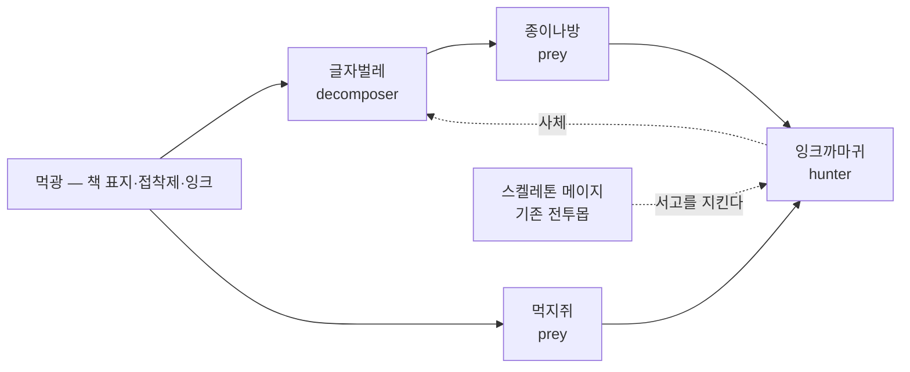

# 통합 생태계 v1.0 가안 (v8.0)

> [!info] 이 문서는?
> 20개 바이옴을 **각자 따로노는 배경이 아니라, 탑 전체가 하나로 도는 생태계**로 묶는 설계.
> 쉽게 말하면: **쥐가 있으니 뱀이 살고, 뱀이 있으니 매가 산맥에서 내려온다.** 모든 층이 이 줄로 이어진다.
> **상위 기준**: [[GDD_v8.0_00_확정사항]] §23 (바이옴) · [[GDD_v8.0_06_바이옴]] §3.4 (habitat 편성).

---

## 1. 목적 & 범위

- **목적:** 06 문서로 층마다 몬스터 편성은 달라졌지만, 바이옴 사이에 **생물이 이동·연결되는 흐름이 없다**. 이 문서는 (1) 생태계가 끊긴 지점을 데이터로 진단하고, (2) 신규 종 최소 추가로 20바이옴 전부를 생태 고리에 넣는다. (2026-09-20 확정 #52로 G4 천정 6종 신설 — 현재 26바이옴, 이 문서의 원래 진단은 20종 시절 기록)
- **원칙 (한 줄):** **기존 종으로 바닥을 깔고, 부족한 곳에만 그 바이옴 고유의 새 종을 심는다.**
- **범위 (in):** 생태 완결 진단 · 신규 서식종 설계 (약 34종, 1차 배치 16종) · 인공 바이옴의 먹이 근원(근원자원) 규칙 · 검증 스크립트 확장 계획
- **비범위 (out):** 전투 몬스터 56종 변경 (무변경) · 스탯 밸런스 · 생태 시뮬레이션 실장 (Phase 5+ 후보 · [[GDD_v8.0_03_개발플랜]] P4-5 이후)

## 2. 진단 — 지금 생태계가 안 도는 이유 (2026-09-15 전수 측정)

**방법:** 각 바이옴의 habitat에 속한 종(앰비언트+전투몹)의 역할(role)을 합산해, 먹이(prey/swarm)·포식(predator/hunter/ambusher/apex)·분해(decomposer/scavenger/corruptor) 3역할이 모두 있는지 검사.

| # | 발견 | 내용 |
|---|---|---|
| D-1 | **바이옴 중 15개 역할 결핍** (20종 시절 진단 — 현재 26종) | 완결은 초원·숲·습지·동굴·연해 5개뿐. 대도서관·신전·하수도·정글·천공은 **종 자체가 1~3개뿐** — 생태가 아니라 배경 |
| D-2 | **인공 바이옴에 먹을 것이 없다** | 신전·서고·하수도·천공·미궁도시는 앰비언트 0종. 포식자가 있어도 먹이가 없으니 사슬이 시작조차 안 됨 |
| D-3 | **연결은 이미 좋다** | 종 공유 통로 36개 (기스양키 삭제로 37→36, 2026-09-15) · 탑 전체가 연결요소 1개 — G1의 쥐·까마귀·슬라임이 G2까지 이어줌. **문제는 연결이 아니라 각 방의 텅 빔** |
| D-4 | **심해·심연·지옥·정점도 먹이 없음** | 포식자만 있는 상층 — "누구를 잡아먹고 사나"가 데이터에 없음 |

> [!note] 판정
> 바이옴을 바꿀 필요는 없다. **각 바이옴에 없는 역할 1~2개를 채우는 종만 추가**하면 20개가 하나의 사슬로 묶인다.

## 3. 설계 — 3계층 종 전략

| 계층 | 뜻 | 범위 | 추가/변경 |
|---|---|---|---|
| ① **야생종** | 어디에나 붙어 다니는 기반 종. 사슬의 바닥 | 기존 앰비언트 19종 (쥐·까마귀·슬라임 등) | **0 변경** — 이미 36개 통로의 주인공 |
| ② **적응종** | 야생종이 다른 환경에 적응한 모습. **기존 종의 리스킨** (스탯·AI 동일, 서식지·속성·이름만 교체) | G1 결핍 바이옴 6곳 | 신규 8종 (리스킨이라 밸런스 리스크 0) |
| ③ **서식종** | 그 바이옴에만 사는 고유 종. 인공 바이옴의 생태를 **그 답게** 만드는 주인공 | G2+G3 전 바이옴 | 신규 26종 (1차 배치 16종) |

- **리스킨 방식:** 원본 종의 stats·aiDecision·pattern을 복사 → habitat를 [바이옴 코드]로, 이름·속성·diet만 교체. 예: 토끼(초원) → 흰쥐(신전) — "같은 동물, 다른 곳".
- **서식종 원칙:** habitat = [자기 바이옴 코드 1~2개]만. 타 바이옴으로 새지 않는다 (G1 야생종이 통로 역할 유지).
- **diet 금지 규칙:** 신규 종의 `prey`는 **전부 자기 바이옴의 근원자원 또는 이웃 종**. `diet: none + prey: []`인 종(산호초 패턴) 신규 추가 금지.

### 3.1 근원자원 — 인공 바이옴이 살아가는 이유

인공 바이옴(신전·서고·하수도·미궁도시·천공)에는 풀도 사슴도 없다. 대신 **건축이 흘려보내는 자원**을 먹고 산다:

| 바이옴 | 근원자원 | 그것을 먹는 자 |
|---|---|---|
| 서고 | **먹광** (잉크 빛·접착제·책 표지) | 글자벌레 → 종이나방 → 잉크까마귀 |
| 신전 | **성수 이슬** (제단에 맺히는 물) | 신전비둘기·성수이끼 → 가람뱀 |
| 하수도 | **슬러지** (버려진 음식물 찌꺼기) | 바퀴벌레 → 하수쥐 |
| 미궁도시 | **버려진 음식물** (시장 잔반) | 도시비둘기·바퀴벌레 → 골목생태 전체 |
| 천공 | **바람씨앗** (상승기류에 뜨는 씨앗) | 바람모종 → 폭풍꿀벌 → 폭풍매 |

- 이렇게 하면 "왜 60층 건물 안에 생물이 사나"가 **설정이 아니라 구조**로 해결된다 — 먹이가 층 자체에서 나온다.
- G3 정점은 allPrev처럼 **모든 근원자원이 합류하는 자리** — 아래 생태의 흘러내림이 정점에서 만난다는 설정 (별가루·아스트랄 이끼).

## 4. 바이옴 생태 완결표 (가안 — 20종 시절 작성 · 상층 5종 확장은 06 참조)

> ✅ = 완결 (유지) · ② = 적응종(리스킨) · ③ = 서식종(신규)

| 바이옴 | 결핍 | 채우는 방법 | 추가 종 (역할) |
|---|---|---|---|
| 초원 | ✅ | — | — |
| 숲 | ✅ | — | — |
| 습지 | ✅ | — | — |
| 동굴 | ✅ | — | — |
| 폐허 | 먹이 | ② | **비둘기** (prey·토끼 리스킨) · **먼지벌레** (swarm·벌 리스킨) |
| 묘지 | 먹이·포식 | ② | **무덤벌레** (prey·딱정벌레 리스킨) · **어스름매** (hunter·매 리스킨) |
| 산맥 | 분해 | ② | **바위이끼** (decomposer·버섯 리스킨) |
| 사막 | 먹이·분해 | ② | **사막쥐** (prey·쥐 리스킨) · **썩고기갑충** (decomposer·딱정벌레 리스킨) |
| 화산 | 먹이 | ② | **화염벌레** (prey·박쥐나방 리스킨 — 열광맥 서식) |
| 연해 | ✅ | — | — |
| 심해 | 먹이 | ③ | **심해플랑크톤** (swarm) |
| 천공 | 전무 | ③ | **바람모종** (prey) · **폭풍꿀벌** (swarm) · **바람버섯** (decomposer — 상승기류를 뜨는 부유 균류) · **폭풍매** (hunter) |
| 미궁도시 | 전무 | ③ | **도시비둘기** (prey) · **바퀴벌레** (decomposer — 하수도와 공유) · **골목쥐** (prey·하수도와 공유) |
| 하수도 | 전무 | ③ | **하수뱀** (ambusher·뱀 리스킨) + **바퀴벌레·골목쥐 공유** — 도시 생태가 흘러드는 구조 |
| 신전 | 전무 | ③ | **신전비둘기** (prey) · **성수이끼** (decomposer) · **가람뱀** (ambusher·뱀 리스킨) |
| 정글 | 전무 | ③ | **원숭이** (prey) · **앵무떼** (swarm) · **부패균** (decomposer) — 포식자는 FONS 전투종 수관잠행자 |
| 심연 | 먹이 | ③ | **심연충** (prey) · **보이드이끼** (decomposer) |
| 지옥 | 먹이 | ③ | **유황파리** (swarm) · **불열매덩굴** (prey — 임프가 따먹는 열매) |
| 서고 (구 대도서관) | 전무 | ③ | **글자벌레** (decomposer) · **종이나방** (prey) · **잉크까마귀** (hunter·까마귀 리스킨) · **먹지쥐** (prey·쥐 리스킨) |
| 정점 | 먹이·분해 | ③ | **별가루** (swarm) · **구름이끼** (producer — 해충 대응 생산자) · **아스트랄 이끼** (decomposer) |

- **합계:** 신규 34종 (②적응종 8 + ③서식종 26) · 1차 배치 = **인공 바이옴 16종** (천공4·미궁도시3·하수도1+공유·신전3·서고4 + 심해1) · 2차 = G1 적응종 8종 + 나머지 10종
- **`ambient.json` 19종 → 약 53종.** 전투 몬스터·스탯은 0 변경. [[GDD_v8.0_02_생태사전]] · `ecology_codex.json`에 신규 종 등재.
- **완결 기준 (검증 규칙화):** 모든 바이옴에서 ① 먹이 1종 이상 ② 포식 1종 이상 ③ 분해 1종 이상 ④ 모든 종의 diet ≠ none.

## 5. 케이스 — 서고(구 대도서관)와 신전

### 5.1 대도서관 → 서고

사용자 지적(2026-09-15): "대도서관 같은 건 바른 걸로 바꿔야 하지 않냐" — 맞다. **대도서관은 공간 이름이지 생태가 아니다.** 실제 서고에는 해충이 산다:



- **먹광(墨光)** = 책의 잉크·표지가 희미하게 빛나는 탑의 마력 찌꺼기 — 근원자원.
- 글자벌레가 표지를 먹고, 종이나방이 글자벌레를 먹고, 잉크까마귀가 나방과 쥐를 잡는다. **3계층 4종이면 사슬이 닫힌다.**
- 몬스터 편성(스켈레톤 메이지)은 기존 그대로 — 생태는 배경에서 돌고, 전투는 별개. **"산 층"과 "싸우는 층"의 분리.**
- 개명: `biome_library` → `biome_archive` (이름 서고). 06 문서·biomes.json 표기 갱신 (몬스터 데이터의 `library` 코드는 유지 — 스키마 무변경).

### 5.2 신전

- 성수 이슬이 제단에 맺히면 이끼가 피고, 비둘기가 이끼 곁의 씨앗을 먹고, 가람뱀이 비둘기를 기다린다 — **그리스 신전의 실제 생태** (아크로폴리스에는 뱀·비둘기가 실존).
- 수호령·광로 잔향체(기존 guardian)는 사슬 위의 **수호자** — 포식 대신 마나 흐름을 흡수해 지킨다. guardian 역할은 생물 포식 사슬 밖의 특수 역할로 취급한다.
  > [!note] 미정N 확정 (2026-09-15) — 현재 정본에 반영됨
  > 수호자 **3종(수호령·광로 잔향체·드레드노트)은 `mana`를 섭취**한다(데이터 반영 완료 — 드레드노트는 08 §5.1 명단과 동일). "지키는" 존재가 마력 흐름을 **소모**해 유지된다는 설정 — 포식(predation)이 아니라 에테르 경로 섭취로, 사슬 밖 특수 역할·"먹지 않고 지킨다"는 서술은 **마력 섭취로 정정**. 근거: 00 #27 · 08 §5.1.

## 6. 작업 목록

| # | 작업 | 근거 | 시점 |
|---|---|---|---|
| T-07-1 | **1차 배치 ✅ 완료 (2026-09-15)** — 서식종 16종 `ambient.json`+`ecology_codex.json` 등재 (천공4·미궁도시2+공유1·하수도1+공유·신전3·서고4·심해1) · 리스킨 방식 · **온도 내성 = 소속 바이옴 band 내 정의** · 생성기 `_tools/gen_new_species.py` (멱등) | §4 · §5 | 완료 |
| T-07-2 | **2차 배치 ✅ 완료 (2026-09-15)** — G1 적응종 8종(폐허2·묘지2·산맥1·사막2·화산1) + 심연·지옥·정점·정글 10종 → ambient/codex **53종** · 온도 내성 = 소속 바이옴 band · codex group 필드 G1/G2/G3 자동 산출 | §4 | 완료 |
| T-07-3 | **근원자원 스키마** — biome에 `resource` 필드 추가 + 신규 종 diet 연결 (기존 prey flora/fauna 분리안과 합침) | §3.1 | P4-2 |
| T-07-4 | **검증 확장** — check_docs.py에 ① 바이옴별 3역할 완결 ② 신규 종 biome 고유성(habitat 단일) ③ diet none 금지 ④ ambient 개수 기대치 갱신(19→53) | §4 완결 기준 | T-07-1 완료 직후 |
| T-07-5 | **서고 개명** — biomes.json name/06 문서 표기 갱신 | §5.1 | T-07-1과 함께 |

- **개수 변동 사전 공지:** `check_docs.py` 현재 "ambient 19종" 고정 검사 → T-07-1에서 기대치 갱신 필수 (미갱신 시 검증 실패 — 의도된 안전장치).
- 미정 신설(00): **미정K — 인공 바이옴 생태 방식** (서고 개명·근원자원 명칭·1차 배치 후 플탐 체감 확인).

## 7. 미결정 & 리스크

- [x] ~~신규 서식종 온도 내성~~ — 1·2차 34종 전부 완료 (소속 바이옴 band 내 정의 — 06 §3.5 검증 통과). 2026-09-16 얇은 바이옴 보강 이후 현재 데이터 총계 109종 교차 0위반.
- [ ] **신규 34종의 밸런스** — 리스킨이라 원본과 동일하나, threatBase가 낮은 종이 많아 "사냥 감성"(처치 보상·재료)과의 접점 설계 필요 → P5 플탐.
- [ ] **02 생태사전 문서 분량** — 신규 34종 전부 수기 표 등재 시 문서 비대화 → 02는 대표 생태만 기술하고 전수 데이터는 JSON 정본 원칙 유지.
- [ ] **생태 시뮬레이션과의 접점** — v7.12의 밀도 가중치 승계안(P4-5 후보)과 이 문서의 종 풀을 합쳐야 "돌아가는" 체감 완성 — 실장은 Phase 5+.

---

## 8. 생태학 개념 매핑 — 시스템의 학문적 뼈대 (2026-09-15)

> [!note] 요약
> 시스템 수치 설계의 근거가 되는 생태학 개념 12개. 시각화는 **`design-docs/생태도감.html`** (생성기: `_tools/gen_ecology_codex.py` — 바이옴 생태 카드 + 로지스틱·로트카-볼테라 인터랙티브 시뮬레이터).

| 개념 | 식 (요약) | 시스템 반영 |
|---|---|---|
| **로지스틱 성장** ★필수 | dN/dt = rN(1−N/K) | 바이옴별 개체수 상한 — 스폰 캡·사냥 개체수 조절의 기본식 (S자 곡선) |
| **수용력 (K)** | K = 자원 등급 × 공간 | 근원자원 풍요도 → 바이옴별 K — 사막(K 35) vs 정글(K 130) 체감 차이 |
| **로트카-볼테라** | dN = rN(1−N/K) − aNP | 포식-피식 개체수 주기 파동 — 시즌별 사냥감 많은 층/적은 층 변동 |
| **영양 단계 · 10% 법칙** | 먹이 10 → 포식 1 | 스폰 테이블 비율 — 최상위 포식자는 항상 소수 |
| **영양급위** | 상위 제거 → 하위 폭발 | 보스 처치 후 2~3시즌 하위종 폭증 이벤트 (후보) |
| **섬생물지리학** | 종수 ∝ 면적·연결 | 5층 블록 = 섬 — K가 면적, 생태 통로 36개가 거리 |
| **니치 분화 · 경쟁 배제** | 같은 자리·먹이 → 1종만 | 신규종 habitat 단일 원칙의 근거 — 역할 중복 금지 |
| **r/K 전략** | r전략 다산·소형 / K전략 대형·소수 | swarm은 사냥해도 금방 회복, apex는 한 번 잡으면 오래 비어 있다 — 사냥 경제 축 |
| **생태 천이** | 빈 땅 → 풀 → 덤불 → 숲 | 리셋 직후 바이옴 재생 단계 — 먹이종 먼저, 포식자는 나중 (미정J 연결) |
| **핵심종 · 지표종** | 핵심종 부재 = 생태 전체 변동 | 쥐 = 지표종(층 건강 게이지) · 정점 보스 = 핵심종 |
| **침입종** | 천적 없는 종의 폭발 | 과거 31~75층 데드존 사례 — 역할 검사가 방지 장치 |
| **영양물질 순환** | 사체 → 분해자 → 자원 | 처치 사체 → 분해자 부스트 (v7.12 검증 역학 승계안) |

- 시뮬레이터 기본식 — 포식 포함: `dN/dt = rN(1−N/K) − aNP`, `dP/dt = baNP − dP` (a 조우율·b 에너지 전환·d 사망률). 평형점 N* = d/(ba), P* = (r/a)(1−N*/K).
- **실데이터 시즌 시뮬레이터 (2026-09-15 구현)** — 도감 시뮬레이터 탭 하단. 35종 야생 + 전투 포식자를 바이옴 단위로 굽니다:
  - **파라미터 = 실측 필드**: r = `reproduction`, d = `food_need` 기반, 포식 강도 a = `aggression`, 최적온도 = 종별 `temperature` 밴드 중심 → φ 종별 계산.
  - **K 배분 = 10% 법칙**: 바이옴 K를 하위층 55% · 최상위 포식자 10%로 나눠 종수로 배분(포식자 최소 2 — 희소성 유지).
  - **마르코프 이상기후** — 한파·평년·폭엔 전이확률행렬(§8)로 시즌마다 φ·r·K·d 진폭. 0.05 미만 = 국소절멸, 시즌 경계 25% 확률 이주 재유입.
  - **검증된 거동**: 초원 10종 전생존 평형(토끼 4.2→5.8→2.5 냉파 파동), 사막 폭엔 3시즌에 독사 1.6→0.1 임계 근접 후 평년 회복 — 계절이 개체수 파동을 지배하는 구조 확인.
- **게임 적용은 Phase 5+** — 지금은 근거 문서화 단계. 실장 시 스폰 가중치·사냥 개체수·시즌 변동이 위 식을 따른다.
- **법칙 검수 (2026-09-15, `design-docs/_tools/audit_sim.py`)** — 시뮬레이터를 파이썬으로 1:1 포팅해 바이옴(당시 20종 → 현재 26종) × 12시즌 전수 루프 검증. **22검사 전부 통과**:
  - 마르코프: 행 합=1 · 대각 우세(이상기후 지속성) · 몬테카를로 200회 실측 전이확률 오차 max 0.048
  - 로지스틱: 무섭식 종이 K에 수렴 (final 12.86 / K 13) · 열성능 φ: 60%+ 종이 계절 반응(밴드 넓은 내성종 둔감은 정상 속성)
  - 로트카-볼테라: 초원 10종 전체 진폭 ≥15% · 에너지 피라미드: 포식자 평균 1.79 < 피식자 9.54
  - 10% 법칙: 바이옴 포식/먹이 K 총합 비율 밴드 내 (현재 0.03~0.55 — 심해 상향은 audit_sim 주석 참조) (포식자 종수가 많은 바이옴은 상한에 붙는 것이 물리 한계 — K floor 때문)
  - 수치 위생: NaN·음수 0건 · 절멸 임계 흡수 누락 0건 · 동일 시드 결정론 확인
  - 검수기는 생성기 소스에서 법칙 식 8종(정규식)과 K 테이블(RESOURCES)을 직접 읽어 **JS↔검수기 드리프트를 자동 감지**한다.

---

## 10. 층 진입·미션 흐름 — 통합 생태 순환에의 접속 (2026-09-20 보강 · D-261/D-265 반영)

> 층은 하나의 생태계이자 하나의 새로운 세계(D-261) — 본 문서의 먹이그물·지맥·서식 모델이 **플레이 루프에서 어떻게 접속되는지**의 정식 서술. 상세 규칙은 [[D-265_층_미션_시스템]].

### 10-1. 플레이 루프 (층 1회)

```
층 진입(탐험형) → 탑이 미션 1개 부여(주 1 + 부 6 — D-265)
  → 생태 조우(웨이브 아님 — 서식지 기반 조우) + 채집·관찰
  → 주 미션 클리어 = 층 클리어 → 수확 전량 마석(화폐 산물 부재 원칙)
  → 부 목표 6종 = 추가 마석 · 미달은 층 실패 아님(다음 층 진행 가능)
```

### 10-2. 생태 모델과의 접속

| 미션 타입 (monsters.json missions) | 생태 접점 | 주의 |
|---|---|---|
| 정찰(discover 3) | world 스폰 2+조우 1 — 서식지 탐사 | 미관찰종 도감 해금 연동 |
| 토벌(kills 2조우) | 포식자 개체군 압력 — 08 먹이그물 로지스틱 | 과도 토벌 → 하위종 폭증 피드백 |
| 수호(hold 90s+repel 3) | 영역성 — 조우당 위협 합(ΣthreatBase) | 방어형 배치 유도 |
| 수집(collect 3) | 산출물·잔해 — corpse 유입 ×0.5 | 채집 루프와 공유 |
| 정예 사냥(elite 1) | 상위 포식자 개체 — 티어 대역 상단 | 리스크·보상 비대칭 |
| 정화(purify 3 · 신설 — D-265 3차) | 오염 침전·썩은 둥지 소각 — 지맥 건강도 소량 회복 | 학살형 토벌의 대비축 — D-268 대비 셀 |
| 호송(escort 1 · 신설 — D-265 3차) | 층 마을 이주민·상인 이동 보호(세계관 #54) | G1 초기 가중 0 — 문명 성숙 후 개방 |
| 게이트키퍼(boss 1) | 층 정점 — 잭팟 10층 단위(D-252) | 클리어 게이트 |

### 10-3. 순환 보존 규칙

- 미션 수행은 생태 **상태를 변경**한다(개체군·시체·서식) — 다음 층 재방문 시 반영 (07 §3 계층 전략 연동)
- 학살형 반복 토벌 → 지맥 건강도 −12%(#45·D-268) — 소환·마나 경제와 생태 관리가 한 줄로 연결
- 미션 실패·부 목표 미달은 생태 파괴가 아니라 **재탐험 유인**으로 설계 (층은 보존됨)

## 11. 도감 UI/UX — 사전형 참조 설계 (2026-09-15)

> [!note] 요약
> `생태도감.html`을 **사전(dictionary)형 UI로 전면 개편** — 조사한 포켓몬 도감(번호·타입 필터·상세 뷰)·사전 앱(표제어 검색·가나다 색인·상호참조) 패턴을 게임 도감에 적용.

### 10.1 설계 원칙

| 원칙 | 적용 |
|---|---|
| **중요도 우선** | 기본 탭 = **종사전(107종)** — 유저가 가장 많이 찾는 단위. 바이옴·개념·시뮬레이터는 그 다음 |
| **사전식 검색** | 표제어 검색(이름·ID·설명) + **ㄱㄲㄴ 초성 색인**(결과에 존재하는 초성만 동적 표시) + 종류 필터(전투/야생/예정) + 정렬(중요도·가나다) |
| **항목 = 뜻풀이** | 카드 클릭 → 상세 팝업: 표제어·ID·배지(종류·역할·티어·속성)·정의문 ·서식/출현층/온도 내성 ·스탯표 |
| **상호참조** | 먹이·천적 칩 **클릭 시 해당 종 항목으로 이동**(사전의 ~참조) — 자원(diet flora)은 비링크 표기 |
| **기본 접힘** | 개념 카드 22장은 한 줄 요약만 기본 표시, ★핵심 2개(로지스틱·로트카-볼테라)만 펼침 |
| **전체 토글** | 개념 탭 상단에 **모두 펼치기/접기 버튼** — 22장 전수 열람 시 카드 하나씩 클릭 불필요 (2026-09-16) |
| **단일 파일** | 인터넷·의존성 0 — 생성기 실행 1번으로 갱신 |

### 10.2 종사전 데이터 모델

> [!warning] 수치 정정 (2026-09-15 검수 · 2026-09-17 최종 · 2026-10-02 재검)
> 작성 시점 기준 수치 (107종 = 야생 35 + 전투 54 + 예정 18). 이후 데이터 정합 라운드에서 **몬스터 50→56종·야생 53→70종 확정**, 2026-09-16 얇은 바이옴 보강 + 3차 리스킨 17종으로 도감 총계 **126종 = 야생 70 + 전투 56**(2026-09-17 스냅샷). 이후 7원소 정령·균등화·폴백 해소·편성 품질·원천연안 확장을 거쳐 **2026-10-02 스냅샷 도감 총계 377종 = 전투 133 + 비전투 244** (02 문서 §1 표기) — 현 데이터는 **전투 162 + 비전투 215** (2026-10-26 자체 실측 · 이동 29종 = 2026-10-18 사육 5종 + 2026-10-23 블록 16·17·20 5종 + 2026-10-26 먹이층 19종 승격). 하단 구 수치는 설계 당시 기록으로 유지.

- **107종 = 야생 35(ambient) + 전투 54(monsters) + 예정 18(07 §4)** — 몬스터의 ecology 블록을 도감이 처음으로 소비(기존 "데이터만 있고 소비자 0" 문제 해소).
- 중요도 정렬: 전투 티어 내림차순 > 야생 > 예정 — 보스급이 도감 앞줄.
- 상호참조는 `ecology.predators`/`prey`의 ID를 이름으로 해석 — 미등재 ID는 자원으로 표기.

### 10.3 먹이사슬 그래프 뷰 (2026-09-15 추가 · 2026-09-16 가독성 개편)

- **영양단계 레이어 레이아웃** (Iskrzyński·Pawluczuk 2022, Methods Ecol Evol 권고 반영) — 세로축 = 영양 단계 고정 (아래 → 위: 근원자원 → 분해·청소 → 먹이·군체 → 포식자 → 최상위 → 언데드·에테르 → 특수). 배경에 층 가이드라인 + 라벨. 자유 배치 헤어볼에서 교과서식 "아래에서 위로 읽기"로 전환 — x축만 시뮬로 같은 층끼리 반발해 벌어짐.
- **화살촉** — 간선 끝(먹는 자 쪽)에 삼각 화살표 — 에너지 흐름 방향 명시.
- **호버 하이라이트** — 노드에 커서 → 연결된 간선·노드만 밝히고 나머지 90% 감광 (선택 시 관계 플로우 강조, 동 연구 권고). 흰 테두리로 커서 노드 표시.
- **라벨 배경 박스** — 라벨 뒤 반투명 박스로 겹침 완화 + 토글 버튼 추가 (45종 초과 뷰는 자동 off).
- **종 단위 그래프** — 노드 = 종(색 = 영양 역할, 금 테두리 = 전투종, 회색 다이아 = 근원자원), 실선 = 데이터 명시 관계(predators/prey), 점선 = 같은 바이옴 내 역할 기반 추정 관계.
- **바이옴 필터** — 선택 바이옴의 종 + 그 종들이 직접 먹는 근원자원만 표시(초원 9종 · 27간선). 전체 뷰는 109종 전체라 헤어변이므로 기본값 = 초원. 하수도 뷰 기준 노드 6종 · 간선 13개로 자체 사슬 확인 가능.
- **상호작용** — 노드 클릭 → 해당 종의 사전 항목 팝업(§10.1 상호참조와 동일 경로), 드래그로 노드 고정, ESC 닫힘.
- **게임 시사점** — 이 그래프가 곧 게임 내 "생태 네트워크" 화면의 원형. 유저가 사냥감 위치·천적 위협을 한눈에 파악하는 UX로 직결.

### 10.3b 개념 탭 UI 수정 (2026-09-16)

- **토글 잘림 버그 수정** — 카드 오른쪽 위 "펼치기/접기" 텍스트가 `margin-top:-17px` 네거티브 마진으로 카드 밖으로 삐져나와 `overflow:hidden`에 잘려 깨진 글자로 보이던 문제. ▸/▴ **화살표 아이콘**으로 교체하고 카드 안쪽 오른쪽 중앙(`right:13px · top:50%`)에 배치 — 잘림 원천 차단.
- **요약줄 겹침 해소** — summary에 우측 패딩(34px)을 줘 한 줄 요약이 토글 영역과 안 겹침 (전수 검사 22/22 카드 겹침 0).
- **모두 펼치기/접기 버튼** — 탭 상단 우측 배치, 22장 전체 일괄 토글.
- 그룹 헤더(cghead)를 flex로 정리 — 제목·부제 줄바꿈 시에도 정렬 유지.

### 10.3c 사전 세분화 — 에너지원 사전 · 생물 대분류 · 그래프 겹침 개편 (2026-09-17)

**에너지원 사전 (신설 탭)**
- **34항목** — 종의 `prey` 문자열(몬스터 ID가 아닌 것)을 전수 사전화. 각 항목: 한글명 · 분류 · 설명 · 게임 매핑 · 이걸 먹는 종(클릭 시 종 항목 이동) · 서식 바이옴.
- **4분류**: 🌱 식물(16) · 🍖 동물성(사체·잔반 등) · ⛰ 무생물·환경(열수 미네랄·유황) · 👻 에테르(마나·영혼·먹광·성수·보이드·근원 합류).
- 표제어 검색 + 분류 필터 + 상세 팝업 — 종사전과 동일한 사전형 UX. 에테르 자원은 물리 먹이사슬과 분리된 제2사슬임을 명시.

**생물 대분류 (종사전 필터 신설)**
- 109종을 **동물(74) · 식물·군체(21) · 정령·에테르(14)**로 분류 — 데이터 `category`(4=동물형·6=식물계·군체) + 역할(undead·elemental=에테르) + 이름 키워드(덩굴·버섯·이끼·균·플랑크톤·산호·모종) 조합 판정. 악마 계열(cat 6)은 animal로 예외 처리.
- **판정식 수정 (2026-09-29) — 키워드가 `category` 를 덮어쓰지 못하게.** 위 문장은 신호를 나열만 하고
  **우선순위를 안 줬다.** 구현이 키워드를 먼저 평가해서 **데이터가 명시적으로 "동물형"(cat 4) 이라고
  선언한 종**이 flora 로 넘어갔다. 실측 7종 전부 명백히 동물이었다 —
  **이끼 두꺼비**(양서) · 이끼 뱀 · 가시덩굴 뱀 · 덩굴보아 · 중력 매복 덩굴 · 바람모종 · 바람모종 벌레.
  `category 4 = 동물형` 은 이름 추측이 아니라 **선언**이다. 선언이 추측에 밀리면 안 된다.
  → 분포 **동물 248 → 255 · 식물·군체 86 → 79 · 정령·에테르 30 = 364** (`gen_ecology_codex.py` `bio_class()`).
- **[미해결 · 판단 필요] cat6 에 전투종이 16종 섞여 있다.** 위 조항이 "악마 계열(cat 6)은 animal 예외" 라
  했는데 현행 구현은 이를 이름 7개 하드코딩(`DEMON_EXCL`)으로 근사하고 있다. 그 목록엔 **죽은 항목 2개**
  (맥압각·맥박 교란자 — 현재 cat6 아님)가 있고 **cat6 전투종 16종 중 11종이 여전히 flora** 다:
  재 화관(predator) · 발록(apex) · 비홀더(apex) · 수정 감시자(guardian) · 빙하 이빨(predator) ·
  어긋난 눈(predator) · 마인드 플레이어(predator) · **오우즈**(decomposer) · 슬라임(그린) · 공허먼지 ·
  **식인 식물**(ambusher).
  이건 키워드 문제가 아니라 **`category` 자체의 문제**라 판정식으로 곧바로 고칠 수 없다.
  · 명백히 동물이 아닌 것 — 발록·비홀더·재 화관·빙하 이빨·어긋난 눈·마인드 플레이어·오우즈 (7)
  · 판단이 갈리는 것 — **식인 식물**( carnivorous plant 라 진짜 식물일 수 있음) ·
    슬라임·공허먼지(식물도 동물도 아님) · **수정 감시자**( 06 §3.5-2 는 guardian 을 "구조물·생체 아님" 으로 봄)
  → **승격하지 않았다.** "cat6 + 전투종 → animal" 같은 규칙은 위 판단 갈리는 3종까지 함께 뒤집어
  데이터 정본 손질 또는 설계자 결정이 선행되어야 한다. (`ecology_codex.json` 값 변경 없음)
- 종 카드·상세 팝업에 대분류 색 칩 표시 + 필터 버튼 4종(생물 전체/동물/식물·군체/정령·에테르).

> **먹이사슬 탭에도 같은 계열 축 적용 (2026-09-29)** — 위 판정식은 **이미 364종 전부에 계산되어 있다**(`gen_ecology_codex.py` 의 `bio_class()` → `species.bc`). 종사전이 그 값을 칩으로 쓰고 있었으므로 사슬 탭도 **판정식을 두 벌 만들지 않고 그대로 재사용**했다(두 벌이면 364종 중 어긋나는 종이 생긴다). 실측 분포: **동물 248 · 식물·군체 86 · 정령·에테르 30 = 364**.
> - **계열 필터** 3버튼(동물/식물·군체/정령·에테르) — 상호배타 1개 선택. 근원자원은 계열이 없으므로 항상 함께 표시한다.
> - **색 모드 전환** — `색 = 역할`(기본) ↔ `색 = 계열`. 역할은 "이 종이 사슬에서 무슨 일을 하는가", 계열은 "이 종이 무슨 존재인가" 를 보려는 서로 다른 축이라 분리했다.
> - 두 축 모두 URL 해시에 실려 공유 링크로 왕복된다.
> - **판정식의 알려진 한계** — `이끼 두꺼비`(양서)가 이름 키워드 `이끼` 때문에 flora 로 잡힌다. 판정식 확장이 아니라 **이름 기반 판정의 한계**이며, 키워드를 늘려 고치면 딱정벌레 4종·해파리 3종처럼 동물이 식물로 새어 나온다(실측). 수정은 데이터 정본 손질이 필요해 승격하지 않았다.
> - **races.json 과는 무관** — 그 26종족은 플레이어 영웅 종족이고 364종과 이름 겹침 0건이다. 02 §184 "오크는 플레이어블 종족으로 몬스터 제외" 참조.
>
> **먹이사슬 탭의 축 세 개 (2026-09-29)** — 364종을 보는 세 각도이며 서로 직교한다:
> · **3역할** (07 §3) — 세로 층. 사슬이 위→아래로 읽힌다. 위→아래 흐름이 사슬의 방향이다.
> · **역할 14종** (`ecology_codex.json` `role`) — **하드코딩하지 않고 DATA 에서 파생**한다(값이 늘어도 자동 추종).
>   3역할로 접으면 `predator`·`hunter`·`ambusher` 가 포식층 한 줄로 뭉개져 **08 §4 경로 유형이 안 보인다.**
>   매복자 27 / 포식자 52 / 사냥꾼 24 / 최상위 12 를 구분해야 그물 구조가 읽힌다.
> · **계열 3분류** (위 판정식) — 이름·키워드가 아니라 존재의 종류. 종사전 칩과 같은 `bc` 값을 재사용한다.
>
> **역할×계열 매트릭스** — 위 두 축의 교차표를 한 표로 보여준다(행 14 × 열 3 = 42 셀, 합 364).
> 셀을 누르면 그 교차집합만 그래프에 남는다 — **표가 탐색 도구**다.
> 실측에서 드러나는 구조: `prey 69` 중 동물 67, `decomposer 40` 중 식물·군체 36,
> `elemental 21` 은 전부 정령·에테르(면역 역할이라 06 §3.5-2 와 일관), `undead 8` 도 전부 정령·에테르.

**그래프 겹침 개편 (전체 뷰 126종 기준)**
- **캔버스 660→1000px 확대** — 영양층 간격을 75→130~170px로 확대.
- **대형 층 2열 분산** — 같은 영양층이 15종을 넘으면 짝수/홀수 인덱스를 y ±24px로 분리해 실질 수용력 2배 (36종×62px=2232px가 캔버스 폭을 초과하는 물리적 한계 해결).
- **행별 균등 초기 배치** — 층 인원수에 맞춰 균등 분산한 상태로 시작 (물리는 탭이 가려지면 멈추므로 초기 배치 품질이 곧 화면 품질).
- **라벨 충돌 해소 패스** — 물리 스텝 후 같은 열에서 실라벨 폭(measureText) 이하로 겹친 인접 노드를 강제 분리 (position-based, 스프링·반발 힘 경쟁과 무관).
- **라벨 자동 off** — 최대 열 인원이 14종을 넘으면 라벨 자동 비표시 (라벨 최대 77px×19열 > 캔버스 1100px — 전체 뷰는 호버로 종명 확인, 바이옴 뷰만 라벨 on).
- **실측**: 초원·하수도·정점 등 바이옴 뷰 라벨 겹침 **0쌍**, 노드 클릭 → 사전 항목 정상.

### 10.4 게임 내 도감 화면 시사점 (P5 후보)

1. 해금(unlock) 연동 — 처치/조우한 종만 표제어 활성, 미해금은 실루엣(포켓몬 도감 방식).
2. 먹이·천적 링크 = 게임 내에서도 탭 한 번에 관계 종 이동 — 사냥 대상 탐색 UX로 직결.
3. 초성 색인은 종 100종 이상 규모에서 필수 — 한국어 게임이면 표준 스펙.

---

## 11. 탐 영역 한정 백그라운드 시뮬레이션 (2026-09-29 설계 확정)

> [!important] 이 절이 풀어야 하는 것
> §10-3 은 **"미션 수행은 생태 상태를 변경한다 → 다음 층 재방문 시 반영"** 이라고 규칙만 적어두고
> **구현이 0** 이었다. 08 §2 의 "각 방의 텅 빔" 진단이 말하는 그물도 같은 이유 — **데이터는 있는데
> 돌지 않는다.** 07 §8 의 법칙(로지스틱·로트카-볼테라·마르코프 12시즌·10% 법칙·국소절멸 0.05·
> 이주 재유입 25%)은 `audit_sim.py` 에서 **22검사 전부 통과**한 상태다. 규칙이 없는 게 아니라
> **규칙을 돌릴 접점이 없었다.**

### 11-1. 사용자 결정 4항목 (2026-09-29)

| # | 결정 | 근거 |
|---|---|---|
| ① | **종은 바이옴 habitat 에서 온다** — 도감에 이미 정해져 있다 | 06 §3.4 habitat 교집합 · 08 §2 사슬 데이터. "종류는 해당 바이옴에 맞는 게 나와야지" |
| ② | **수는 시뮬이 정한다** | 07 §8. 종 목록은 위, 개체수만 아래에서 굴린다 |
| ③ | **시간은 게임 내 경과 시간** — 현실 시간 아님 | 07 §8 마르코프 12시즌(한파·평년·폭염)이 그대로 작동. 결정론 유지 → 세이브·재현 가능. **단위는 2026-09-29 에 확정: 현실 ×7 (04 §3.13 · `EstateSystem.IslandTimeMultiplier`)** |
| ④ | **국소절멸 허용 + 이주 재유입 25%** | 07 §8 이 이미 검증한 경로 |

> **범위를 넓히지 않은 것** — ①의 역인 "어떤 종이 나오는지는 시뮬이 정한다" 를 **채택하지 않았다.**
> 그러면 08 §2 의 사슬 데이터(364종)가 실제로는 배경값이 되고, 06 §3.4 habitat 게이트가 무의미해진다.

### 11-2. 모델

```
[탐 영역 한정]
  관측하지 않은 좌표 = 개체수 0 (생명이 없다가 생긴다)
  관측한 면적 A        = 그 바이옴 K 의 일부 — K ∝ 면적 (섬생물지리학)

[종 목록]  06 §3.4 habitat 교집합 → 그 바이옴에 사는 종 (고정)
[개체수]  audit_sim.run() 을 그대로 호출 — 면적 계수만 곱한다
           dN/dt = rN(1−N/K) − dN − 포식항
           K계절 = K × (0.25 + 0.75φ)   φ = 가우스 열성능
           계절 전이 = 마르코프 3×3 (한파·평년·폭염)
           N < 0.05 → 국소절멸 → 시즌 경계 25% 이주 재유입

[시간]    탑 밖 = 시뮬 정지. 재진입 = 그사이 경과한 시즌만큼 일괄 계산.
[반입]    플레이어 사냥 = 그 종 N 감소 → 다음 방문부터 반영 (07 §10-2 「과도 토벌 → 하위종 폭증」)
```

**규칙은 두 벌이 아니다** — `sim_explored_ecology.py` 는 `audit_sim.run()` 을 **호출**한다
(물리·K 배분·전이행렬·임계값 전부 audit_sim 이 한다). 검증 도구가 스스로의 물리를 다시 쓰면
그게 곧 드리프트다.

### 11-3. 실측 (2026-09-29 · `design-docs/_tools/sim_explored_ecology.py`)

기준 = `biome_plains`(풀바다) · habitat 종 14종 · 12시즌

**① 관측 면적 → 총 개체수 (섬생물지리학)**

| 면적 배수 | 총 개체 | 생존종 |
|---|---|---|
| ×0.25 | 29.7 | 14/14 |
| ×0.5 | 29.7 | 14/14 |
| ×1.0 | 53.0 | 14/14 |
| ×2.0 | 100.7 | 14/14 |
| ×4.0 | 198.5 | 14/14 |

→ **비감소 ✅**. ×0.25~×0.5 의 평탄은 `audit_sim.k_alloc` 의 **floor(하위 5·포식 2)** 때문이다 —
좁은 구역에서는 종당 K 가 바닥에 닿는다. `audit_sim` 주석도 같은 성질을 경고한다. 버그가 아니라
07 §8 K 배분의 이미 알려진 특성이고, **floor 를 낮출지는 문서에 수치가 없어 여기서 결정하지 않는다.**

**② 국소절멸 · 이주 재유입** — 26바이옴 × 12시즌 궤적에서 개체 0 에 닿은 종 94건 중
시즌 말에 회복된 종 24건 (**26%** — 문서 목표 25%). 규칙이 실제로 돈다.

**③ 재방문 시 상태 변화 (07 §10-3)** — 6시드 중 **4/6** 에서 4시즌→8시즌 총 개체수가 바뀐다.
시드 1234는 궤적이 `평년→한파×3→평년×2→한파×3` 으로 가며 59.0 → 25.1 (−33.9).
**탑 밖에서 시간이 흐르면 재방문 결과가 실제로 달라진다.**

**④ 26바이옴 × 12시즌 전수** — 총 개체 0 바이옴 **0** · NaN/음수 **0**.

### 11-4. 미해결 — 다음에 결정할 것

> [!note] 처음에 5건이었는데 조사 과정에서 2건이 빠졌다 (2026-09-29)
> **"K 미정의 바이옴 11개"** — **거짓이었다.** `RESOURCES` 에 26개 전부 있다
> (줄 161~189). 11개가 보인 것은 **파싱 버그**였다 — `re.search(r"RESOURCES = \{(.*?)\n\}")` 가
> 주석 줄 `# G4 천정 — …` 에서 잘려 G4 6종을 삼켰다. 행 단위 파싱으로 27개(별칭 1 추가) 확인.
> **이 정규식은 `audit_sim.py` 본체가 쓰고 있다** — 즉 **10% 법칙 검사가 G4 6종을 빼고 돌아가고 있다.**
> 07 §8 §6 표에도 26개 K 가 적혀 있다. **결함이며 수치 문제가 아니다.**
> · **"EcoLedger 세이브 충돌"** — **거짓이었다.** `_ecoLedger` 는 `readonly` 이고
> `StartNewRun()` 이 리셋하지 않는다(2026-09-29 실측). **런 안에서 탑을 나갔다 들어오면 상태가 살아있다.**
> 세이브 파일 문제가 아니었다.

남은 3건:

| # | 미정 | 상태 |
|---|---|---|
| ① | **K floor(하위 5·포식 2) 유지 여부** | 좁은 구역에서 면적이 통하지 않는 원인(×0.25≡×0.5). `audit_sim` 주석도 경고하는 알려진 trade-off |
| ② | ~~**시즌 = 시간 단위**~~ | **해소 (2026-09-29 사용자 결정 · 현실 ×7)** — 04 §3.13 이 이미 정했고 `EstateSystem.IslandTimeMultiplier = 7f` 로 구현돼 있다(04 §189·201·614). 처음에 미정이라 올린 것은 조사 실패 |
| ③ | ~~**접촉당 편성**~~ | **해소 (06 §3.7 신설)** — 중심 tier 는 안 바꾸고 **동률 순서만** 마커 번호로 회전. 75/75층 검증 |

> **별건 (결함 · 수치 아님) — 2026-09-29 수정 완료**
> `audit_sim.py` 의 RESOURCES 정규식이 G4 6종을 삼키고 있어 10% 법칙 검사가 26 중 20개만 돌았다.
> 행 단위 파싱으로 고쳤고(`biome_archive` ↔ `biome_library` 별칭 포함), **22검사 전부 통과를 유지**한다 —
> 그 6종의 비율이 이미 밴드 안에 있었으므로 결과는 안 변한다. **판정 범위만 넓어졌다.**

### 11-5. 구현 순서 (제안)

1. `EcoLedger` 확장 — 현재 런 단위(사체·목격만) → **바이옴 × 개체수 스냅샷** 추가. 세이브 아님.
2. 재진입 시 catch-up — 시간 단위는 **현실 ×7** 로 정해졌다(04 §3.13). 경과 시간 → 경과 시즌 수로 환산해 일괄 계산.
3. 마커 접촉 시 — 그 층 스냅샷 개체수를 3~5종 편성에 가중 (06 §3.4 종 목록 · §3.7 접촉 스케일은 그대로).
4. 사냥 반영 — `EcoLedger.CommitKill` → 해당 종 N 감소.

> [!note] 1단계는 세이브 문제가 아니다 (2026-09-29 조사 결과)
> 처음에 "`EcoLedger` 는 세이브에 저장하지 않는다" 고 적은 걸 오해했다. 실제로는
> `_ecoLedger` 가 `readonly` 이고 `StartNewRun()` 이 리셋하지 **않는다** — 런 안에서 탑을
> 나갔다 들어오면 **상태가 살아 있다.** "나갔다 돌아오면 달라져야 한다" 는 요구는 런 안에서
> 자연히 성립하고, **세이브 포맷을 건드릴 필요가 없다.**
> 1단계는 그래서 "무엇을 저장할지" 가 아니라 **"EcoLedger 에 개체수 스냅샷을 얹을지"** 다.

---

## ✅ 작성 완료 체크리스트 (AGENTS.md §6)

- [x] ①~④ 프론트매터 · 위키링크 · 콜아웃 · 머메이드
- [x] **⑤ README 등록** — [[README]] 문서 목록 등록
- [x] **⑥ 결정로그 등록** — [[GDD_v8.0_00_확정사항]] §24 + 미정K
- [x] **⑦ 상태 태그 = status 필드와 정합** — Draft(상태/초안)
- [x] **검증 스크립트 실행** — `python3 design-docs/_tools/check_docs.py` (2026-09-15 통과)
- [x] 🔗 관련 문서 표에 상호 링크 (📌 결정 기록 행 포함)

---

## 🔗 관련 문서

| 관계 | 문서 |
|---|---|
| 🏛 홈 | [[README]] |
| 📖 기준 | [[GDD_v8.0_00_확정사항]] |
| 📖 바이옴 | [[GDD_v8.0_06_바이옴]] — 슬롯·난이도·habitat 편성 |
| 📖 생태 | [[GDD_v8.0_02_생태사전]] — 야생종 19종 본원 |
| 📌 결정 | [[GDD_v8.0_00_확정사항]] §24 · 미정K |
| 🖼 도감 UI | 본 문서 §10 — `design-docs/생태도감.html` (사전형) |
